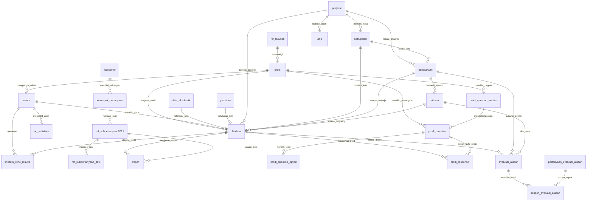
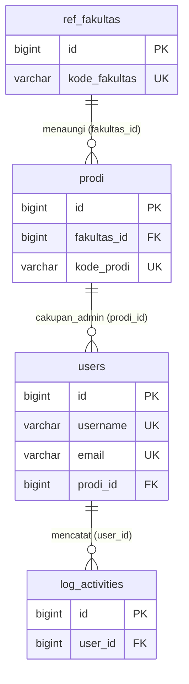
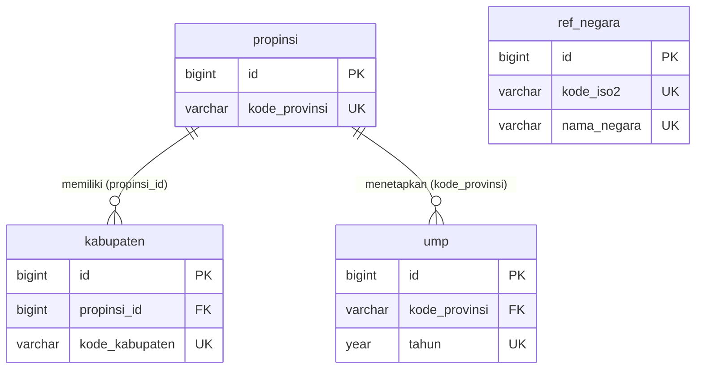
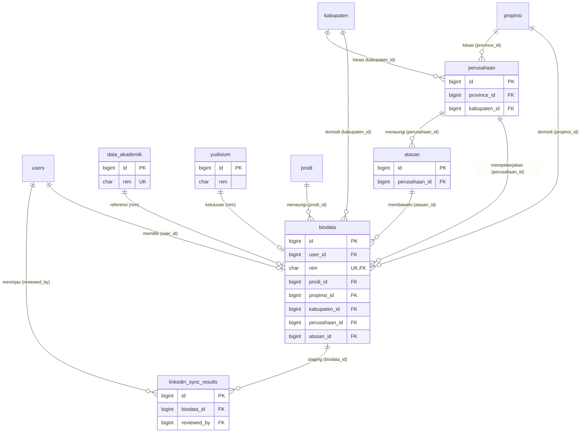
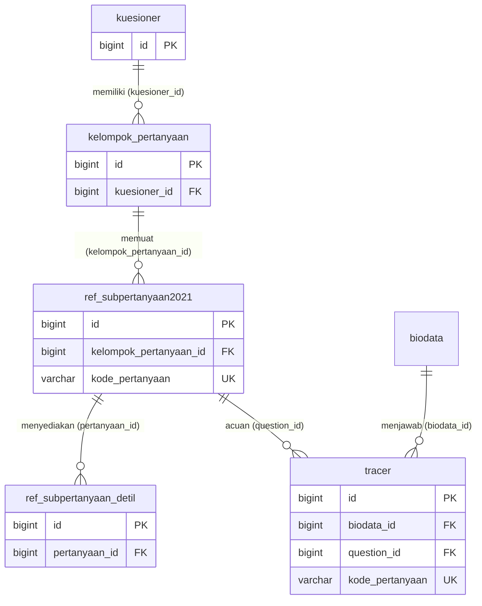
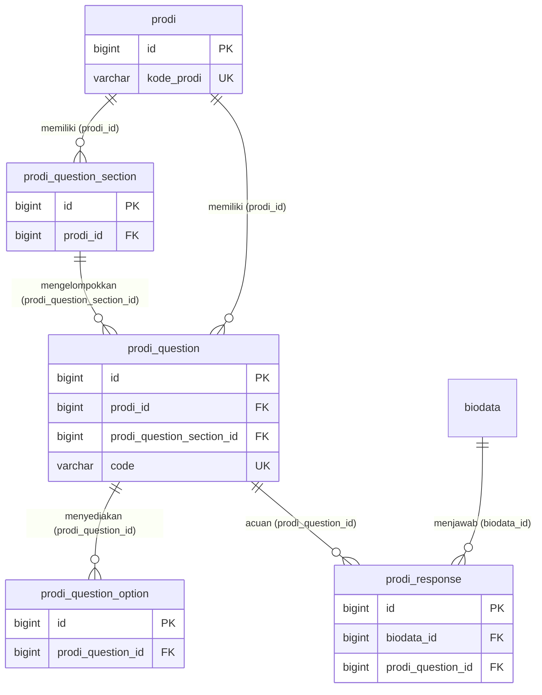
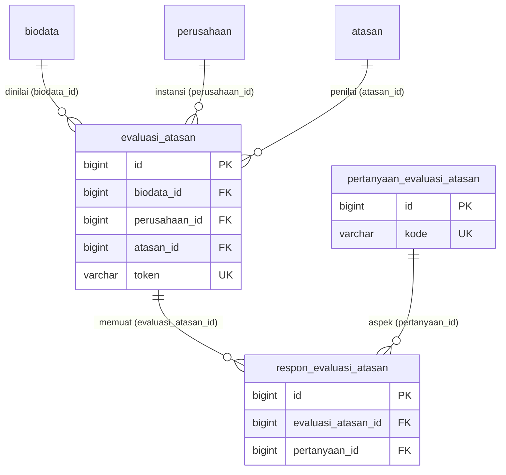
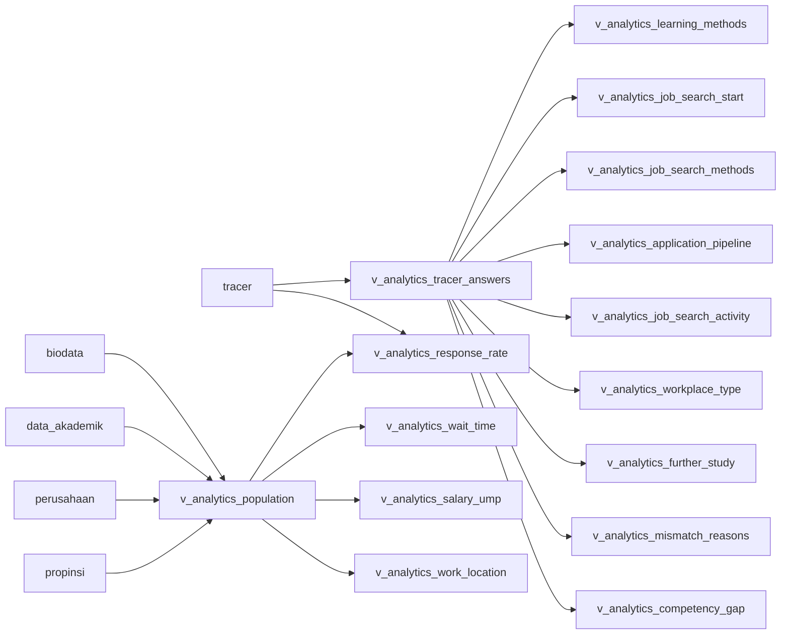

# Entity Relationship Diagram (ERD) & Kamus Data — Sistem Informasi Tracer Study UKDW

Dokumen ini menyajikan spesifikasi struktur basis data aktif **`tracer_study`** Universitas Kristen Duta Wacana (UKDW). Sesuai kaidah rekayasa perangkat lunak dan penulisan Tugas Akhir:
1. **Visualisasi ERD disajikan secara ringkas (hanya memuat Primary Key `PK`, Foreign Key `FK`, Unique Key `UK`, serta garis relasi & kardinalitas)** dan **dipecah per modul domain** agar diagram bersih, fokus, dan mudah dibaca.
2. **Daftar Relasi Antar Tabel** dirangkum secara eksplisit dalam tabel spesifikasi relasi.
3. **Detail atribut/kolom lengkap untuk setiap tabel disajikan di bagian bawah dalam bentuk Tabel Kamus Data (*Data Dictionary*)**.

> **Catatan Schema Aktif:** Kontak dan domisili aktif alumni hanya berada di tabel `biodata`, sedangkan `data_akademik` menjadi sumber resmi referensi akademik. Atribut sensitif/legacy (`nik`, `npwp`, `no_kk`, tabel `data_orang_tua`, serta field dosen pembimbing/penguji pada `yudisium`) tidak termasuk dalam schema aktif.

---

## Daftar Isi

1. [Bagian 1: Diagram ERD (Hanya PK, FK, UK, & Relasi)](#bagian-1-diagram-erd-hanya-pk-fk-uk--relasi)
   - [1.1 ERD Master Keseluruhan (Overview Relasi Antar Tabel)](#11-erd-master-keseluruhan-overview-relasi-antar-tabel)
   - [1.2 ERD Modul 1: Autentikasi, Pengguna, & Audit Log](#12-erd-modul-1-autentikasi-pengguna--audit-log)
   - [1.3 ERD Modul 2: Master Akademik, Wilayah, & Standar UMP](#13-erd-modul-2-master-akademik-wilayah--standar-ump)
   - [1.4 ERD Modul 3: Profil Alumni, Akademik, Karier, & LinkedIn Sync](#14-erd-modul-3-profil-alumni-akademik-karier--linkedin-sync)
   - [1.5 ERD Modul 4: Kuesioner Tracer Study Universitas](#15-erd-modul-4-kuesioner-tracer-study-universitas)
   - [1.6 ERD Modul 5: Kuesioner Khusus Program Studi](#16-erd-modul-5-kuesioner-khusus-program-studi)
   - [1.7 ERD Modul 6: Evaluasi Pengguna Lulusan (Atasan)](#17-erd-modul-6-evaluasi-pengguna-lulusan-atasan)
2. [Bagian 2: Spesifikasi Relasi & Kardinalitas Antar Tabel](#bagian-2-spesifikasi-relasi--kardinalitas-antar-tabel)
3. [Bagian 3: Kamus Data (Data Dictionary) Detail Per Tabel](#bagian-3-kamus-data-data-dictionary-detail-per-tabel)
   - [3.1 Modul 1: Autentikasi, Pengguna, & Audit Log](#31-modul-1-autentikasi-pengguna--audit-log)
   - [3.2 Modul 2: Master Akademik, Wilayah, & Standar UMP](#32-modul-2-master-akademik-wilayah--standar-ump)
   - [3.3 Modul 3: Profil Alumni, Akademik, Karier, & LinkedIn Sync](#33-modul-3-profil-alumni-akademik-karier--linkedin-sync)
   - [3.4 Modul 4: Kuesioner Tracer Study Universitas](#34-modul-4-kuesioner-tracer-study-universitas)
   - [3.5 Modul 5: Kuesioner Khusus Program Studi](#35-modul-5-kuesioner-khusus-program-studi)
   - [3.6 Modul 6: Evaluasi Pengguna Lulusan (Atasan)](#36-modul-6-evaluasi-pengguna-lulusan-atasan)
   - [3.7 Tabel Infrastruktur Framework Laravel](#37-tabel-infrastruktur-framework-laravel)
4. [Bagian 4: Kepemilikan Data & Proyeksi View Analitik](#bagian-4-kepemilikan-data--proyeksi-view-analitik)

---

## Bagian 1: Diagram ERD (Hanya PK, FK, UK, & Relasi)

Setiap kotak entitas pada diagram di bawah ini **hanya menampilkan kolom kunci (`PK`, `FK`, `UK`)** untuk menjaga keterbacaan visual. Rincian tipe data dan atribut non-kunci dapat dilihat pada **Bagian 3 (Kamus Data)**.

### 1.1 ERD Master Keseluruhan (Overview Relasi Antar Tabel)

---

### 1.2 ERD Modul 1: Autentikasi, Pengguna, & Audit Log

Modul ini menangani akun autentikasi multi-peran (`superadmin`, `admin_prodi`, `alumni`), keterkaitan cakupan wewenang Program Studi, serta pencatatan rekam jejak audit (*audit trail*).

---

### 1.3 ERD Modul 2: Master Akademik, Wilayah, & Standar UMP

Modul ini menyimpan data referensi kewilayahan (Negara ISO-3166, Provinsi, Kabupaten/Kota) serta nilai standar Upah Minimum Provinsi (`ump`) per tahun yang digunakan untuk analitik daya saing gaji lulusan.

---

### 1.4 ERD Modul 3: Profil Alumni, Akademik, Karier, & LinkedIn Sync

Modul inti yang menghubungkan master kelulusan (`data_akademik`, `yudisium`) dengan profil terkini alumni (`biodata`), tempat bekerja (`perusahaan`), kontak pimpinan/penilai (`atasan`), dan antrean hasil ekstraksi profil LinkedIn (`linkedin_sync_results`).

---

### 1.5 ERD Modul 4: Kuesioner Tracer Study Universitas

Modul instrumen survei Tracer Study tingkat Universitas yang mengacu pada standar pelaporan DIKTI/Kemdiktisaintek.

---

### 1.6 ERD Modul 5: Kuesioner Khusus Program Studi

Modul instrumen kuesioner mandiri yang dikelola oleh masing-masing Admin Program Studi untuk menggali kompetensi spesifik lulusan per prodi.

---

### 1.7 ERD Modul 6: Evaluasi Pengguna Lulusan (Atasan)

Modul survei kepuasan pengguna lulusan (*user survey*) yang diakses oleh atasan langsung melalui tautan ber-token unik tanpa memerlukan login akun.

---

## Bagian 2: Spesifikasi Relasi & Kardinalitas Antar Tabel

Tabel berikut merinci seluruh relasi kunci asing (*Foreign Key*) dan referensi logis antar tabel pada basis data `tracer_study`:

| No | Tabel Induk (Parent) | Kunci Induk | Tabel Anak (Child) | Kolom FK / Referensi | Kardinalitas | Aturan `ON DELETE` | Deskripsi Relasi Bisnis |
| :--- | :--- | :--- | :--- | :--- | :---: | :---: | :--- |
| 1 | `ref_fakultas` | `id` | `prodi` | `fakultas_id` | `1 : N` | `SET NULL` | Satu fakultas menaungi banyak program studi. |
| 2 | `prodi` | `id` | `users` | `prodi_id` | `1 : N` | `SET NULL` | Satu prodi dapat dikelola oleh satu atau lebih akun Admin Prodi. |
| 3 | `users` | `id` | `log_activities` | `user_id` | `1 : N` | `SET NULL` | Satu akun pengguna dapat menghasilkan banyak catatan audit aktivitas. |
| 4 | `propinsi` | `id` | `kabupaten` | `propinsi_id` | `1 : N` | `CASCADE` | Satu provinsi memiliki banyak kabupaten/kota. |
| 5 | `propinsi` | `kode_provinsi` | `ump` | `kode_provinsi` | `1 : N` | `CASCADE` | Satu provinsi memiliki riwayat besaran UMP per tahun. |
| 6 | `users` | `id` | `biodata` | `user_id` | `1 : 1` | `SET NULL` | Satu akun pengguna (`role = alumni`) terhubung ke satu profil biodata alumni. |
| 7 | `data_akademik` | `nim` | `biodata` | `nim` | `1 : 1` | `CASCADE` | Satu master akademik mahasiswa (`nim`) mereferensikan satu biodata alumni. |
| 8 | `yudisium` | `nim` | `biodata` | `nim` *(relasi logis)* | `1 : 1` | `-` | Data kelulusan/tugas akhir yudisium terhubung ke biodata alumni melalui `nim`. |
| 9 | `prodi` | `id` | `biodata` | `prodi_id` | `1 : N` | `SET NULL` | Satu program studi memiliki banyak biodata alumni. |
| 10 | `propinsi` | `id` | `biodata` | `propinsi_id` | `1 : N` | `SET NULL` | Provinsi domisili tempat tinggal alumni saat ini. |
| 11 | `kabupaten` | `id` | `biodata` | `kabupaten_id` | `1 : N` | `SET NULL` | Kabupaten/kota domisili tempat tinggal alumni saat ini. |
| 12 | `propinsi` | `id` | `perusahaan` | `province_id` | `1 : N` | `SET NULL` | Provinsi lokasi kantor perusahaan/instansi tempat kerja. |
| 13 | `kabupaten` | `id` | `perusahaan` | `kabupaten_id` | `1 : N` | `SET NULL` | Kabupaten/kota lokasi kantor perusahaan/instansi tempat kerja. |
| 14 | `perusahaan` | `id` | `biodata` | `perusahaan_id` | `1 : N` | `SET NULL` | Satu perusahaan dapat mempekerjakan banyak alumni UKDW. |
| 15 | `perusahaan` | `id` | `atasan` | `perusahaan_id` | `1 : N` | `SET NULL` | Satu perusahaan memiliki satu atau beberapa kontak atasan penilai. |
| 16 | `atasan` | `id` | `biodata` | `atasan_id` | `1 : N` | `SET NULL` | Satu atasan langsung dapat membawahi/menilai satu atau lebih alumni. |
| 17 | `biodata` | `id` | `linkedin_sync_results` | `biodata_id` | `1 : N` | `CASCADE` | Satu alumni dapat memiliki riwayat staging sinkronisasi profil LinkedIn. |
| 18 | `users` | `id` | `linkedin_sync_results` | `reviewed_by` | `1 : N` | `SET NULL` | Admin meninjau dan menyetujui/menolak hasil sinkronisasi LinkedIn. |
| 19 | `kuesioner` | `id` | `kelompok_pertanyaan` | `kuesioner_id` | `1 : N` | `CASCADE` | Satu periode kuesioner universitas memiliki banyak kelompok/bagian pertanyaan. |
| 20 | `kelompok_pertanyaan` | `id` | `ref_subpertanyaan2021` | `kelompok_pertanyaan_id` | `1 : N` | `CASCADE` | Satu kelompok pertanyaan memuat banyak butir pertanyaan tracer. |
| 21 | `ref_subpertanyaan2021` | `id` | `ref_subpertanyaan_detil` | `pertanyaan_id` | `1 : N` | `CASCADE` | Satu butir pertanyaan tracer memiliki banyak opsi pilihan jawaban. |
| 22 | `biodata` | `id` | `tracer` | `biodata_id` | `1 : N` | `CASCADE` | Satu alumni mengisi banyak butir jawaban pada kuesioner universitas. |
| 23 | `ref_subpertanyaan2021` | `id` | `tracer` | `question_id` | `1 : N` | `CASCADE` | Satu butir pertanyaan universitas dijawab oleh banyak alumni. |
| 24 | `prodi` | `id` | `prodi_question_section` | `prodi_id` | `1 : N` | `CASCADE` | Satu program studi memiliki banyak bagian (*section*) kuesioner prodi. |
| 25 | `prodi` | `id` | `prodi_question` | `prodi_id` | `1 : N` | `CASCADE` | Satu program studi memiliki daftar butir pertanyaan kuesioner prodi. |
| 26 | `prodi_question_section` | `id` | `prodi_question` | `prodi_question_section_id` | `1 : N` | `CASCADE` | Satu bagian kuesioner prodi mengelompokkan banyak butir pertanyaan. |
| 27 | `prodi_question` | `id` | `prodi_question_option` | `prodi_question_id` | `1 : N` | `CASCADE` | Satu pertanyaan kuesioner prodi menyediakan banyak opsi pilihan jawaban. |
| 28 | `biodata` | `id` | `prodi_response` | `biodata_id` | `1 : N` | `CASCADE` | Satu alumni mengisi banyak jawaban pada kuesioner khusus prodi. |
| 29 | `prodi_question` | `id` | `prodi_response` | `prodi_question_id` | `1 : N` | `CASCADE` | Satu butir pertanyaan prodi dijawab oleh banyak alumni dari prodi terkait. |
| 30 | `biodata` | `id` | `evaluasi_atasan` | `biodata_id` | `1 : N` | `CASCADE` | Satu alumni dapat dinilai dalam lembar evaluasi pengguna lulusan. |
| 31 | `perusahaan` | `id` | `evaluasi_atasan` | `perusahaan_id` | `1 : N` | `SET NULL` | Evaluasi atasan mencatat instansi perusahaan tempat alumni bekerja. |
| 32 | `atasan` | `id` | `evaluasi_atasan` | `atasan_id` | `1 : N` | `SET NULL` | Evaluasi atasan mencatat identitas pejabat penilai langsung. |
| 33 | `evaluasi_atasan` | `id` | `respon_evaluasi_atasan` | `evaluasi_atasan_id` | `1 : N` | `CASCADE` | Satu lembar evaluasi atasan memuat rincian skor penilaian per aspek. |
| 34 | `pertanyaan_evaluasi_atasan` | `id` | `respon_evaluasi_atasan` | `pertanyaan_id` | `1 : N` | `CASCADE` | Satu aspek penilaian dievaluasi pada banyak lembar evaluasi atasan. |

---

## Bagian 3: Kamus Data (Data Dictionary) Detail Per Tabel

Bagian ini mendokumentasikan spesifikasi lengkap setiap kolom pada **26 tabel domain utama** serta **7 tabel infrastruktur sistem**.

### 3.1 Modul 1: Autentikasi, Pengguna, & Audit Log

#### 1. Tabel `users`
Menyimpan kredensial autentikasi untuk seluruh peran pengguna (`alumni`, `admin_prodi`, dan `superadmin`).

| Nama Kolom | Tipe Data | Kunci / Indeks | Nullable / Default | Keterangan |
| :--- | :--- | :---: | :---: | :--- |
| `id` | `bigint unsigned` | `PK` | `NOT NULL`, `AUTO_INCREMENT` | ID unik akun pengguna sistem. |
| `name` | `varchar(120)` | - | `NOT NULL` | Nama tampilan pengguna. |
| `username` | `varchar(50)` | `UK` | `NULL` | Username login unik (NIM 8 digit untuk alumni atau kode admin). |
| `email` | `varchar(120)` | `UK` | `NOT NULL` | Alamat email unik pengguna. |
| `email_verified_at` | `timestamp` | - | `NULL` | Waktu verifikasi email pengguna. |
| `password` | `varchar(255)` | - | `NOT NULL` | Hash kata sandi autentikasi (bcrypt). |
| `must_change_password` | `tinyint(1)` | - | `NOT NULL`, Default `'0'` | Penanda wajib ganti password saat login pertama (`1` = Wajib, `0` = Tidak). |
| `role` | `varchar(20)` | - | `NOT NULL`, Default `'alumni'` | Peran otorisasi pengguna: `superadmin`, `admin_prodi`, atau `alumni`. |
| `prodi_id` | `bigint unsigned` | `FK` | `NULL` | Referensi ke `prodi.id` (khusus pembatasan wewenang akun `admin_prodi`). |
| `remember_token` | `varchar(100)` | - | `NULL` | Token sesi *remember me* Laravel. |
| `created_at` | `timestamp` | - | `NULL` | Waktu pembuatan rekaman. |
| `updated_at` | `timestamp` | - | `NULL` | Waktu pembaruan terakhir. |

#### 2. Tabel `log_activities`
Menyimpan rekam jejak audit (*audit trail*) atas aksi perubahan data penting yang dilakukan pengguna maupun administrator.

| Nama Kolom | Tipe Data | Kunci / Indeks | Nullable / Default | Keterangan |
| :--- | :--- | :---: | :---: | :--- |
| `id` | `bigint unsigned` | `PK` | `NOT NULL`, `AUTO_INCREMENT` | ID unik rekam jejak aktivitas audit. |
| `user_id` | `bigint unsigned` | `FK` | `NULL` | Referensi ke `users.id` pelaku aktivitas (`ON DELETE SET NULL`). |
| `action` | `varchar(100)` | `INDEX` | `NOT NULL` | Kode jenis aktivitas (misal: `GANTI_PERUSAHAAN_MASTER`, `UPDATE_PROFIL`). |
| `model_type` | `varchar(100)` | `INDEX` | `NULL` | Nama kelas model Eloquent yang menjadi target aktivitas. |
| `model_id` | `bigint unsigned` | `INDEX` | `NULL` | ID rekaman pada model target aktivitas. |
| `description` | `text` | - | `NOT NULL` | Uraian naratif lengkap aktivitas sistem. |
| `old_values` | `json` | - | `NULL` | Snapshot nilai atribut sebelum perubahan dalam format JSON. |
| `new_values` | `json` | - | `NULL` | Snapshot nilai atribut sesudah perubahan dalam format JSON. |
| `ip_address` | `varchar(45)` | - | `NULL` | Alamat IPv4/IPv6 perangkat pengakses. |
| `user_agent` | `text` | - | `NULL` | Identitas browser atau klien HTTP pengakses. |
| `created_at` | `timestamp` | `INDEX` | `NULL` | Waktu terjadinya aktivitas. |
| `updated_at` | `timestamp` | - | `NULL` | Waktu pembaruan rekaman log. |

---

### 3.2 Modul 2: Master Akademik, Wilayah, & Standar UMP

#### 3. Tabel `ref_fakultas`
Menyimpan daftar master fakultas di lingkungan UKDW.

| Nama Kolom | Tipe Data | Kunci / Indeks | Nullable / Default | Keterangan |
| :--- | :--- | :---: | :---: | :--- |
| `id` | `bigint unsigned` | `PK` | `NOT NULL`, `AUTO_INCREMENT` | ID unik master fakultas. |
| `kode_fakultas` | `varchar(10)` | `UK` | `NOT NULL` | Kode resmi fakultas (misal: `7` untuk FTI). |
| `nama_fakultas` | `varchar(100)` | - | `NOT NULL` | Nama resmi fakultas (misal: `Fakultas Teknologi Informasi`). |
| `singkatan` | `varchar(20)` | - | `NULL` | Singkatan nama fakultas (misal: `FTI`, `FB`, `FK`). |
| `created_at` | `timestamp` | - | `NULL` | Waktu pembuatan rekaman. |
| `updated_at` | `timestamp` | - | `NULL` | Waktu pembaruan terakhir. |

#### 4. Tabel `prodi`
Menyimpan daftar master Program Studi di bawah naungan fakultas UKDW.

| Nama Kolom | Tipe Data | Kunci / Indeks | Nullable / Default | Keterangan |
| :--- | :--- | :---: | :---: | :--- |
| `id` | `bigint unsigned` | `PK` | `NOT NULL`, `AUTO_INCREMENT` | ID unik master program studi. |
| `fakultas_id` | `bigint unsigned` | `FK` | `NULL` | Referensi ke `ref_fakultas.id` (`ON DELETE SET NULL`). |
| `kode_prodi` | `varchar(10)` | `UK` | `NOT NULL` | Kode resmi program studi (misal: `71` Informatika, `72` Sistem Informasi). |
| `nama_prodi` | `varchar(100)` | - | `NOT NULL` | Nama resmi program studi. |
| `created_at` | `timestamp` | - | `NULL` | Waktu pembuatan rekaman. |
| `updated_at` | `timestamp` | - | `NULL` | Waktu pembaruan terakhir. |

#### 5. Tabel `propinsi`
Menyimpan data referensi provinsi di Indonesia sesuai kode BPS/Kemendagri.

| Nama Kolom | Tipe Data | Kunci / Indeks | Nullable / Default | Keterangan |
| :--- | :--- | :---: | :---: | :--- |
| `id` | `bigint unsigned` | `PK` | `NOT NULL`, `AUTO_INCREMENT` | ID unik referensi provinsi. |
| `kode_provinsi` | `varchar(10)` | `UK` | `NULL` | Kode BPS/Kemendagri provinsi (misal: `34` untuk DI Yogyakarta). |
| `nama_provinsi` | `varchar(60)` | - | `NOT NULL` | Nama resmi provinsi. |
| `created_at` | `timestamp` | - | `NULL` | Waktu pembuatan rekaman. |
| `updated_at` | `timestamp` | - | `NULL` | Waktu pembaruan terakhir. |

#### 6. Tabel `kabupaten`
Menyimpan data referensi Kabupaten/Kota di Indonesia yang berelasi ke tabel `propinsi`.

| Nama Kolom | Tipe Data | Kunci / Indeks | Nullable / Default | Keterangan |
| :--- | :--- | :---: | :---: | :--- |
| `id` | `bigint unsigned` | `PK` | `NOT NULL`, `AUTO_INCREMENT` | ID unik referensi kabupaten/kota. |
| `propinsi_id` | `bigint unsigned` | `FK` | `NOT NULL` | Referensi ke `propinsi.id` (`ON DELETE CASCADE`). |
| `kode_kabupaten` | `varchar(10)` | `UK` | `NULL` | Kode BPS/Kemendagri kabupaten/kota (misal: `34.04`). |
| `nama_kabupaten` | `varchar(60)` | - | `NOT NULL` | Nama resmi kabupaten/kota (misal: `Kabupaten Sleman`). |
| `created_at` | `timestamp` | - | `NULL` | Waktu pembuatan rekaman. |
| `updated_at` | `timestamp` | - | `NULL` | Waktu pembaruan terakhir. |

#### 7. Tabel `ref_negara`
Menyimpan daftar referensi negara dunia standar ISO-3166 untuk penempatan kerja atau studi lanjut luar negeri.

| Nama Kolom | Tipe Data | Kunci / Indeks | Nullable / Default | Keterangan |
| :--- | :--- | :---: | :---: | :--- |
| `id` | `bigint unsigned` | `PK` | `NOT NULL`, `AUTO_INCREMENT` | ID unik referensi negara. |
| `kode_iso2` | `varchar(2)` | `UK` | `NOT NULL` | Kode 2 huruf ISO-3166-1 alpha-2 (misal: `ID`, `SG`, `JP`). |
| `kode_iso3` | `varchar(3)` | - | `NULL` | Kode 3 huruf ISO-3166-1 alpha-3 (misal: `IDN`, `SGP`, `JPN`). |
| `nama_negara` | `varchar(80)` | `UK` | `NOT NULL` | Nama umum negara dalam Bahasa Indonesia. |
| `nama_resmi` | `varchar(120)` | - | `NULL` | Nama resmi kenegaraan lengkap. |
| `benua` | `varchar(50)` | - | `NULL` | Benua lokasi negara (`Asia`, `Eropa`, `Amerika`, dll). |
| `ibu_kota` | `varchar(80)` | - | `NULL` | Nama ibu kota negara. |
| `created_at` | `timestamp` | - | `NULL` | Waktu pembuatan rekaman. |
| `updated_at` | `timestamp` | - | `NULL` | Waktu pembaruan terakhir. |

#### 8. Tabel `ump`
Menyimpan standar Upah Minimum Provinsi (UMP) per tahun sebagai acuan evaluasi kesesuaian pendapatan lulusan (`>= 1.2x UMP`).

| Nama Kolom | Tipe Data | Kunci / Indeks | Nullable / Default | Keterangan |
| :--- | :--- | :---: | :---: | :--- |
| `id` | `bigint unsigned` | `PK` | `NOT NULL`, `AUTO_INCREMENT` | ID unik referensi Upah Minimum Provinsi (UMP). |
| `kode_provinsi` | `varchar(10)` | `FK`, `UK(1)` | `NOT NULL` | Referensi ke `propinsi.kode_provinsi` (`ON DELETE CASCADE`). |
| `tahun` | `year` | `UK(2)` | `NOT NULL`, Default `'2026'` | Tahun penetapan UMP (`YYYY`). |
| `besaran` | `decimal(15,2)` | - | `NULL` | Nominal besaran rupiah UMP per bulan. |
| `catatan` | `varchar(150)` | - | `NULL` | Catatan atau nomor SK Gubernur penetapan UMP. |
| `created_at` | `timestamp` | - | `NULL` | Waktu pembuatan rekaman. |
| `updated_at` | `timestamp` | - | `NULL` | Waktu pembaruan terakhir. |

---

### 3.3 Modul 3: Profil Alumni, Akademik, Karier, & LinkedIn Sync

#### 9. Tabel `data_akademik`
Menyimpan data master identitas akademik dan riwayat kelulusan resmi mahasiswa dari sistem akademik universitas.

| Nama Kolom | Tipe Data | Kunci / Indeks | Nullable / Default | Keterangan |
| :--- | :--- | :---: | :---: | :--- |
| `id` | `bigint unsigned` | `PK` | `NOT NULL`, `AUTO_INCREMENT` | ID unik master akademik mahasiswa/alumni. |
| `nim` | `char(8)` | `UK` | `NOT NULL` | Nomor Induk Mahasiswa (8 karakter unik). |
| `nama` | `varchar(100)` | - | `NOT NULL` | Nama lengkap mahasiswa sesuai ijazah. |
| `jenis_kelamin` | `varchar(20)` | - | `NULL` | Jenis kelamin (`Laki-laki` / `Perempuan`). |
| `tempat_lahir` | `varchar(60)` | - | `NULL` | Kota/kabupaten tempat kelahiran. |
| `tanggal_lahir` | `date` | - | `NULL` | Tanggal lahir mahasiswa (digunakan juga sebagai password default awal `DDMMYYYY`). |
| `agama` | `varchar(25)` | - | `NULL` | Agama yang dianut mahasiswa. |
| `kewarganegaraan` | `varchar(20)` | - | `NULL` | Status kewarganegaraan (`WNI` / `WNA`). |
| `nisn` | `varchar(15)` | - | `NULL` | Nomor Induk Siswa Nasional saat SMA/sederajat. |
| `no_bpjs` | `varchar(20)` | - | `NULL` | Nomor kepesertaan BPJS Kesehatan. |
| `email_students` | `varchar(100)` | - | `NULL` | Alamat email institusi (`@students.ukdw.ac.id`). |
| `angkatan` | `year` | `INDEX` | `NULL` | Tahun angkatan masuk kuliah (`YYYY`). |
| `status` | `varchar(30)` | - | `NULL` | Status kemahasiswaan di sistem akademik (`LULUS`, `AKTIF`, dll). |
| `tanggal_masuk` | `date` | - | `NULL` | Tanggal resmi terdaftar masuk kuliah. |
| `tanggal_lulus` | `date` | - | `NULL` | Tanggal resmi kelulusan yudisium. |
| `tahun_lulus` | `year` | `INDEX` | `NULL` | Tahun kelulusan (`YYYY`). |
| `semester_lulus` | `varchar(15)` | - | `NULL` | Semester kelulusan (`Ganjil` / `Genap`). |
| `lama_studi_bulan` | `smallint unsigned` | - | `NULL` | Total masa tempuh studi dalam satuan bulan. |
| `sks_kumulatif` | `smallint unsigned` | - | `NULL` | Total capaian SKS kumulatif saat lulus. |
| `ip_kumulatif` | `decimal(3,2)` | - | `NULL` | Indeks Prestasi Kumulatif (IPK) akhir (skala `4.00`). |
| `predikat_kelulusan` | `varchar(40)` | - | `NULL` | Predikat yudisium (`Cum Laude`, `Sangat Memuaskan`, `Memuaskan`). |
| `no_ijazah` | `varchar(50)` | - | `NULL` | Nomor seri ijazah / Penomoran Ijazah Nasional (PIN). |
| `tanggal_ijazah` | `date` | - | `NULL` | Tanggal penerbitan ijazah. |
| `created_at` | `timestamp` | - | `NULL` | Waktu pembuatan rekaman. |
| `updated_at` | `timestamp` | - | `NULL` | Waktu pembaruan terakhir. |

#### 10. Tabel `yudisium`
Menyimpan informasi Tugas Akhir / Skripsi dan status yudisium lulusan.

| Nama Kolom | Tipe Data | Kunci / Indeks | Nullable / Default | Keterangan |
| :--- | :--- | :---: | :---: | :--- |
| `id` | `bigint unsigned` | `PK` | `NOT NULL`, `AUTO_INCREMENT` | ID unik data kelulusan yudisium. |
| `nim` | `char(8)` | `INDEX` | `NOT NULL` | NIM mahasiswa peserta yudisium. |
| `periode_yudisium` | `varchar(30)` | - | `NULL` | Kode atau nama periode pelaksanaan yudisium. |
| `tanggal_pengajuan` | `date` | - | `NULL` | Tanggal pengajuan berkas yudisium. |
| `tanggal_kelulusan` | `date` | - | `NULL` | Tanggal pengesahan kelulusan pada rapat yudisium. |
| `judul_ta` | `text` | - | `NULL` | Judul lengkap Tugas Akhir / Skripsi. |
| `abstrak_ta` | `text` | - | `NULL` | Abstrak ringkas Tugas Akhir / Skripsi. |
| `jenis_ta` | `varchar(40)` | - | `NULL` | Jenis karya tugas akhir (`Skripsi`, `Proyek`, `Magang`, dll). |
| `jalur_program` | `varchar(40)` | - | `NULL` | Jalur program kurikulum yang ditempuh. |
| `nilai_huruf_ta` | `varchar(5)` | - | `NULL` | Nilai huruf mutu Tugas Akhir (`A`, `A-`, `B+`, dst). |
| `nilai_angka_ta` | `decimal(5,2)` | - | `NULL` | Nilai skor numerik Tugas Akhir. |
| `url_repository` | `varchar(150)` | - | `NULL` | Tautan repositori perpustakaan untuk naskah Tugas Akhir. |
| `status_publikasi` | `varchar(30)` | - | `NULL` | Status publikasi naskah (`Full Text`, `Embargo`, `Abstrak Saja`). |
| `no_sk_yudisium` | `varchar(60)` | - | `NULL` | Nomor Surat Keputusan (SK) Dekan/Rektor tentang yudisium. |
| `status_lulus` | `varchar(20)` | - | `NULL` | Status kelulusan yudisium (`LULUS`, `TUNDA`). |
| `catatan` | `text` | - | `NULL` | Catatan administratif terkait yudisium mahasiswa. |
| `created_at` | `timestamp` | - | `NULL` | Waktu pembuatan rekaman. |
| `updated_at` | `timestamp` | - | `NULL` | Waktu pembaruan terakhir. |

#### 11. Tabel `biodata`
Tabel sentral profil mutakhir alumni yang menyimpan kontak aktif, alamat domisili saat ini, jejak karier, pendapatan, studi lanjut, serta tautan ke perusahaan dan atasan langsung.

| Nama Kolom | Tipe Data | Kunci / Indeks | Nullable / Default | Keterangan |
| :--- | :--- | :---: | :---: | :--- |
| `id` | `bigint unsigned` | `PK` | `NOT NULL`, `AUTO_INCREMENT` | ID unik biodata alumni. |
| `user_id` | `bigint unsigned` | `FK` | `NULL` | Referensi ke `users.id` (`ON DELETE SET NULL`). |
| `nim` | `char(8)` | `UK`, `FK` | `NOT NULL` | Referensi ke `data_akademik.nim` (`ON DELETE CASCADE`). |
| `prodi_id` | `bigint unsigned` | `FK` | `NULL` | Referensi ke `prodi.id` (`ON DELETE SET NULL`). |
| `nama_lengkap` | `varchar(100)` | - | `NULL` | Nama lengkap alumni beserta gelar terkini. |
| `foto_profil` | `varchar(150)` | - | `NULL` | Path file foto profil alumni pada media penyimpanan. |
| `email_pribadi` | `varchar(100)` | - | `NULL` | Alamat email pribadi aktif untuk korespondensi karir. |
| `nomor_telepon` | `varchar(25)` | - | `NULL` | Nomor telepon seluler / WhatsApp aktif alumni. |
| `alamat_saat_ini` | `text` | - | `NULL` | Alamat jalan/kompleks tempat tinggal domisili saat ini. |
| `kelurahan` | `varchar(80)` | - | `NULL` | Nama kelurahan/desa domisili saat ini. |
| `kecamatan` | `varchar(80)` | - | `NULL` | Nama kecamatan/kapanewon domisili saat ini. |
| `kabupaten_id` | `bigint unsigned` | `FK` | `NULL` | Referensi ke `kabupaten.id` untuk domisili saat ini. |
| `propinsi_id` | `bigint unsigned` | `FK` | `NULL` | Referensi ke `propinsi.id` untuk domisili saat ini. |
| `kode_pos` | `varchar(10)` | - | `NULL` | Kode pos area domisili saat ini. |
| `negara_domisili` | `varchar(60)` | - | `NULL`, Default `'Indonesia'` | Negara tempat tinggal saat ini. |
| `linkedin_url` | `varchar(150)` | - | `NULL` | URL profil LinkedIn alumni. |
| `linkedin_username` | `varchar(80)` | - | `NULL` | Username/slug profil LinkedIn alumni. |
| `ig_url` | `varchar(150)` | - | `NULL` | URL profil atau akun Instagram alumni. |
| `fb_url` | `varchar(150)` | - | `NULL` | URL profil Facebook alumni. |
| `tiktok_url` | `varchar(150)` | - | `NULL` | URL profil TikTok alumni. |
| `skills` | `text` | - | `NULL` | Daftar keahlian/kompetensi profesional (tersinkronisasi dari LinkedIn/input profil). |
| `experience` | `text` | - | `NULL` | Ringkasan riwayat pengalaman kerja (tersinkronisasi dari LinkedIn/input profil). |
| `pekerjaan` | `varchar(60)` | `INDEX` | `NULL` | Status aktivitas utama (`Pekerja`, `Wirausaha`, `Tidak Bekerja`). |
| `sedang_studi_lanjut` | `tinyint(1)` | - | `NOT NULL`, Default `'0'` | Penanda sedang menempuh pendidikan lanjut (`1` = Ya, `0` = Tidak). |
| `studi_lanjut_jenjang` | `varchar(30)` | - | `NULL` | Jenjang studi lanjut (`S2`, `S3`, `Profesi`, `Spesialis`, dll). |
| `studi_lanjut_kampus` | `varchar(120)` | - | `NULL` | Nama perguruan tinggi tempat menempuh studi lanjut. |
| `studi_lanjut_prodi` | `varchar(120)` | - | `NULL` | Nama program studi pada pendidikan lanjut. |
| `studi_lanjut_lokasi` | `varchar(30)` | - | `NULL` | Cakupan lokasi studi lanjut (`Dalam Negeri` / `Luar Negeri`). |
| `studi_lanjut_negara` | `varchar(60)` | - | `NULL` | Negara tempat menempuh studi lanjut. |
| `bidang_pekerjaan` | `varchar(100)` | - | `NULL` | Bidang pekerjaan atau divisi penempatan alumni. |
| `posisi_jabatan` | `varchar(80)` | - | `NULL` | Posisi/level jabatan struktural (F2G: `Direksi`, `Manager`, `Staff`, dll). |
| `gaji` | `decimal(15,2)` | - | `NULL` | Rata-rata pendapatan per bulan (*Take Home Pay*) dalam Rupiah. |
| `perusahaan_id` | `bigint unsigned` | `FK` | `NULL` | Referensi ke `perusahaan.id` tempat bekerja saat ini. |
| `atasan_id` | `bigint unsigned` | `FK` | `NULL` | Referensi ke `atasan.id` selaku penilai/atasan langsung. |
| `created_at` | `timestamp` | - | `NULL` | Waktu pembuatan rekaman. |
| `updated_at` | `timestamp` | - | `NULL` | Waktu pembaruan terakhir. |

#### 12. Tabel `perusahaan`
Menyimpan data master profil perusahaan/instansi tempat alumni bekerja. Data ini tersinkronisasi dua arah antara pengisian profil karier alumni dan verifikasi oleh atasan pada formulir evaluasi pengguna lulusan.

| Nama Kolom | Tipe Data | Kunci / Indeks | Nullable / Default | Keterangan |
| :--- | :--- | :---: | :---: | :--- |
| `id` | `bigint unsigned` | `PK` | `NOT NULL`, `AUTO_INCREMENT` | ID unik perusahaan atau instansi tempat kerja. |
| `nama_perusahaan` | `varchar(120)` | `INDEX` | `NOT NULL` | Nama resmi perusahaan, instansi, atau unit usaha. |
| `jenis_perusahaan` | `varchar(80)` | - | `NULL` | Kategori jenis instansi sesuai standar DIKTI (F11: Swasta, BUMN, Pemerintah, LSM, dll). |
| `jenis_perusahaan_lainnya` | `varchar(120)` | - | `NULL` | Keterangan tambahan apabila memilih jenis instansi `Lainnya`. |
| `skala` | `varchar(40)` | - | `NULL` | Skala operasional perusahaan (F2H/F5D: `Lokal`, `Nasional`, `Multinasional`). |
| `bentuk_perusahaan` | `varchar(100)` | - | `NULL` | Bentuk badan hukum organisasi (`Perusahaan Terbatas`, `BUMN`, `CV`, `Koperasi`, `Firma`, dll). |
| `jumlah_pegawai` | `varchar(50)` | - | `NULL` | Rentang jumlah karyawan keseluruhan di perusahaan (diisi oleh atasan pada survei pengguna lulusan). |
| `jenis_lokasi` | `varchar(30)` | - | `NULL` | Cakupan lokasi perusahaan (`Dalam Negeri` / `Luar Negeri`). |
| `negara` | `varchar(60)` | - | `NULL`, Default `'Indonesia'` | Nama negara lokasi perusahaan beroperasi. |
| `alamat` | `text` | - | `NULL` | Alamat lengkap kantor perusahaan/instansi. |
| `kode_pos` | `varchar(10)` | - | `NULL` | Kode pos lokasi kantor perusahaan. |
| `no_telp_fax` | `varchar(100)` | - | `NULL` | Nomor telepon resmi atau faksimile kantor perusahaan. |
| `homepage` | `varchar(255)` | - | `NULL` | Alamat situs web resmi (*homepage*) perusahaan. |
| `kabupaten_id` | `bigint unsigned` | `FK` | `NULL` | Referensi ke `kabupaten.id` lokasi perusahaan (`ON DELETE SET NULL`). |
| `province_id` | `bigint unsigned` | `FK` | `NULL` | Referensi ke `propinsi.id` lokasi perusahaan (`ON DELETE SET NULL`). |
| `created_at` | `timestamp` | - | `NULL` | Waktu pembuatan rekaman. |
| `updated_at` | `timestamp` | - | `NULL` | Waktu pembaruan terakhir. |

#### 13. Tabel `atasan`
Menyimpan identitas dan kontak atasan langsung (pejabat penilai) yang berwenang mengisi survei evaluasi pengguna lulusan.

| Nama Kolom | Tipe Data | Kunci / Indeks | Nullable / Default | Keterangan |
| :--- | :--- | :---: | :---: | :--- |
| `id` | `bigint unsigned` | `PK` | `NOT NULL`, `AUTO_INCREMENT` | ID unik data atasan langsung alumni. |
| `perusahaan_id` | `bigint unsigned` | `FK` | `NULL` | Referensi ke `perusahaan.id` tempat atasan bertugas (`ON DELETE SET NULL`). |
| `nama_atasan` | `varchar(100)` | - | `NOT NULL` | Nama lengkap atasan langsung atau pejabat penilai. |
| `jabatan_atasan` | `varchar(80)` | - | `NULL` | Posisi jabatan struktural/fungsional atasan di perusahaan. |
| `email_atasan` | `varchar(100)` | - | `NULL` | Alamat email resmi/aktif atasan untuk pengiriman undangan evaluasi. |
| `no_hp_atasan` | `varchar(25)` | - | `NULL` | Nomor telepon atau WhatsApp aktif atasan untuk pengiriman tautan evaluasi. |
| `created_at` | `timestamp` | - | `NULL` | Waktu pembuatan rekaman. |
| `updated_at` | `timestamp` | - | `NULL` | Waktu pembaruan terakhir. |

#### 14. Tabel `linkedin_sync_results`
Menyimpan data *staging* hasil ekstraksi profil LinkedIn (melalui layanan integrasi Bright Data) sebelum ditinjau dan disetujui oleh Admin untuk memperbarui kolom `skills` dan `experience` di `biodata`.

| Nama Kolom | Tipe Data | Kunci / Indeks | Nullable / Default | Keterangan |
| :--- | :--- | :---: | :---: | :--- |
| `id` | `bigint unsigned` | `PK` | `NOT NULL`, `AUTO_INCREMENT` | ID unik hasil sinkronisasi LinkedIn. |
| `biodata_id` | `bigint unsigned` | `FK`, `INDEX` | `NOT NULL` | Referensi ke `biodata.id` pemilik profil (`ON DELETE CASCADE`). |
| `linkedin_url` | `varchar(150)` | - | `NOT NULL` | URL profil LinkedIn yang disinkronkan. |
| `linkedin_username` | `varchar(100)` | - | `NULL` | Username/slug akun LinkedIn. |
| `scraped_data` | `json` | - | `NOT NULL` | Payload data mentah hasil ekstraksi LinkedIn dalam format JSON. |
| `status` | `enum` | `INDEX` | `NOT NULL`, Default `'pending'` | Status peninjauan: `'pending'`, `'approved'`, atau `'rejected'`. |
| `reviewed_by` | `bigint unsigned` | `FK` | `NULL` | Referensi ke `users.id` admin peninjau (`ON DELETE SET NULL`). |
| `reviewed_at` | `timestamp` | - | `NULL` | Waktu keputusan persetujuan/penolakan oleh admin. |
| `scraped_at` | `timestamp` | - | `NULL` | Waktu pengambilan data dari LinkedIn selesai dilakukan. |
| `created_at` | `timestamp` | - | `NULL` | Waktu pembuatan rekaman. |
| `updated_at` | `timestamp` | - | `NULL` | Waktu pembaruan terakhir. |

---

### 3.4 Modul 4: Kuesioner Tracer Study Universitas

#### 15. Tabel `kuesioner`
Menyimpan metadata instrumen kuesioner Tracer Study tingkat universitas per periode tahun pelaksanaan.

| Nama Kolom | Tipe Data | Kunci / Indeks | Nullable / Default | Keterangan |
| :--- | :--- | :---: | :---: | :--- |
| `id` | `bigint unsigned` | `PK` | `NOT NULL`, `AUTO_INCREMENT` | ID unik instrumen kuesioner induk universitas. |
| `title` | `varchar(150)` | - | `NOT NULL` | Judul instrumen kuesioner (misal: `Tracer Study 2026`). |
| `description` | `text` | - | `NULL` | Deskripsi penjelasan instrumen kuesioner bagi responden. |
| `year` | `year` | - | `NOT NULL` | Tahun periode pelaksanaan Tracer Study (`YYYY`). |
| `is_active` | `tinyint(1)` | - | `NOT NULL`, Default `'1'` | Status keaktifan kuesioner (`1` = Aktif dibuka, `0` = Ditutup). |
| `target_response_rate` | `decimal(5,2)` | - | `NOT NULL`, Default `'60.00'` | Target capaian *response rate* periode kuesioner dalam persen (`%`). |
| `created_at` | `timestamp` | - | `NULL` | Waktu pembuatan rekaman. |
| `updated_at` | `timestamp` | - | `NULL` | Waktu pembaruan terakhir. |

#### 16. Tabel `kelompok_pertanyaan`
Menyimpan pengelompokan bagian (*section*) pertanyaan pada kuesioner universitas.

| Nama Kolom | Tipe Data | Kunci / Indeks | Nullable / Default | Keterangan |
| :--- | :--- | :---: | :---: | :--- |
| `id` | `bigint unsigned` | `PK` | `NOT NULL`, `AUTO_INCREMENT` | ID unik bagian/kelompok pertanyaan kuesioner universitas. |
| `kuesioner_id` | `bigint unsigned` | `FK` | `NULL` | Referensi ke `kuesioner.id` (`ON DELETE CASCADE`). |
| `kode_kelompok` | `char(5)` | - | `NULL` | Kode pengelompokan pertanyaan (misal: `K1`, `K2`, `F`). |
| `title` | `varchar(150)` | - | `NOT NULL` | Nama bagian / *section* kuesioner yang tampil di stepper. |
| `order` | `smallint` | - | `NOT NULL`, Default `'0'` | Nomor urut penampilan bagian kuesioner. |
| `created_at` | `timestamp` | - | `NULL` | Waktu pembuatan rekaman. |
| `updated_at` | `timestamp` | - | `NULL` | Waktu pembaruan terakhir. |

#### 17. Tabel `ref_subpertanyaan2021`
Menyimpan daftar master butir pertanyaan kuesioner universitas beserta tipe input dan aturan percabangannya.

| Nama Kolom | Tipe Data | Kunci / Indeks | Nullable / Default | Keterangan |
| :--- | :--- | :---: | :---: | :--- |
| `id` | `bigint unsigned` | `PK` | `NOT NULL`, `AUTO_INCREMENT` | ID unik butir pertanyaan kuesioner universitas. |
| `kelompok` | `char(5)` | - | `NOT NULL` | Kode kelompok pertanyaan (`K1`, `K2`, dst). |
| `kelompok_pertanyaan_id` | `bigint unsigned` | `FK` | `NULL` | Referensi ke `kelompok_pertanyaan.id` (`ON DELETE CASCADE`). |
| `kode_pertanyaan` | `varchar(20)` | `UK` | `NOT NULL` | Kode unik butir pertanyaan standar DIKTI (misal: `F8`, `F504`, `F11`, `F1761`). |
| `subpertanyaan` | `text` | - | `NOT NULL` | Teks redaksi pertanyaan yang ditampilkan kepada responden. |
| `type` | `varchar(50)` | - | `NOT NULL` | Tipe komponen input (`radio`, `multiple_choice`, `text`, `number`, `rating_5`, `date`, dll). |
| `keterangan` | `varchar(100)` | - | `NULL` | Instruksi pengisian atau keterangan operasional sub-pertanyaan. |
| `wajib` | `tinyint` | - | `NOT NULL`, Default `'1'` | Indikator kewajiban pengisian (`1` = Wajib, `0` = Opsional). |
| `tampil_di` | `varchar(100)` | - | `NULL` | Aturan logika percabangan/kondisi status pekerjaan penampil pertanyaan. |
| `order` | `smallint` | - | `NOT NULL`, Default `'0'` | Nomor urut penampilan pertanyaan di dalam kelompoknya. |
| `created_at` | `timestamp` | - | `NULL` | Waktu pembuatan rekaman. |
| `updated_at` | `timestamp` | - | `NULL` | Waktu pembaruan terakhir. |

#### 18. Tabel `ref_subpertanyaan_detil`
Menyimpan daftar pilihan opsi jawaban untuk setiap butir pertanyaan pada `ref_subpertanyaan2021`.

| Nama Kolom | Tipe Data | Kunci / Indeks | Nullable / Default | Keterangan |
| :--- | :--- | :---: | :---: | :--- |
| `id` | `bigint unsigned` | `PK` | `NOT NULL`, `AUTO_INCREMENT` | ID unik opsi butir pertanyaan universitas. |
| `pertanyaan_id` | `bigint unsigned` | `FK` | `NOT NULL` | Referensi ke `ref_subpertanyaan2021.id` (`ON DELETE CASCADE`). |
| `kode_pertanyaan` | `varchar(20)` | - | `NULL` | Kode pertanyaan induk sebagai referensi cepat. |
| `kode_opsi` | `varchar(20)` | - | `NULL` | Kode opsi jawaban standar DIKTI (misal: `1`, `2`, `F401`). |
| `option_text` | `text` | - | `NOT NULL` | Label teks pilihan jawaban yang tampil di antarmuka. |
| `jump_to` | `varchar(20)` | - | `NULL` | Kode pertanyaan tujuan lompat (*skip logic*) apabila opsi ini dipilih. |
| `order` | `smallint` | - | `NOT NULL`, Default `'0'` | Nomor urut penampilan opsi jawaban. |
| `created_at` | `timestamp` | - | `NULL` | Waktu pembuatan rekaman. |
| `updated_at` | `timestamp` | - | `NULL` | Waktu pembaruan terakhir. |

#### 19. Tabel `tracer`
Menyimpan transaksi jawaban alumni terhadap butir-butir kuesioner Tracer Study universitas.

| Nama Kolom | Tipe Data | Kunci / Indeks | Nullable / Default | Keterangan |
| :--- | :--- | :---: | :---: | :--- |
| `id` | `bigint unsigned` | `PK` | `NOT NULL`, `AUTO_INCREMENT` | ID unik respon jawaban kuesioner universitas. |
| `biodata_id` | `bigint unsigned` | `FK`, `UK(1,2)` | `NOT NULL` | Referensi ke `biodata.id` responden (`ON DELETE CASCADE`). |
| `question_id` | `bigint unsigned` | `FK`, `UK(2)` | `NULL` | Referensi ke `ref_subpertanyaan2021.id` (`ON DELETE CASCADE`). |
| `nim` | `char(8)` | `INDEX` | `NOT NULL` | Snapshot NIM mahasiswa responden (8 karakter). |
| `kelompok` | `char(3)` | `INDEX` | `NOT NULL` | Snapshot kode kelompok kuesioner (`K1`, `K2`, `F`). |
| `kode_pertanyaan` | `varchar(20)` | `UK(1)`, `INDEX` | `NOT NULL` | Snapshot kode butir pertanyaan (unik per `biodata_id` + `kode_pertanyaan`). |
| `subpertanyaan` | `text` | - | `NOT NULL` | Snapshot teks redaksi pertanyaan saat dijawab. |
| `answer` | `text` | - | `NULL` | Nilai jawaban tunggal (teks, angka, atau opsi tunggal yang dipilih). |
| `answer_json` | `json` | - | `NULL` | Nilai jawaban jamak (*multiple choice*) atau beserta isian kustom dalam format JSON. |
| `keterangan` | `varchar(100)` | - | `NULL` | Keterangan label opsi terpilih atau metadata tambahan jawaban. |
| `tahun_lulus` | `year` | - | `NULL` | Tahun kelulusan responden saat mengisi kuesioner (`YYYY`). |
| `created_at` | `timestamp` | - | `NULL` | Waktu pertama kali jawaban disimpan. |
| `updated_at` | `timestamp` | - | `NULL` | Waktu pembaruan jawaban terakhir. |

---

### 3.5 Modul 5: Kuesioner Khusus Program Studi

#### 20. Tabel `prodi_question_section`
Menyimpan bagian/kelompok pertanyaan (*section*) untuk kuesioner spesifik masing-masing Program Studi.

| Nama Kolom | Tipe Data | Kunci / Indeks | Nullable / Default | Keterangan |
| :--- | :--- | :---: | :---: | :--- |
| `id` | `bigint unsigned` | `PK` | `NOT NULL`, `AUTO_INCREMENT` | ID unik bagian kuesioner prodi. |
| `prodi_id` | `bigint unsigned` | `FK` | `NOT NULL` | Referensi ke `prodi.id` pemilik bagian kuesioner (`ON DELETE CASCADE`). |
| `title` | `varchar(150)` | - | `NOT NULL` | Nama bagian / *section* kuesioner prodi. |
| `description` | `text` | - | `NULL` | Deskripsi pengantar bagian kuesioner prodi. |
| `order` | `smallint` | - | `NOT NULL`, Default `'1'` | Nomor urut penampilan bagian pada stepper kuesioner prodi. |
| `created_at` | `timestamp` | - | `NULL` | Waktu pembuatan rekaman. |
| `updated_at` | `timestamp` | - | `NULL` | Waktu pembaruan terakhir. |

#### 21. Tabel `prodi_question`
Menyimpan daftar butir pertanyaan kuesioner spesifik Program Studi.

| Nama Kolom | Tipe Data | Kunci / Indeks | Nullable / Default | Keterangan |
| :--- | :--- | :---: | :---: | :--- |
| `id` | `bigint unsigned` | `PK` | `NOT NULL`, `AUTO_INCREMENT` | ID unik butir pertanyaan kuesioner prodi. |
| `prodi_id` | `bigint unsigned` | `FK`, `UK(1)` | `NOT NULL` | Referensi ke `prodi.id` (`ON DELETE CASCADE`). |
| `prodi_question_section_id` | `bigint unsigned` | `FK` | `NOT NULL` | Referensi ke `prodi_question_section.id` (`ON DELETE CASCADE`). |
| `code` | `varchar(30)` | `UK(2)` | `NOT NULL` | Kode unik pertanyaan per prodi (contoh: `PSI-1-01`, `PTI-01`). |
| `question_text` | `text` | - | `NOT NULL` | Teks redaksi pertanyaan kuesioner prodi. |
| `type` | `varchar(40)` | - | `NOT NULL`, Default `'single_choice'` | Tipe input (`single_choice`, `multiple_choice`, `text`, `number`, `rating_5`, `radio_input`). |
| `is_required` | `tinyint(1)` | - | `NOT NULL`, Default `'1'` | Indikator wajib isi (`1` = Wajib, `0` = Opsional). |
| `order` | `smallint` | - | `NOT NULL`, Default `'1'` | Nomor urut penampilan pertanyaan di dalam bagiannya. |
| `created_at` | `timestamp` | - | `NULL` | Waktu pembuatan rekaman. |
| `updated_at` | `timestamp` | - | `NULL` | Waktu pembaruan terakhir. |

#### 22. Tabel `prodi_question_option`
Menyimpan daftar opsi pilihan jawaban untuk pertanyaan kuesioner Program Studi.

| Nama Kolom | Tipe Data | Kunci / Indeks | Nullable / Default | Keterangan |
| :--- | :--- | :---: | :---: | :--- |
| `id` | `bigint unsigned` | `PK` | `NOT NULL`, `AUTO_INCREMENT` | ID unik pilihan opsi jawaban kuesioner prodi. |
| `prodi_question_id` | `bigint unsigned` | `FK` | `NOT NULL` | Referensi ke `prodi_question.id` (`ON DELETE CASCADE`). |
| `code` | `varchar(30)` | - | `NULL` | Kode opsi jawaban. |
| `option_text` | `text` | - | `NOT NULL` | Label teks pilihan jawaban (termasuk opsi `Lainnya` / `Other`). |
| `jump_to` | `varchar(30)` | - | `NULL` | Kode pertanyaan tujuan lompat (*skip logic*) bila opsi ini dipilih. |
| `order` | `smallint` | - | `NOT NULL`, Default `'1'` | Nomor urut penampilan opsi jawaban. |
| `created_at` | `timestamp` | - | `NULL` | Waktu pembuatan rekaman. |
| `updated_at` | `timestamp` | - | `NULL` | Waktu pembaruan terakhir. |

#### 23. Tabel `prodi_response`
Menyimpan jawaban alumni terhadap butir pertanyaan kuesioner khusus Program Studi.

| Nama Kolom | Tipe Data | Kunci / Indeks | Nullable / Default | Keterangan |
| :--- | :--- | :---: | :---: | :--- |
| `id` | `bigint unsigned` | `PK` | `NOT NULL`, `AUTO_INCREMENT` | ID unik respon kuesioner prodi. |
| `biodata_id` | `bigint unsigned` | `FK`, `UK(1)` | `NOT NULL` | Referensi ke `biodata.id` alumni responden (`ON DELETE CASCADE`). |
| `prodi_question_id` | `bigint unsigned` | `FK`, `UK(2)` | `NOT NULL` | Referensi ke `prodi_question.id` (`ON DELETE CASCADE`). |
| `answer_text` | `text` | - | `NULL` | Nilai jawaban teks/angka atau opsi pilihan tunggal yang dipilih. |
| `answer_json` | `json` | - | `NULL` | Nilai jawaban berupa array/JSON untuk pilihan ganda atau teks kustom (`Lainnya`). |
| `created_at` | `timestamp` | - | `NULL` | Waktu pengisian jawaban. |
| `updated_at` | `timestamp` | - | `NULL` | Waktu pembaruan jawaban terakhir. |

---

### 3.6 Modul 6: Evaluasi Pengguna Lulusan (Atasan)

#### 24. Tabel `pertanyaan_evaluasi_atasan`
Menyimpan daftar master aspek penilaian kesiapan kerja dan kinerja alumni pada instrumen Survei Pengguna Lulusan.

| Nama Kolom | Tipe Data | Kunci / Indeks | Nullable / Default | Keterangan |
| :--- | :--- | :---: | :---: | :--- |
| `id` | `bigint unsigned` | `PK` | `NOT NULL`, `AUTO_INCREMENT` | ID unik butir pertanyaan evaluasi atasan. |
| `kode` | `varchar(50)` | `UK` | `NOT NULL` | Kode unik aspek penilaian (misal: `integritas`, `keahlian_bidang_ilmu`, `kerjasama_tim`). |
| `aspek` | `varchar(255)` | - | `NOT NULL` | Judul aspek penilaian kinerja atau karakteristik lulusan. |
| `deskripsi` | `text` | - | `NULL` | Penjelasan operasional mengenai aspek yang dinilai. |
| `kategori` | `varchar(50)` | - | `NOT NULL`, Default `'Kinerja'` | Kategori instrumen (`Karakteristik`, `Kesiapan Kerja`, `Kinerja`). |
| `tipe` | `varchar(50)` | - | `NOT NULL`, Default `'likert_5'` | Tipe input (`likert_5` untuk skala Sangat Kurang s/d Sangat Tinggi, atau `pilihan_ganda`). |
| `pilihan_jawaban` | `json` | - | `NULL` | Daftar opsi pilihan jawaban dalam JSON apabila bertipe `pilihan_ganda`. |
| `is_active` | `tinyint(1)` | - | `NOT NULL`, Default `'1'` | Status keaktifan butir instrumen dalam formulir (`1` = Aktif, `0` = Nonaktif). |
| `order` | `int` | - | `NOT NULL`, Default `'1'` | Nomor urut penampilan pertanyaan evaluasi. |
| `created_at` | `timestamp` | - | `NULL` | Waktu pembuatan rekaman. |
| `updated_at` | `timestamp` | - | `NULL` | Waktu pembaruan terakhir. |

#### 25. Tabel `evaluasi_atasan`
Menyimpan sesi/lembar transaksi undangan evaluasi pengguna lulusan per pasangan alumni–perusahaan–atasan beserta token akses publiknya.

| Nama Kolom | Tipe Data | Kunci / Indeks | Nullable / Default | Keterangan |
| :--- | :--- | :---: | :---: | :--- |
| `id` | `bigint unsigned` | `PK` | `NOT NULL`, `AUTO_INCREMENT` | ID unik transaksi evaluasi atasan. |
| `biodata_id` | `bigint unsigned` | `FK` | `NOT NULL` | Referensi ke `biodata.id` alumni yang dinilai (`ON DELETE CASCADE`). |
| `perusahaan_id` | `bigint unsigned` | `FK` | `NULL` | Referensi ke `perusahaan.id` tempat alumni bekerja (`ON DELETE SET NULL`). |
| `atasan_id` | `bigint unsigned` | `FK` | `NULL` | Referensi ke `atasan.id` pejabat penilai (`ON DELETE SET NULL`). |
| `token` | `varchar(64)` | `UK` | `NOT NULL` | Token acak unik (64 karakter) untuk tautan pengisian survei publik tanpa login. |
| `is_submitted` | `tinyint(1)` | - | `NOT NULL`, Default `'0'` | Penanda apakah evaluasi sudah disubmit oleh atasan (`1` = Sudah, `0` = Belum). |
| `submitted_at` | `timestamp` | - | `NULL` | Waktu penyerahan (*submit*) hasil evaluasi oleh atasan. |
| `jumlah_alumni_ukdw` | `varchar(100)` | - | `NULL` | Rentang jumlah alumni UKDW yang bekerja di instansi terkait (`< 5 Orang`, dll). |
| `standar_gaji_pertama` | `varchar(100)` | - | `NULL` | Rentang standar gaji pertama per bulan yang diberikan instansi kepada lulusan UKDW. |
| `created_at` | `timestamp` | - | `NULL` | Waktu pembuatan token evaluasi. |
| `updated_at` | `timestamp` | - | `NULL` | Waktu pembaruan terakhir. |

#### 26. Tabel `respon_evaluasi_atasan`
Menyimpan rincian jawaban/skor penilaian atasan untuk setiap aspek pada lembar `evaluasi_atasan`.

| Nama Kolom | Tipe Data | Kunci / Indeks | Nullable / Default | Keterangan |
| :--- | :--- | :---: | :---: | :--- |
| `id` | `bigint unsigned` | `PK` | `NOT NULL`, `AUTO_INCREMENT` | ID unik detail respon evaluasi atasan. |
| `evaluasi_atasan_id` | `bigint unsigned` | `FK`, `UK(1)` | `NOT NULL` | Referensi ke `evaluasi_atasan.id` (`ON DELETE CASCADE`). |
| `pertanyaan_id` | `bigint unsigned` | `FK`, `UK(2)` | `NOT NULL` | Referensi ke `pertanyaan_evaluasi_atasan.id` (`ON DELETE CASCADE`). |
| `nilai` | `varchar(100)` | - | `NOT NULL` | Nilai atau skala penilaian yang dipilih oleh atasan penilai. |
| `catatan` | `text` | - | `NULL` | Catatan kualitatif atau saran tambahan dari atasan. |
| `created_at` | `timestamp` | - | `NULL` | Waktu penyimpanan respon. |
| `updated_at` | `timestamp` | - | `NULL` | Waktu pembaruan terakhir. |

---

### 3.7 Tabel Infrastruktur Framework Laravel

Selain 26 tabel domain bisnis di atas, basis data menyertakan 7 tabel standar infrastruktur Laravel untuk manajemen sesi, antrean pekerjaan (*queue jobs*), dan *caching*:

| No | Nama Tabel | Primary Key (`PK`) | Fungsi Infrastruktur |
| :--- | :--- | :--- | :--- |
| 1 | `password_reset_tokens` | `email` (`varchar(255)`) | Menyimpan token sementara untuk fitur pemulihan kata sandi pengguna. |
| 2 | `sessions` | `id` (`varchar(255)`) | Menyimpan sesi login HTTP aktif pengguna beserta `user_id`, `ip_address`, dan `payload`. |
| 3 | `cache` | `key` (`varchar(255)`) | Menyimpan data *application cache* berbasis tabel database (`value`, `expiration`). |
| 4 | `cache_locks` | `key` (`varchar(255)`) | Mengelola *atomic lock* proses background agar tidak terjadi kondisi balapan (*race condition*). |
| 5 | `jobs` | `id` (`bigint unsigned`) | Menyimpan antrean tugas asinkron (*background queue*), seperti pengiriman email dan sinkronisasi LinkedIn. |
| 6 | `job_batches` | `id` (`varchar(255)`) | Mengelola eksekusi sekumpulan pekerjaan (*batch jobs*) beserta progres penyelesaiannya. |
| 7 | `failed_jobs` | `id` (`bigint unsigned`) | Menyimpan log pekerjaan antrean yang gagal dieksekusi (`uuid` UK, `exception`, `failed_at`). |

---

## Bagian 4: Kepemilikan Data & Proyeksi View Analitik

### 4.1 Kepemilikan Data Kanonik

| Domain Data | Tabel Sumber Aktif | Aturan Kanonik & Catatan |
| :--- | :--- | :--- |
| Identitas akademik, tanggal lahir, NIM, kelulusan | `data_akademik` | Data master dari universitas, ditampilkan sebagai referensi resmi. |
| Kontak pribadi dan domisili saat ini | `biodata` | Satu-satunya sumber kontak & domisili aktif; tidak diduplikasi di `data_akademik`. |
| Karier, bidang pekerjaan, gaji, *skills*, *experience* | `biodata` | `experience` dan `skills` adalah nama kolom kanonik. |
| Profil perusahaan & instansi kerja | `perusahaan` | Tersinkronisasi dua arah antara form karier alumni dan verifikasi atasan. |
| Tugas akhir, publikasi, status yudisium | `yudisium` | Hanya menyimpan metadata TA dan yudisium; kolom pembimbing/penguji tidak dipakai. |
| Jawaban kuesioner universitas | `tracer` | Relasi utama memakai `question_id`; snapshot `kode_pertanyaan` dijaga untuk audit. |
| Jawaban kuesioner prodi | `prodi_response` | Relasi memakai `prodi_question_id` dan `biodata_id`. |
| Evaluasi pengguna lulusan (atasan) | `evaluasi_atasan` & `respon_evaluasi_atasan` | Menyimpan token survei, jumlah alumni UKDW, standar gaji pertama, dan skor aspek penilaian. |
| Hasil ekstraksi profil LinkedIn | `linkedin_sync_results` | Berfungsi sebagai tabel *staging* sampai Admin menyetujui sinkronisasi ke `biodata`. |

### 4.2 Proyeksi Database Views (Analitik & Operasional)

View analitik dan operasional dihitung secara langsung di level SQL (*database views*) tanpa membuat duplikasi tabel baru. Ketergantungan datanya adalah sebagai berikut:

Setiap view `Q1` sampai `Q9` hanya memproyeksikan kode pertanyaan milik satu indikator. Pemisahan ini menjaga satu request grafik tidak membaca jawaban indikator lain, sedangkan `v_analytics_tracer_answers` membaca satu jawaban kanonik per alumni dan kode sesuai unique key tabel `tracer`. Perhitungan partisipasi dipisahkan ke `v_analytics_response_rate` agar view populasi tidak mengagregasi jawaban ketika indikator aktif tidak membutuhkannya. Khusus `Q7` (`v_analytics_further_study`) memproyeksikan `F12`, `F18b`, `F18c`, dan `F18d` agar sumber biaya, perguruan tinggi, program studi, serta tanggal mulai tetap dapat dibedakan sebagai empat dimensi studi lanjut.

### 4.3 Catatan Migrasi

Struktur aktif dibuat oleh migration di `database/migrations`, dengan satu file untuk setiap tabel atau view. Instalasi ulang menggunakan `php artisan migrate` lalu `php artisan db:seed`; tidak ada tabel orang tua, NIK, NPWP, No. KK, atau field pembimbing/penguji pada migration aktif. Database terpisah bernama `tracer` tidak dikelola aplikasi ini dan tidak disentuh oleh migrasi `tracer_study`.
