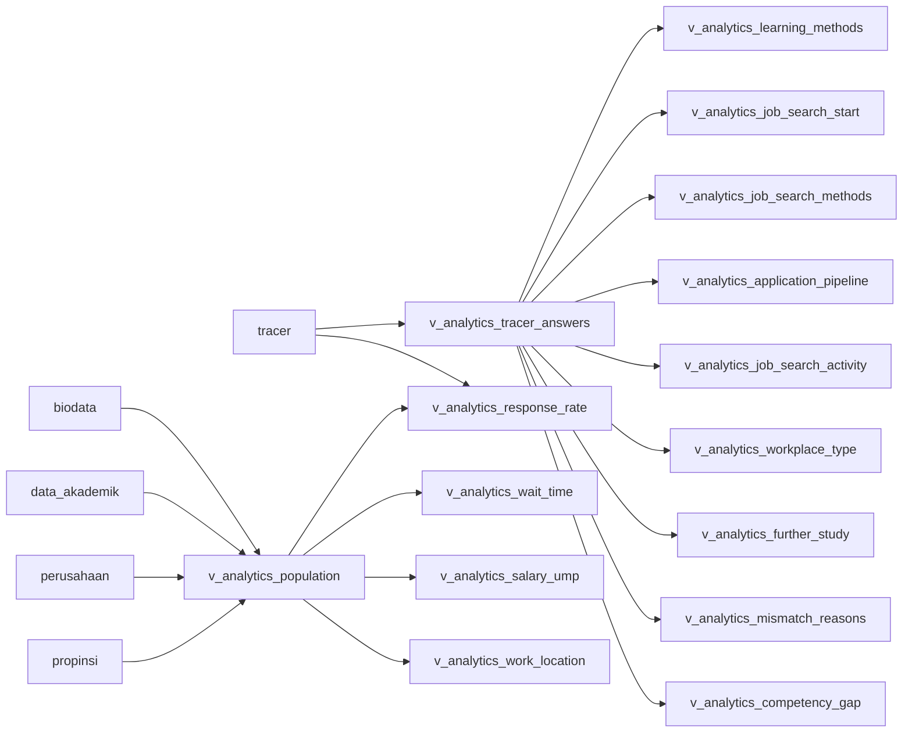

# Entity Relationship Diagram

Dokumen ini menjelaskan schema aktif tracer_study. Kontak dan domisili aktif alumni hanya berada di biodata; data_akademik menjadi sumber resmi data akademik. NIK, NPWP, No. KK, tabel orang tua, dan field pembimbing/penguji tidak termasuk schema aktif.

## ERD aktif

~~~mermaid
erDiagram
    users ||--o| biodata : memiliki
    data_akademik ||--o| biodata : "terhubung melalui nim"
    prodi ||--o{ biodata : menaungi
    ref_fakultas ||--o{ prodi : memiliki
    yudisium ||--o| biodata : "referensi kelulusan"
    perusahaan ||--o{ biodata : mempekerjakan
    atasan ||--o{ biodata : menilai
    propinsi ||--o{ kabupaten : memiliki
    propinsi ||--o{ biodata : domisili
    kabupaten ||--o{ biodata : domisili
    biodata ||--o{ tracer : menjawab
    ref_subpertanyaan2021 ||--o{ tracer : memiliki
    biodata ||--o{ prodi_response : menjawab
    prodi_question ||--o{ prodi_response : memiliki
    prodi ||--o{ prodi_question : memiliki
    prodi_question_section ||--o{ prodi_question : mengelompokkan
    prodi_question ||--o{ prodi_question_option : menyediakan
    biodata ||--o{ linkedin_sync_results : staging
    users ||--o{ linkedin_sync_results : meninjau
    biodata ||--o{ evaluasi_atasan : menerima
    atasan ||--o{ evaluasi_atasan : mengisi
    perusahaan ||--o{ evaluasi_atasan : terkait

    users {
        bigint id PK
        string username UK
        string email
        string role
        boolean must_change_password
    }
    data_akademik {
        bigint id PK
        char nim UK
        string nama
        date tanggal_lahir
        string email_students
        string nisn
        string no_bpjs
        year tahun_lulus
        date tanggal_lulus
        decimal ip_kumulatif
    }
    biodata {
        bigint id PK
        bigint user_id FK
        char nim FK
        bigint prodi_id FK
        string nomor_telepon
        string email_pribadi
        text alamat_saat_ini
        string kelurahan
        string kecamatan
        bigint kabupaten_id FK
        bigint propinsi_id FK
        string kode_pos
        string skills
        text experience
        string bidang_pekerjaan
        decimal gaji
        bigint perusahaan_id FK
        bigint atasan_id FK
    }
    yudisium {
        bigint id PK
        char nim
        text judul_ta
        string status_lulus
        string status_publikasi
    }
    tracer {
        bigint id PK
        bigint biodata_id FK
        bigint question_id FK
        text answer
        json answer_json
        string kode_pertanyaan_snapshot
    }
    prodi_response {
        bigint id PK
        bigint biodata_id FK
        bigint prodi_question_id FK
        text answer_text
        json answer_json
    }
    linkedin_sync_results {
        bigint id PK
        bigint biodata_id FK
        string status
        json scraped_data
        datetime scraped_at
        datetime reviewed_at
    }
~~~

## Kepemilikan data

| Data | Sumber aktif | Catatan |
|---|---|---|
| Identitas akademik, tanggal lahir, NIM, kelulusan | data_akademik | Data master, ditampilkan sebagai referensi. |
| Kontak pribadi dan domisili saat ini | biodata | Tidak lagi diduplikasi di data_akademik. |
| Karier, bidang pekerjaan, gaji, skills, pengalaman | biodata | experience dan skills adalah nama kanonik. |
| Tugas akhir, publikasi, status yudisium | yudisium | Pembimbing/penguji tidak dipakai. |
| Jawaban kuesioner universitas | tracer | Relasi utama memakai question_id; snapshot kode tetap untuk audit. |
| Jawaban kuesioner prodi | prodi_response | Relasi memakai prodi_question_id. |
| Hasil LinkedIn | linkedin_sync_results | Staging sampai admin menyetujui. |

## Proyeksi view analitik

View analitik tidak menyimpan entitas bisnis baru. Ketergantungan datanya
adalah sebagai berikut:

Setiap view `Q1` sampai `Q9` hanya memproyeksikan kode pertanyaan milik satu
indikator. Pemisahan ini menjaga satu request grafik tidak membaca jawaban
indikator lain, sedangkan `v_analytics_tracer_answers` membaca satu jawaban
kanonik per alumni dan kode sesuai unique key tabel `tracer`. Perhitungan
partisipasi wajib dipisahkan ke `v_analytics_response_rate` agar view populasi
tidak mengagregasi jawaban ketika indikator aktif tidak membutuhkannya. Khusus `Q7`
(`v_analytics_further_study`) memproyeksikan F12, F18b, F18c, dan F18d agar
sumber biaya, perguruan tinggi, program studi, serta tanggal mulai tetap dapat
dibedakan sebagai empat dimensi studi lanjut.

## Catatan migrasi

Struktur aktif dibuat oleh migration di `database/migrations`, dengan satu file
untuk setiap tabel atau view. Instalasi ulang menggunakan `migrate` lalu
`db:seed`; tidak ada tabel orang tua, NIK, NPWP, No. KK, atau field
pembimbing/penguji pada migration aktif.

Database terpisah bernama tracer tidak dikelola aplikasi ini dan tidak disentuh oleh migrasi tracer_study.
