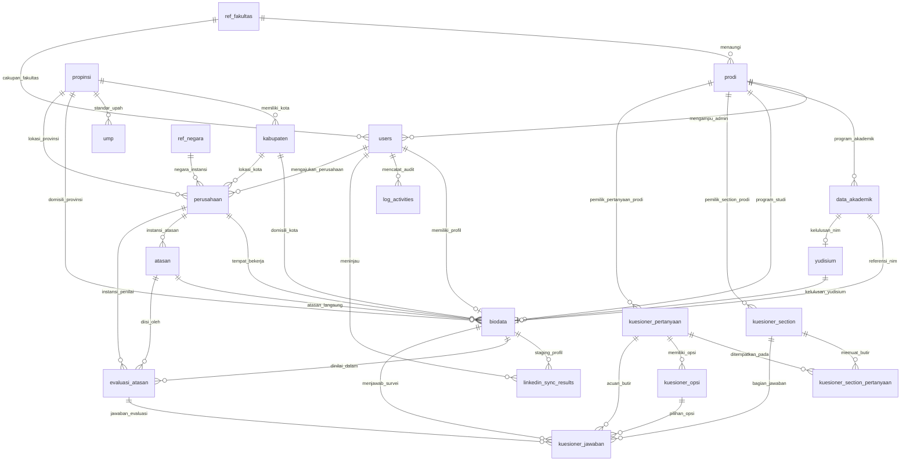
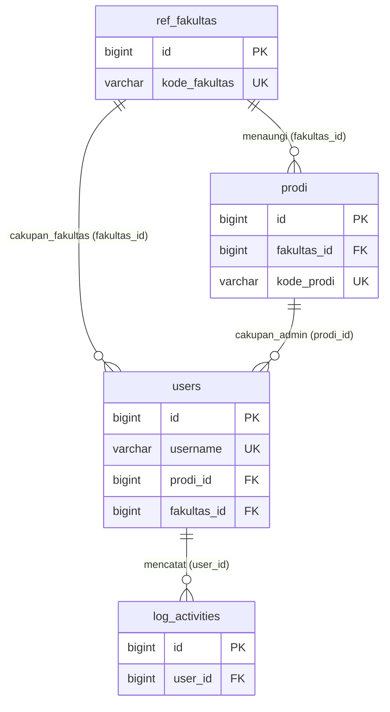
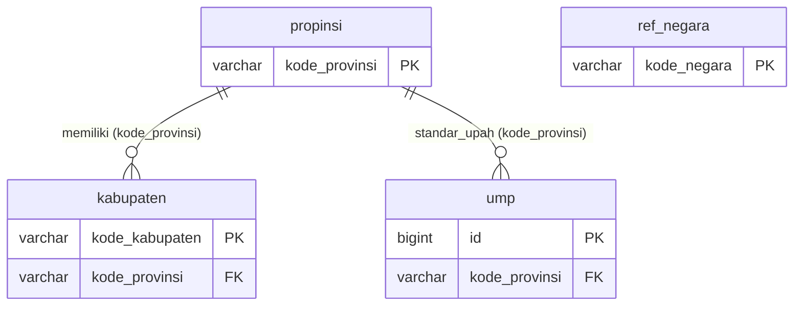
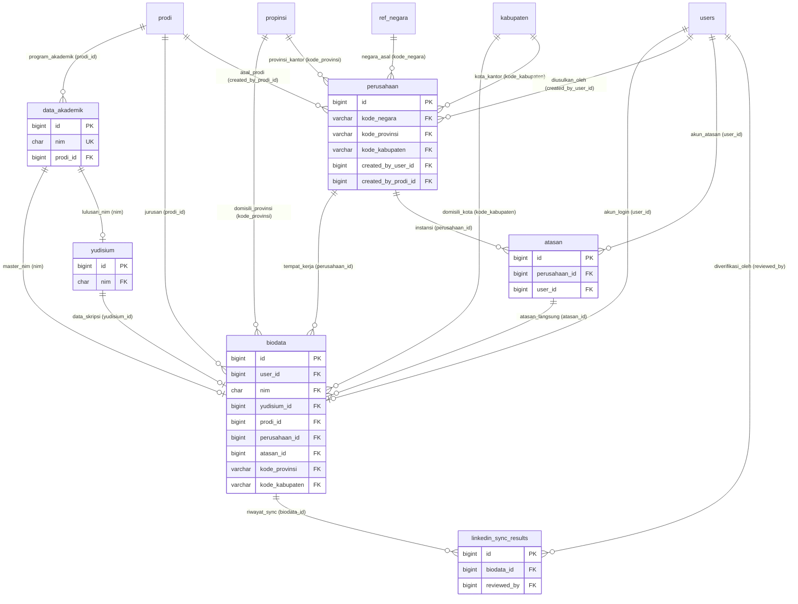
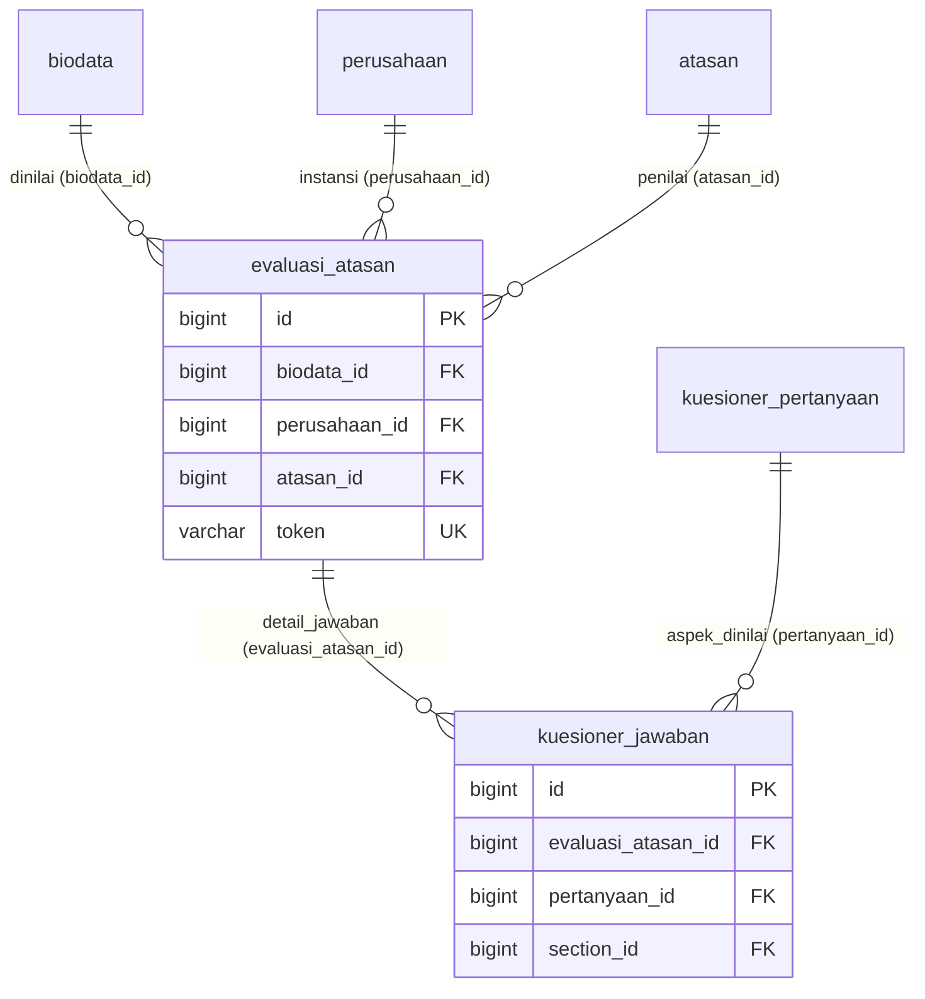
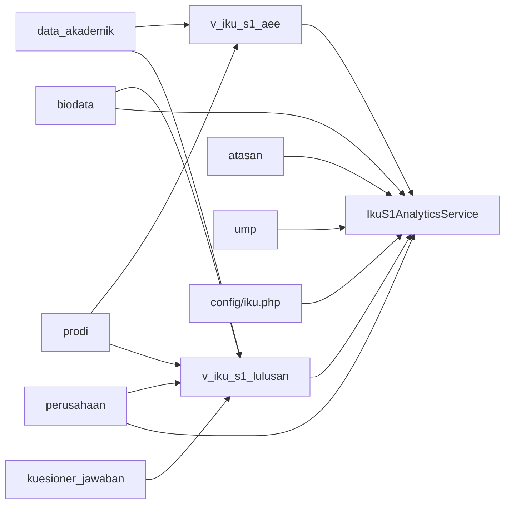
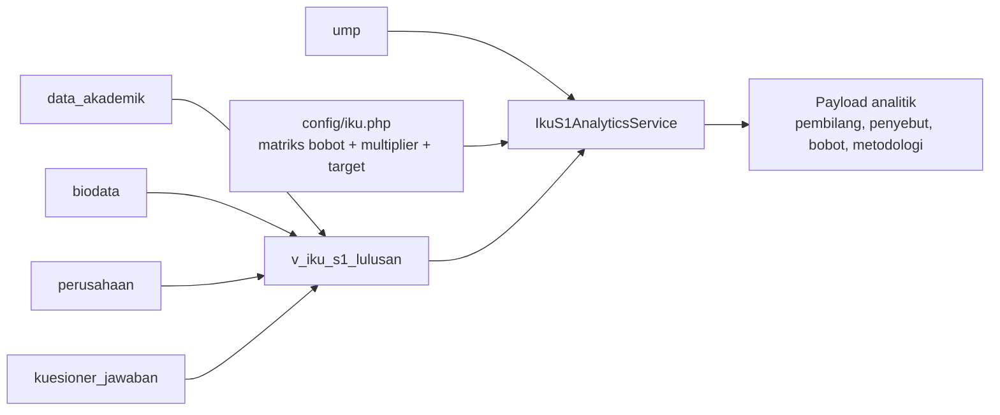
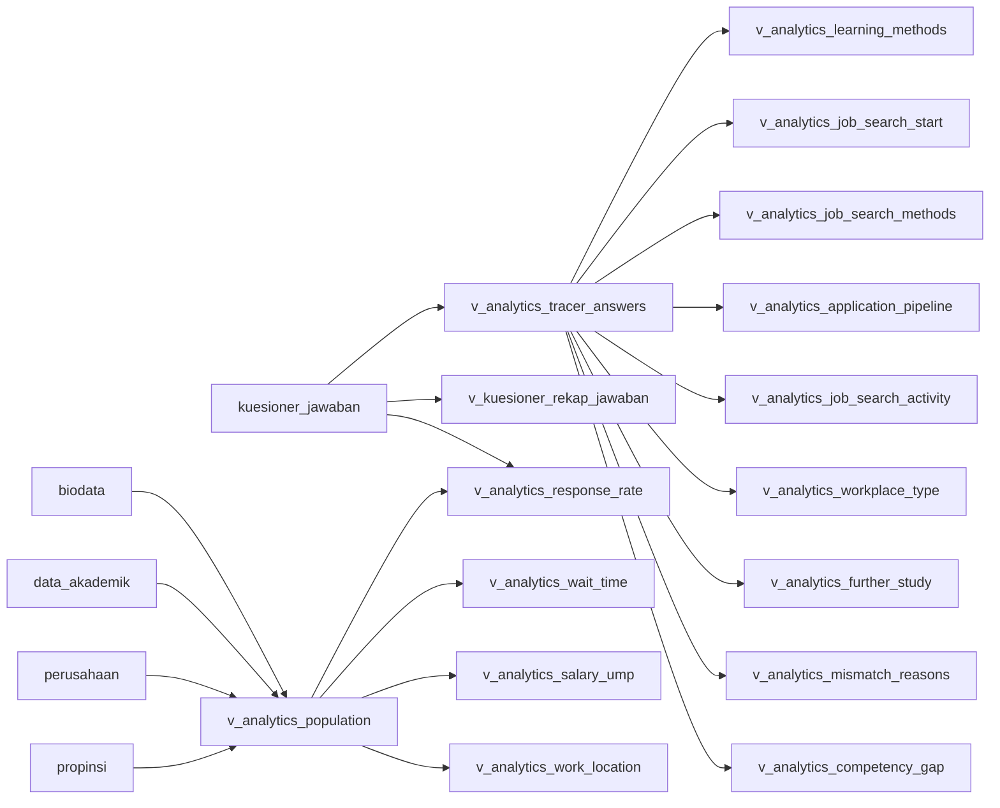
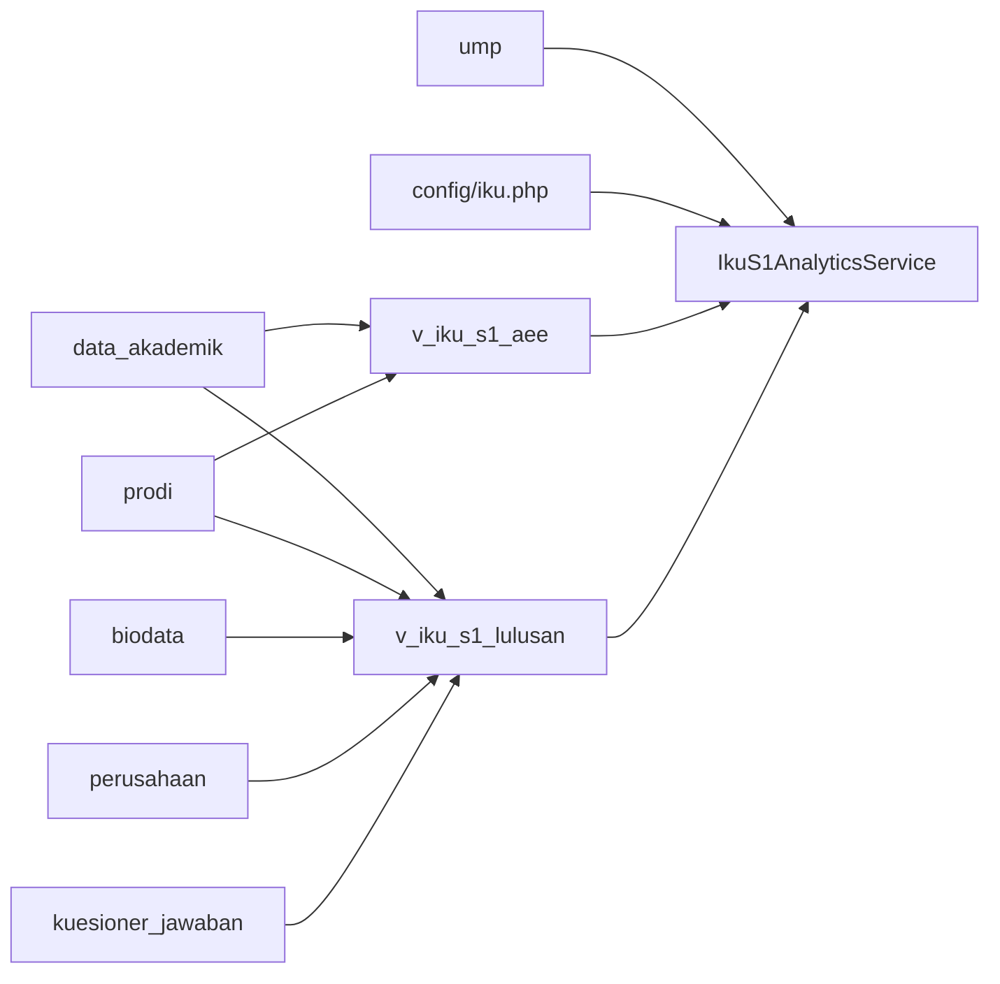

# Entity Relationship Diagram (ERD) & Kamus Data — Sistem Informasi Tracer Study UKDW

Dokumen ini menyajikan spesifikasi struktur basis data aktif **`tracer`** Universitas Kristen Duta Wacana (UKDW). Sesuai kaidah rekayasa perangkat lunak dan penulisan Tugas Akhir:
1. **Visualisasi ERD disajikan secara ringkas (hanya memuat Primary Key `PK`, Foreign Key `FK`, Unique Key `UK`, serta garis relasi & kardinalitas)** dan **dipecah per modul domain** agar diagram bersih, fokus, dan mudah dibaca.
2. **Daftar Relasi Antar Tabel** dirangkum secara eksplisit dalam tabel spesifikasi relasi.
3. **Detail atribut/kolom lengkap untuk setiap tabel disajikan di bagian bawah dalam bentuk Tabel Kamus Data (*Data Dictionary*)**.

> **Catatan Schema Aktif:** Dokumentasi ini diaudit terhadap migration yang berstatus `Ran` dan koneksi runtime `mysql.tracer` pada November 2026. Database aktif aplikasi adalah `tracer`. Seluruh instrumen kuesioner (Universitas, Program Studi, dan Evaluasi Pengguna Lulusan/Atasan) telah disatukan secara terpadu (*Unified Survey Engine*) ke dalam tabel `kuesioner_section`, `kuesioner_pertanyaan`, `kuesioner_section_pertanyaan`, `kuesioner_opsi`, dan `kuesioner_jawaban`. Tabel-tabel silo legacy (`kelompok_pertanyaan`, `ref_subpertanyaan2021`, `ref_subpertanyaan_detil`, `tracer`, `prodi_question_section`, `prodi_question`, `prodi_question_option`, `prodi_response`, `pertanyaan_evaluasi_atasan`, `respon_evaluasi_atasan`) telah sepenuhnya dihapus dari skema aktif.

> **Aturan nama kanonik:** Foreign key wilayah selalu memakai `kode_provinsi` ke `propinsi.kode_provinsi` dan `kode_kabupaten` ke `kabupaten.kode_kabupaten`. Foreign key negara selalu memakai `kode_negara` ISO-3166-1 alpha-2 ke `ref_negara.kode_negara`.

### Status sumber data

Status berikut dipakai konsisten pada ERD, kamus data, dan dokumentasi view:

| Status | Arti |
| :--- | :--- |
| **KANONIK/AKTIF** | Sumber data utama yang boleh menjadi sumber tulis dan sumber perhitungan. |
| **FK/RELASI** | Kunci relasi internal berbasis `id` atau kode natural yang memang menjadi foreign key. |
| **DERIVED/VIEW** | Nilai baca yang dihitung atau ditarik dari tabel kanonik; tidak menjadi sumber tulis. |
| **SNAPSHOT/LEGACY** | Salinan kompatibilitas yang masih ada pada schema/runtime, tetapi bukan sumber utama. |
| **KONFIGURASI** | Aturan aplikasi yang dibaca dari konfigurasi, bukan data transaksi. |
| **DISPLAY** | Nilai untuk label, ekspor, atau tampilan; tidak digunakan sebagai kunci relasi. |

---

## Daftar Isi

1. [Bagian 1: Diagram ERD (Hanya PK, FK, UK, & Relasi)](#bagian-1-diagram-erd-hanya-pk-fk-uk--relasi)
   - [1.1 ERD Master Keseluruhan (Overview Relasi Antar Tabel)](#11-erd-master-keseluruhan-overview-relasi-antar-tabel)
   - [1.2 ERD Modul 1: Autentikasi, Pengguna, & Audit Log](#12-erd-modul-1-autentikasi-pengguna--audit-log)
   - [1.3 ERD Modul 2: Master Akademik, Wilayah, & Standar UMP](#13-erd-modul-2-master-akademik-wilayah--standar-ump)
   - [1.4 ERD Modul 3: Profil Alumni, Perusahaan, Atasan, & LinkedIn Sync](#14-erd-modul-3-profil-alumni-perusahaan-atasan--linkedin-sync)
   - [1.5 ERD Modul 4: Engine Kuesioner Terpadu (Unified Survey Engine)](#15-erd-modul-4-engine-kuesioner-terpadu-unified-survey-engine)
   - [1.6 ERD Modul 5: Evaluasi Pengguna Lulusan (Atasan Langsung)](#16-erd-modul-5-evaluasi-pengguna-lulusan-atasan-langsung)
   - [1.7 Read-model IKU S1: AEE & Karier](#17-read-model-iku-s1-aee--karier)
   - [1.8 Audit Formula, Bobot, dan Sumber Konfigurasi](#18-audit-formula-bobot-dan-sumber-konfigurasi)
2. [Bagian 2: Spesifikasi Relasi & Kardinalitas Antar Tabel](#bagian-2-spesifikasi-relasi--kardinalitas-antar-tabel)
3. [Bagian 3: Kamus Data (Data Dictionary) Detail Per Tabel](#bagian-3-kamus-data-data-dictionary-detail-per-tabel)
   - [3.1 Modul 1: Autentikasi, Pengguna, & Audit Log](#31-modul-1-autentikasi-pengguna--audit-log)
   - [3.2 Modul 2: Master Akademik, Wilayah, & Standar UMP](#32-modul-2-master-akademik-wilayah--standar-ump)
   - [3.3 Modul 3: Profil Alumni, Perusahaan, Atasan, & LinkedIn Sync](#33-modul-3-profil-alumni-perusahaan-atasan--linkedin-sync)
   - [3.4 Modul 4: Engine Kuesioner Terpadu (Unified Survey Engine)](#34-modul-4-engine-kuesioner-terpadu-unified-survey-engine)
   - [3.5 Modul 5: Evaluasi Pengguna Lulusan (Atasan)](#35-modul-5-evaluasi-pengguna-lulusan-atasan)
   - [3.6 Tabel Infrastruktur Framework Laravel](#36-tabel-infrastruktur-framework-laravel)
4. [Bagian 4: Kepemilikan Data & Proyeksi View Analitik](#bagian-4-kepemilikan-data--proyeksi-view-analitik)
   - [4.3 Read-model IKU S1](#43-read-model-iku-s1)
   - [4.4 Audit Formula dan Bobot](#44-audit-formula-dan-bobot)
   - [4.5 Audit Schema Runtime](#45-audit-schema-runtime)

---

## Bagian 1: Diagram ERD (Hanya PK, FK, UK, & Relasi)

Setiap kotak entitas pada diagram di bawah ini **hanya menampilkan kolom kunci (`PK`, `FK`, `UK`)** untuk menjaga keterbacaan visual. Rincian tipe data dan atribut non-kunci dapat dilihat pada **Bagian 3 (Kamus Data)**.

### 1.1 ERD Master Keseluruhan (Overview Relasi Antar Tabel)



---

### 1.2 ERD Modul 1: Autentikasi, Pengguna, & Audit Log

Modul ini menangani akun autentikasi multi-peran (`superadmin`, `admin_biro3`, `admin_fakultas`, `admin_prodi`, `alumni`), keterkaitan cakupan wewenang Program Studi dan Fakultas, serta pencatatan rekam jejak audit (*audit trail*).



---

### 1.3 ERD Modul 2: Master Akademik, Wilayah, & Standar UMP

Modul ini mengelola data master wilayah administratif standar BPS/Kemendagri (`propinsi`, `kabupaten`), standar kode negara ISO 2-huruf (`ref_negara`), serta tabel referensi Upah Minimum Provinsi (`ump`).



---

### 1.4 ERD Modul 3: Profil Alumni, Perusahaan, Atasan, & LinkedIn Sync

Modul ini mengelola riwayat akademik mahasiswa (`data_akademik`), data yudisium kelulusan (`yudisium`), profil terintegrasi alumni (`biodata`), instansi tempat bekerja (`perusahaan`), kontak atasan penilai (`atasan`), dan hasil staging penarikan profil LinkedIn (`linkedin_sync_results`).



---

### 1.5 ERD Modul 4: Engine Kuesioner Terpadu (Unified Survey Engine)

Modul instrumen survei terpadu yang melayani seluruh jenis instrumen kuesioner:
1. **Kuesioner Universitas** (`target = 'univ'`) standar Dikti.
2. **Kuesioner Program Studi** (`target = 'prodi'`) spesifik per program studi.
3. **Survei Kepuasan Pengguna Lulusan / Atasan** (`target = 'atasan'`).

```mermaid
erDiagram
    prodi ||--o{ kuesioner_section : "pemilik_section (prodi_id)"
    prodi ||--o{ kuesioner_pertanyaan : "pembuat_butir (pemilik_prodi_id)"
    kuesioner_section ||--o{ kuesioner_section_pertanyaan : "memuat (section_id)"
    kuesioner_pertanyaan ||--o{ kuesioner_section_pertanyaan : "dikelompokkan (pertanyaan_id)"
    kuesioner_pertanyaan ||--o{ kuesioner_opsi : "menyediakan (pertanyaan_id)"
    biodata ||--o{ kuesioner_jawaban : "respon_alumni (biodata_id)"
    kuesioner_section ||--o{ kuesioner_jawaban : "dalam_bagian (section_id)"
    kuesioner_pertanyaan ||--o{ kuesioner_jawaban : "menjawab_butir (pertanyaan_id)"
    kuesioner_opsi ||--o{ kuesioner_jawaban : "opsi_terpilih (opsi_id)"

    kuesioner {
        bigint id PK
    }

    kuesioner_section {
        bigint id PK
        varchar kode_section UK
        bigint prodi_id FK
    }

    kuesioner_pertanyaan {
        bigint id PK
        varchar kode_pertanyaan UK
        bigint pemilik_prodi_id FK
    }

    kuesioner_section_pertanyaan {
        bigint id PK
        bigint section_id FK
        bigint pertanyaan_id FK
    }

    kuesioner_opsi {
        bigint id PK
        bigint pertanyaan_id FK
        varchar kode_opsi
        text label
        varchar "UNIQUE(pertanyaan_id, kode_opsi)"
    }

    kuesioner_jawaban {
        bigint id PK
        bigint biodata_id FK
        bigint evaluasi_atasan_id FK
        bigint section_id FK
        bigint pertanyaan_id FK
        bigint opsi_id FK
        text kode_opsi
        text jawaban_teks
    }
```

Aturan konsistensi opsi: `opsi_id` adalah ID global master, sedangkan
`kode_opsi` hanya unik dalam lingkup `pertanyaan_id`. Karena itu kode seperti
`3` boleh muncul pada F8 dan pertanyaan lain, tetapi tidak boleh muncul dua kali
untuk pertanyaan yang sama. Untuk jawaban pilihan, `jawaban_teks` selalu memakai
`kuesioner_opsi.label`; normalisasi jawaban lama dilakukan oleh
`KuesionerAnswerConsistencySeeder`.

Status field pada engine kuesioner: `id`, `pertanyaan_id`, dan `opsi_id` adalah
relasi **KANONIK/AKTIF**; `kode_pertanyaan` dan `kode_opsi` pada tabel jawaban
adalah **SNAPSHOT/LEGACY** dan tidak boleh menjadi kunci relasi baru. Kode tetap
ditarik untuk tampilan dan laporan melalui master atau view. Khusus pilihan
jamak seperti F4, `kode_opsi` masih menyimpan array JSON pada data aktif; migrasi
ke relasi ID jamak perlu dilakukan sebelum kolom snapshot tersebut dihapus.

---

### 1.6 ERD Modul 5: Evaluasi Pengguna Lulusan (Atasan Langsung)

Modul evaluasi kepuasan atasan terhadap alumni UKDW. Lembar evaluasi diakses oleh atasan penilai melalui tautan token unik tanpa login akun, dan seluruh skor/jawaban disimpan ke dalam tabel terpadu `kuesioner_jawaban` dengan `responden_type = 'atasan'`.



---

### 1.7 Read-model IKU S1: AEE & Karier

IKU S1 tidak menambah tabel transaksi maupun foreign key. Kedua view di bawah
adalah *read-model* yang membaca tabel kanonik untuk perhitungan di
`IkuS1AnalyticsService`. Garis menunjukkan ketergantungan baca, bukan relasi
penyimpanan.



| Read-model | Grain | Kontrak perhitungan |
| :--- | :--- | :--- |
| `v_iku_s1_aee` | Satu lulusan akademik S1 | Hanya memuat status akademik `Lulus`; service membandingkan lulusan tepat waktu dan terlambat tanpa kategori mahasiswa aktif/belum terdeteksi. |
| `v_iku_s1_lulusan` | Satu lulusan S1 | Menyatukan status karier, masa tunggu, pendapatan, provinsi perusahaan, dan tanggal studi lanjut untuk formula bobot IKU. |

Untuk drill-down grafik Outcomes, service membaca relasi aktif `biodata.perusahaan_id`
dan `biodata.atasan_id` setelah mengambil read-model lulusan. Nama perusahaan,
alamat/kota/provinsi cabang, nama atasan, skills, jabatan, peran wirausaha, dan
detail studi lanjut ditampilkan dari tabel kanonik; tidak ada duplikasi data atau
bobot yang disimpan pada tabel baru.

### 1.8 Audit Formula, Bobot, dan Sumber Konfigurasi

Bobot IKU S1 bukan entitas relasional dan tidak disimpan sebagai kolom pada tabel
atau view. `config/iku.php` adalah sumber konfigurasi utama yang dibaca oleh
`IkuS1AnalyticsService`; view hanya menyediakan fakta mentah/ternormalisasi.
Diagram ini sengaja memisahkan alur penyimpanan data dari alur kalkulasi agar
angka bobot tidak keliru dianggap sebagai data transaksi.

| Komponen | Sumber aktif | Disimpan di database? | Keterangan |
| :--- | :--- | :---: | :--- |
| Bobot capaian karier IKU S1 | `config/iku.php` → `IkuS1AnalyticsService` | Tidak | Matriks `study_continuation`, `before_graduation_*`, `employee_*`, `founder_*`, dan `freelancer_*`. |
| Ambang pendapatan IKU | `ump` + `config/iku.php` | Sebagian | Besaran UMP dan tahun tersimpan di `ump`; multiplier `1,2×` berada di konfigurasi. |
| Nilai skor opsi kuesioner | `kuesioner_opsi.nilai_skor` | Ya | Skor Likert/opsi untuk rekap jawaban; ini berbeda dari bobot capaian karier IKU. |
| Skor kemiripan perusahaan | `PerusahaanVerificationService` | Tidak | Bonus lokasi `+20` kota/kabupaten dan `+10` provinsi, ambang rekomendasi, serta skor level nama masih berupa konstanta algoritma di service. |



Audit hardcode per November 2026:

- Angka bobot IKU utama sudah dipusatkan di `config/iku.php`, bukan di Vue atau SQL.
- `IkuS1AnalyticsService` masih memiliki angka fallback pada operator `??` untuk menjaga sistem tetap berjalan jika key konfigurasi hilang. Nilai fallback tersebut duplikasi defensif, bukan sumber aturan utama.
- Batas klasifikasi (`< 6` bulan, `< 12` bulan), AEE ideal `25%`, daftar kategori valid, dan skor kemiripan perusahaan masih merupakan logika/konstanta kode. Perubahan nilai-nilai itu tetap memerlukan perubahan kode atau refactor konfigurasi.
- `kuesioner_opsi.nilai_skor` tetap persisted untuk metadata Likert/rating, tetapi tidak diterima dari form CRUD dan tidak dipakai sebagai bobot formula IKU S1. Opsi non-rating selalu bernilai `NULL`.

---

## Bagian 2: Spesifikasi Relasi & Kardinalitas Antar Tabel

Tabel berikut merinci seluruh relasi kunci asing (*Foreign Key*) dan referensi logis aktif antar tabel pada basis data `tracer`:

| No | Tabel Induk (Parent) | Kunci Induk | Tabel Anak (Child) | Kolom FK / Referensi | Kardinalitas | Aturan `ON DELETE` | Deskripsi Relasi Bisnis |
| :--- | :--- | :--- | :--- | :--- | :---: | :---: | :--- |
| 1 | `ref_fakultas` | `id` | `prodi` | `fakultas_id` | `1 : N` | `SET NULL` | Satu fakultas menaungi banyak program studi. |
| 2 | `ref_fakultas` | `id` | `users` | `fakultas_id` | `1 : N` | `SET NULL` | Satu fakultas dapat dikelola oleh akun Admin Fakultas. |
| 3 | `prodi` | `id` | `users` | `prodi_id` | `1 : N` | `SET NULL` | Satu prodi dapat dikelola oleh satu atau lebih akun Admin Prodi. |
| 3a | `prodi` | `id` | `data_akademik` | `prodi_id` | `1 : N` | `SET NULL` | Program studi akademik mahasiswa, termasuk mahasiswa yang belum lulus dan belum memiliki biodata alumni. |
| 4 | `users` | `id` | `log_activities` | `user_id` | `1 : N` | `SET NULL` | Satu akun pengguna dapat menghasilkan banyak catatan audit aktivitas. |
| 5 | `propinsi` | `kode_provinsi` | `kabupaten` | `kode_provinsi` | `1 : N` | `CASCADE` | Satu provinsi memiliki banyak kabupaten/kota. |
| 6 | `propinsi` | `kode_provinsi` | `ump` | `kode_provinsi` | `1 : N` | `CASCADE` | Satu provinsi memiliki riwayat besaran UMP per tahun. |
| 7 | `users` | `id` | `biodata` | `user_id` | `1 : 1` bisnis | `CASCADE` | Satu akun pengguna (`role = alumni`) memiliki satu profil biodata. |
| 8 | `data_akademik` | `nim` | `biodata` | `nim` | `1 : 1` | `CASCADE` | Master akademik mahasiswa (`nim`) mereferensikan satu biodata alumni. |
| 9 | `data_akademik` | `nim` | `yudisium` | `nim` | `1 : 1` | `CASCADE` | Data akademik mereferensikan satu data kelulusan tugas akhir yudisium. |
| 10 | `yudisium` | `id` | `biodata` | `yudisium_id` | `1 : 1` | `SET NULL` | Data yudisium terhubung langsung ke biodata alumni melalui foreign key `yudisium_id`. |
| 11 | `prodi` | `id` | `biodata` | `prodi_id` | `1 : N` | `SET NULL` | Satu program studi memiliki banyak biodata alumni. |
| 12 | `propinsi` | `kode_provinsi` | `biodata` | `kode_provinsi` | `1 : N` | `SET NULL` | Provinsi domisili tempat tinggal alumni saat ini. |
| 13 | `kabupaten` | `kode_kabupaten` | `biodata` | `kode_kabupaten` | `1 : N` | `SET NULL` | Kabupaten/kota domisili tempat tinggal alumni saat ini. |
| 14 | `ref_negara` | `kode_negara` | `perusahaan` | `kode_negara` | `1 : N` | `RESTRICT` | Negara lokasi kantor perusahaan/instansi (ISO 2-huruf). |
| 15 | `propinsi` | `kode_provinsi` | `perusahaan` | `kode_provinsi` | `1 : N` | `SET NULL` | Provinsi lokasi kantor perusahaan/instansi tempat kerja. |
| 16 | `kabupaten` | `kode_kabupaten` | `perusahaan` | `kode_kabupaten` | `1 : N` | `SET NULL` | Kabupaten/kota lokasi kantor perusahaan/instansi tempat kerja. |
| 17 | `users` | `id` | `perusahaan` | `created_by_user_id` | `1 : N` | `SET NULL` | Pengguna (alumni/admin) mengusulkan atau mendaftarkan entitas perusahaan baru. |
| 18 | `prodi` | `id` | `perusahaan` | `created_by_prodi_id` | `1 : N` | `SET NULL` | Usulan instansi perusahaan dikelompokkan berdasarkan program studi asal pengusul. |
| 19 | `perusahaan` | `id` | `biodata` | `perusahaan_id` | `1 : N` | `SET NULL` | Satu perusahaan dapat mempekerjakan banyak alumni UKDW. |
| 20 | `perusahaan` | `id` | `atasan` | `perusahaan_id` | `1 : N` | `SET NULL` | Satu perusahaan memiliki satu atau beberapa kontak pimpinan/atasan penilai. |
| 21 | `users` | `id` | `atasan` | `user_id` | `1 : N` | `SET NULL` | Pimpinan/atasan terhubung ke akun login jika terdaftar sebagai pengguna sistem. |
| 22 | `atasan` | `id` | `biodata` | `atasan_id` | `1 : N` | `SET NULL` | Satu atasan langsung dapat membawahi/menilai satu atau lebih alumni. |
| 23 | `biodata` | `id` | `linkedin_sync_results` | `biodata_id` | `1 : N` | `CASCADE` | Satu alumni dapat memiliki riwayat staging sinkronisasi profil LinkedIn. |
| 24 | `users` | `id` | `linkedin_sync_results` | `reviewed_by` | `1 : N` | `SET NULL` | Admin meninjau dan memverifikasi hasil sinkronisasi LinkedIn. |
| 25 | `prodi` | `id` | `kuesioner_section` | `prodi_id` | `1 : N` | `SET NULL` | Satu program studi dapat memiliki bagian kuesioner prodi spesifik (`target = 'prodi'`). |
| 26 | `prodi` | `id` | `kuesioner_pertanyaan` | `pemilik_prodi_id` | `1 : N` | `SET NULL` | Mengidentifikasi program studi pemilik/hak cipta butir soal bank pertanyaan. |
| 27 | `kuesioner_section` | `id` | `kuesioner_section_pertanyaan` | `section_id` | `1 : N` | `CASCADE` | Bagian kuesioner mengelompokkan banyak butir pertanyaan. |
| 28 | `kuesioner_pertanyaan` | `id` | `kuesioner_section_pertanyaan` | `pertanyaan_id` | `1 : N` | `CASCADE` | Butir pertanyaan dari bank soal ditempatkan ke dalam satu atau lebih bagian kuesioner. |
| 29 | `kuesioner_pertanyaan` | `id` | `kuesioner_opsi` | `pertanyaan_id` | `1 : N` | `CASCADE` | Satu pertanyaan pilihan ganda memiliki banyak opsi jawaban. |
| 30 | `biodata` | `id` | `evaluasi_atasan` | `biodata_id` | `1 : N` | `CASCADE` | Satu alumni dapat dinilai dalam lembar evaluasi pengguna lulusan. |
| 31 | `perusahaan` | `id` | `evaluasi_atasan` | `perusahaan_id` | `1 : N` | `SET NULL` | Evaluasi atasan mencatat instansi perusahaan tempat alumni bekerja. |
| 32 | `atasan` | `id` | `evaluasi_atasan` | `atasan_id` | `1 : N` | `SET NULL` | Evaluasi atasan mencatat identitas pejabat penilai langsung. |
| 33 | `biodata` | `id` | `kuesioner_jawaban` | `biodata_id` | `1 : N` | `CASCADE` | Jawaban survei alumni (Tracer Universitas & Prodi) disimpan terpadu. |
| 34 | `evaluasi_atasan` | `id` | `kuesioner_jawaban` | `evaluasi_atasan_id` | `1 : N` | `CASCADE` | Jawaban survei kepuasan atasan disimpan terpadu pada entitas jawaban yang sama. |
| 35 | `kuesioner_section` | `id` | `kuesioner_jawaban` | `section_id` | `1 : N` | `CASCADE` | Setiap jawaban terasosiasi ke bagian kuesioner tempat butir berada. |
| 36 | `kuesioner_pertanyaan` | `id` | `kuesioner_jawaban` | `pertanyaan_id` | `1 : N` | `CASCADE` | Setiap jawaban merujuk ke master butir pertanyaan yang dijawab. |
| 37 | `kuesioner_opsi` | `id` | `kuesioner_jawaban` | `opsi_id` | `1 : N` | `SET NULL` | Merujuk ke opsi pilihan jawaban terpilih (untuk pertanyaan pilihan tunggal/ganda). |

---

## Bagian 3: Kamus Data (Data Dictionary) Detail Per Tabel

Bagian ini mendokumentasikan spesifikasi lengkap setiap kolom pada **21 tabel domain bisnis aktif** serta **7 tabel infrastruktur sistem**.

### 3.1 Modul 1: Autentikasi, Pengguna, & Audit Log

#### 1. Tabel `users`
Menyimpan kredensial autentikasi untuk seluruh peran pengguna (`superadmin`, `admin_biro3`, `admin_fakultas`, `admin_prodi`, dan `alumni`).

| Nama Kolom | Tipe Data | Kunci / Indeks | Nullable / Default | Keterangan |
| :--- | :--- | :---: | :---: | :--- |
| `id` | `bigint unsigned` | `PK` | `NOT NULL`, `AUTO_INCREMENT` | ID unik akun pengguna sistem. |
| `name` | `varchar(100)` | - | `NULL` | Nama lengkap pengguna atau alumni. |
| `username` | `varchar(50)` | `UK` | `NOT NULL` | Username login unik (NIM untuk alumni, identitas untuk staf/admin). |
| `email` | `varchar(100)` | - | `NULL` | Alamat email akun login (dapat digunakan sebagai login alternatif). |
| `password` | `varchar(255)` | - | `NOT NULL` | Hash kata sandi autentikasi akun (bcrypt). |
| `role` | `varchar(30)` | - | `NOT NULL`, Default `'alumni'` | Peran otorisasi: `superadmin`, `admin_biro3`, `admin_fakultas`, `admin_prodi`, atau `alumni`. |
| `prodi_id` | `bigint unsigned` | `FK` | `NULL` | Referensi ke `prodi.id` (khusus pembatasan wewenang `admin_prodi` atau alumni). |
| `fakultas_id` | `bigint unsigned` | `FK` | `NULL` | Referensi ke `ref_fakultas.id` (khusus pembatasan wewenang `admin_fakultas`). |
| `must_change_password` | `tinyint(1)` | - | `NOT NULL`, Default `'0'` | Penanda wajib ganti sandi saat login pertama (`1` = Wajib, `0` = Tidak). |
| `remember_token` | `varchar(100)` | - | `NULL` | Token sesi *remember me* Laravel. |
| `created_at` | `timestamp` | - | `NULL` | Waktu pembuatan rekaman. |
| `updated_at` | `timestamp` | - | `NULL` | Waktu pembaruan terakhir. |

#### 2. Tabel `log_activities`
Menyimpan rekam jejak audit (*audit trail*) atas aksi perubahan data penting yang dilakukan pengguna maupun administrator.

| Nama Kolom | Tipe Data | Kunci / Indeks | Nullable / Default | Keterangan |
| :--- | :--- | :---: | :---: | :--- |
| `id` | `bigint unsigned` | `PK` | `NOT NULL`, `AUTO_INCREMENT` | ID unik rekam jejak aktivitas audit. |
| `user_id` | `bigint unsigned` | `FK` | `NULL` | Referensi ke `users.id` pelaku aktivitas (`ON DELETE SET NULL`). |
| `action` | `varchar(100)` | `INDEX` | `NOT NULL` | Kode jenis aktivitas (misal: `GANTI_PERUSAHAAN_MASTER`, `UPDATE_PROFIL`). |
| `model_type` | `varchar(100)` | `INDEX` | `NULL` | Nama kelas model Eloquent target aktivitas. |
| `model_id` | `bigint unsigned` | `INDEX` | `NULL` | ID rekaman pada model target aktivitas. |
| `description` | `text` | - | `NULL` | Deskripsi naratif rincian aktivitas yang dijalankan. |
| `old_values` | `json` | - | `NULL` | Snapshot nilai atribut lama sebelum dilakukan perubahan dalam format JSON. |
| `new_values` | `json` | - | `NULL` | Snapshot nilai atribut baru setelah dilakukan perubahan dalam format JSON. |
| `ip_address` | `varchar(45)` | - | `NULL` | Alamat IP perangkat pengguna saat aktivitas berlangsung. |
| `user_agent` | `text` | - | `NULL` | Informasi peramban/klien HTTP perangkat pengguna. |
| `created_at` | `timestamp` | - | `NULL` | Waktu pencatatan aktivitas audit. |
| `updated_at` | `timestamp` | - | `NULL` | Waktu pembaruan rekaman audit. |

---

### 3.2 Modul 2: Master Akademik, Wilayah, & Standar UMP

#### 3. Tabel `ref_fakultas`
Menyimpan data referensi fakultas penaung program studi di UKDW.

| Nama Kolom | Tipe Data | Kunci / Indeks | Nullable / Default | Keterangan |
| :--- | :--- | :---: | :---: | :--- |
| `id` | `bigint unsigned` | `PK` | `NOT NULL`, `AUTO_INCREMENT` | ID unik fakultas. |
| `kode_fakultas` | `varchar(10)` | `UK` | `NOT NULL` | Kode singkatan resmi fakultas (misal: `FTI`, `FB`, `FAD`, `FK`, `FT`, `FBIO`, `FKHUM`). |
| `nama_fakultas` | `varchar(100)` | - | `NOT NULL` | Nama lengkap fakultas di lingkungan UKDW. |
| `singkatan` | `varchar(20)` | - | `NULL` | Singkatan nama fakultas untuk tampilan ringkas. |
| `created_at` | `timestamp` | - | `NULL` | Waktu pembuatan rekaman. |
| `updated_at` | `timestamp` | - | `NULL` | Waktu pembaruan terakhir. |

#### 4. Tabel `prodi`
Menyimpan data master program studi sarjana/profesi di lingkungan UKDW.

| Nama Kolom | Tipe Data | Kunci / Indeks | Nullable / Default | Keterangan |
| :--- | :--- | :---: | :---: | :--- |
| `id` | `bigint unsigned` | `PK` | `NOT NULL`, `AUTO_INCREMENT` | ID unik program studi. |
| `fakultas_id` | `bigint unsigned` | `FK` | `NULL` | Referensi ke `ref_fakultas.id` (`ON DELETE SET NULL`). |
| `kode_prodi` | `varchar(10)` | `UK` | `NOT NULL` | Kode resmi program studi 2-digit (contoh: `71` Informatika, `72` Sistem Informasi). |
| `nama_prodi` | `varchar(100)` | - | `NOT NULL` | Nama program studi. |
| `jenjang` | `varchar(10)` | - | `NOT NULL`, Default `'S1'` | Jenjang pendidikan (`S1`, `Profesi`, `S2`). |
| `created_at` | `timestamp` | - | `NULL` | Waktu pembuatan rekaman. |
| `updated_at` | `timestamp` | - | `NULL` | Waktu pembaruan terakhir. |

#### 5. Tabel `propinsi`
Menyimpan data master provinsi standar BPS/Kemendagri.

| Nama Kolom | Tipe Data | Kunci / Indeks | Nullable / Default | Keterangan |
| :--- | :--- | :---: | :---: | :--- |
| `kode_provinsi` | `varchar(10)` | `PK` | `NOT NULL` | Kode resmi provinsi BPS/Kemendagri (contoh: `'34'` untuk D.I. Yogyakarta). |
| `nama_provinsi` | `varchar(100)` | - | `NOT NULL` | Nama resmi provinsi di wilayah Indonesia. |
| `created_at` | `timestamp` | - | `NULL` | Waktu pembuatan rekaman. |
| `updated_at` | `timestamp` | - | `NULL` | Waktu pembaruan terakhir. |

#### 6. Tabel `kabupaten`
Menyimpan data master kabupaten dan kota madya standar BPS/Kemendagri.

| Nama Kolom | Tipe Data | Kunci / Indeks | Nullable / Default | Keterangan |
| :--- | :--- | :---: | :---: | :--- |
| `kode_kabupaten` | `varchar(10)` | `PK` | `NOT NULL` | Kode resmi kabupaten/kota BPS/Kemendagri (contoh: `'34.04'` untuk Kab. Sleman). |
| `kode_provinsi` | `varchar(10)` | `FK` | `NOT NULL` | Referensi ke `propinsi.kode_provinsi` (`ON DELETE CASCADE`). |
| `nama_kabupaten` | `varchar(100)` | - | `NOT NULL` | Nama resmi kabupaten atau kota madya. |
| `created_at` | `timestamp` | - | `NULL` | Waktu pembuatan rekaman. |
| `updated_at` | `timestamp` | - | `NULL` | Waktu pembaruan terakhir. |

#### 7. Tabel `ref_negara`
Menyimpan daftar standar kode negara internasional ISO-3166-1 alpha-2.

| Nama Kolom | Tipe Data | Kunci / Indeks | Nullable / Default | Keterangan |
| :--- | :--- | :---: | :---: | :--- |
| `kode_negara` | `varchar(2)` | `PK` | `NOT NULL` | Kode ISO 2-huruf negara (contoh: `'ID'` untuk Indonesia, `'SG'` untuk Singapura). |
| `kode_iso3` | `varchar(3)` | - | `NULL` | Kode ISO-3166-1 alpha-3, misalnya `IDN` atau `SGP`. |
| `nama_negara` | `varchar(80)` | `UK` | `NOT NULL` | Nama umum negara dalam Bahasa Indonesia. |
| `nama_resmi` | `varchar(120)` | - | `NULL` | Nama resmi kenegaraan lengkap. |
| `benua` | `varchar(50)` | - | `NULL` | Benua lokasi negara. |
| `ibu_kota` | `varchar(80)` | - | `NULL` | Nama ibu kota negara. |
| `created_at` | `timestamp` | - | `NULL` | Waktu pembuatan rekaman. |
| `updated_at` | `timestamp` | - | `NULL` | Waktu pembaruan terakhir. |

#### 8. Tabel `ump`
Menyimpan data referensi besaran Upah Minimum Provinsi (UMP) per tahun untuk analitik gaji lulusan.

| Nama Kolom | Tipe Data | Kunci / Indeks | Nullable / Default | Keterangan |
| :--- | :--- | :---: | :---: | :--- |
| `id` | `bigint unsigned` | `PK` | `NOT NULL`, `AUTO_INCREMENT` | ID unik riwayat standar UMP. |
| `kode_provinsi` | `varchar(10)` | `FK`, `UK(1)` | `NOT NULL` | Referensi ke `propinsi.kode_provinsi` (`ON DELETE CASCADE`). |
| `tahun` | `year` | `UK(2)` | `NOT NULL` | Tahun penetapan besaran UMP (`YYYY`). |
| `besaran` | `decimal(15,2)` | - | `NULL` | Nominal besaran standar upah minimum per bulan dalam mata uang Rupiah (`Rp`). |
| `catatan` | `varchar(150)` | - | `NULL` | Catatan atau dasar hukum penetapan UMP. |
| `created_at` | `timestamp` | - | `NULL` | Waktu pembuatan rekaman. |
| `updated_at` | `timestamp` | - | `NULL` | Waktu pembaruan terakhir. |

---

### 3.3 Modul 3: Profil Alumni, Perusahaan, Atasan, & LinkedIn Sync

#### 9. Tabel `data_akademik`
Menyimpan rekaman resmi master akademik seluruh mahasiswa UKDW, termasuk yang
belum lulus, pindah, cuti, atau drop out. Tabel ini menjadi populasi awal AEE;
profil tracer hanya dibuat pada `biodata` ketika mahasiswa menjadi alumni.

| Nama Kolom | Tipe Data | Kunci / Indeks | Nullable / Default | Keterangan |
| :--- | :--- | :---: | :---: | :--- |
| `id` | `bigint unsigned` | `PK` | `NOT NULL`, `AUTO_INCREMENT` | ID unik rekam akademik. |
| `nim` | `char(8)` | `UK` | `NOT NULL` | Nomor Induk Mahasiswa 8 karakter (contoh: `'72220001'`). |
| `nama` | `varchar(100)` | - | `NULL` | Nama resmi mahasiswa. |
| `email_pribadi` | `varchar(100)` | - | `NULL` | Snapshot email pribadi dari sumber akademik saat impor awal; perubahan kontak aktif disimpan di `biodata.email_pribadi`. |
| `prodi_id` | `bigint unsigned` | `FK`, `INDEX` | `NULL` | Referensi ke `prodi.id`; dipakai juga untuk populasi mahasiswa non-alumni pada AEE. |
| `angkatan_masuk` | `year` | - | `NULL` | Tahun angkatan pertama kali masuk perkuliahan. |
| `tahun_akademik_masuk` | `varchar(30)` | - | `NULL` | Periode masuk reguler, misalnya `2023/2024 (Semester Ganjil)`. |
| `status_mahasiswa` | `varchar(20)` | - | `NULL` | Status akademik terakhir (misal: `'Lulus'`). |
| `tahun_akademik_lulus` | `varchar(20)` | - | `NULL` | Periode semester dan tahun akademik kelulusan (misal: `'Genap 2025/2026'`). |
| `tahun_lulus` | `year` | `INDEX` | `NULL` | Tahun kelulusan mahasiswa (`YYYY`). |
| `tanggal_lulus` | `date` | - | `NULL` | Tanggal resmi surat keputusan kelulusan. |
| `ip_kumulatif` | `decimal(3,2)` | - | `NULL` | Indeks Prestasi Kumulatif (IPK) kelulusan (skala 0.00 - 4.00). |
| `total_sks` | `smallint` | - | `NULL` | Total beban Satuan Kredit Semester yang telah diselesaikan. |
| `total_angka_kualitas` | `decimal(6,2)` | - | `NULL` | Total bobot angka kualitas akademik mahasiswa. |
| `tanggal_lahir` | `date` | - | `NULL` | Tanggal lahir resmi mahasiswa (sumber kata sandi default `ddmmyyyy`). |
| `jenis_kelamin` | `varchar(15)` | - | `NULL` | Jenis kelamin mahasiswa (`'Laki-laki'` atau `'Perempuan'`). |
| `warga_negara` | `varchar(50)` | - | `NULL`, Default `'WNI'` | Status kewarganegaraan resmi. |
| `created_at` | `timestamp` | - | `NULL` | Waktu pembuatan rekaman. |
| `updated_at` | `timestamp` | - | `NULL` | Waktu pembaruan terakhir. |

#### 10. Tabel `yudisium`
Menyimpan riwayat dan metadata kelulusan yudisium serta publikasi tugas akhir/skripsi.

| Nama Kolom | Tipe Data | Kunci / Indeks | Nullable / Default | Keterangan |
| :--- | :--- | :---: | :---: | :--- |
| `id` | `bigint unsigned` | `PK` | `NOT NULL`, `AUTO_INCREMENT` | ID unik catatan yudisium kelulusan. |
| `nim` | `char(8)` | `FK`, `UK` | `NOT NULL` | Referensi ke `data_akademik.nim` (`ON DELETE CASCADE`). |
| `judul_ta` | `text` | - | `NOT NULL` | Judul resmi tugas akhir / skripsi mahasiswa (Bahasa Indonesia). |
| `judul_ta_inggris` | `text` | - | `NULL` | Judul resmi tugas akhir dalam Bahasa Inggris. |
| `url_publikasi` | `varchar(255)` | - | `NULL` | Tautan repositori publikasi digital kampus atau jurnal eksternal. |
| `jenis_publikasi` | `varchar(100)` | - | `NULL` | Jenis publikasi ilmiah (contoh: Jurnal Nasional Terakreditasi, Prosiding). |
| `status_publikasi` | `varchar(50)` | - | `NULL` | Status publikasi karya ilmiah (`Terbit`, `Review`). |
| `keterangan_hasil_yudisium`| `varchar(100)` | - | `NULL` | Predikat kelulusan (misal: `'Cumlaude'`, `'Sangat Memuaskan'`). |
| `status_lulus` | `varchar(30)` | - | `NULL`, Default `'Lulus'` | Status penegasan kelulusan pada sidang yudisium. |
| `created_at` | `timestamp` | - | `NULL` | Waktu pembuatan rekaman. |
| `updated_at` | `timestamp` | - | `NULL` | Waktu pembaruan terakhir. |

#### 11. Tabel `perusahaan`
Menyimpan master data entitas instansi, institusi, atau perusahaan tempat alumni bekerja.

| Nama Kolom | Tipe Data | Kunci / Indeks | Nullable / Default | Keterangan |
| :--- | :--- | :---: | :---: | :--- |
| `id` | `bigint unsigned` | `PK` | `NOT NULL`, `AUTO_INCREMENT` | ID unik entitas perusahaan/instansi. |
| `kode_provinsi` | `varchar(10)` | `FK` | `NULL` | Referensi ke `propinsi.kode_provinsi` (`ON DELETE SET NULL`). |
| `kode_kabupaten` | `varchar(10)` | `FK` | `NULL` | Referensi ke `kabupaten.kode_kabupaten` (`ON DELETE SET NULL`). |
| `nama_perusahaan` | `varchar(150)` | - | `NOT NULL` | Nama resmi perusahaan atau instansi kerja. |
| `alamat` | `text` | - | `NULL` | Alamat lengkap kantor/tempat kerja. |
| `homepage` | `varchar(150)` | - | `NULL` | Website atau homepage resmi instansi. |
| `no_telp_fax` | `varchar(30)` | - | `NULL` | Nomor telepon atau fax resmi instansi. |
| `kode_pos` | `varchar(10)` | - | `NULL` | Kode pos kantor, termasuk format lokasi internasional. |
| `sektor` | `varchar(100)` | - | `NULL` | Sektor bidang industri atau usaha. |
| `skala` | `enum` | - | `NOT NULL`, Default `'Nasional'` | Skala usaha: `Lokal`, `Regional/Lokal`, `Nasional`, atau `Internasional`. |
| `bentuk_perusahaan` | `varchar(60)` | - | `NULL` | Bentuk instansi, misalnya BUMN, PT, koperasi, CV, atau firma. |
| `jumlah_pegawai` | `varchar(60)` | - | `NULL` | Rentang jumlah pegawai instansi. |
| `status_verifikasi` | `enum` | `INDEX` | `NOT NULL`, Default `'Menunggu Verifikasi'` | Status verifikasi: `Menunggu Verifikasi`, `Terverifikasi`, atau `Ditolak`. |
| `jenis_lokasi` | `enum` | - | `NOT NULL`, Default `'Dalam Negeri'` | Kategori lokasi operasional: `Dalam Negeri` atau `Luar Negeri`. |
| `kode_negara` | `varchar(2)` | `FK` | `NOT NULL`, Default `'ID'` | Referensi ke `ref_negara.kode_negara`. |
| `jenis_perusahaan` | `varchar(100)` | - | `NULL` | Kategori instansi menurut instrumen Dikti. |
| `jenis_perusahaan_lainnya` | `text` | - | `NULL` | Keterangan tambahan jika kategori instansi memilih opsi lainnya. |
| `created_by_user_id` | `bigint unsigned` | `FK` | `NULL` | Referensi ke `users.id` pembuat/pengusul entitas (`ON DELETE SET NULL`). |
| `created_by_prodi_id`| `bigint unsigned` | `FK` | `NULL` | Referensi ke `prodi.id` asal pengusul (`ON DELETE SET NULL`). |
| `created_at` | `timestamp` | - | `NULL` | Waktu pembuatan rekaman. |
| `updated_at` | `timestamp` | - | `NULL` | Waktu pembaruan terakhir. |

#### 12. Tabel `atasan`
Menyimpan identitas dan kontak pejabat penilai (atasan langsung) alumni pada instansi tempat kerja. Relasi fisiknya tetap `atasan` ke banyak `biodata` karena satu atasan dapat dipakai bersama oleh beberapa alumni. Pada tampilan master Data Atasan, read-model dibentuk dari `biodata` sehingga satu baris selalu mewakili satu alumni, bukan satu baris unik per nama atasan.

| Nama Kolom | Tipe Data | Kunci / Indeks | Nullable / Default | Keterangan |
| :--- | :--- | :---: | :---: | :--- |
| `id` | `bigint unsigned` | `PK` | `NOT NULL`, `AUTO_INCREMENT` | ID unik pimpinan/atasan langsung. |
| `perusahaan_id` | `bigint unsigned` | `FK` | `NULL` | Referensi ke `perusahaan.id` tempat atasan bertugas (`ON DELETE SET NULL`). |
| `user_id` | `bigint unsigned` | `FK` | `NULL` | Referensi ke `users.id` jika atasan memiliki akun sistem (`ON DELETE SET NULL`). |
| `nama` | `varchar(100)` | - | `NOT NULL` | Nama lengkap pejabat/atasan langsung penilai. |
| `email` | `varchar(100)` | - | `NULL` | Alamat email atasan untuk pengiriman lembar survei evaluasi. |
| `telepon` | `varchar(20)` | - | `NULL` | Nomor telepon atau WhatsApp atasan. |
| `created_at` | `timestamp` | - | `NULL` | Waktu pembuatan rekaman. |
| `updated_at` | `timestamp` | - | `NULL` | Waktu pembaruan terakhir. |

**Kontrak tampilan Master Data Atasan:** sumber `diisi_oleh` adalah alumni melalui Profil alumni. Tidak ada kolom PIC/collector, jabatan, bidang keahlian, atau lokasi pada schema aktif `atasan`; data yang belum ada tidak diisi dengan nilai hardcode. Perusahaan/organisasi diambil melalui relasi `atasan.perusahaan` dengan fallback ke `biodata.perusahaan`.

#### 13. Tabel `biodata`
Menyimpan profil karier, kontak domisili aktif, serta tautan relasi alumni ke perusahaan dan yudisium.

| Nama Kolom | Tipe Data | Kunci / Indeks | Nullable / Default | Keterangan |
| :--- | :--- | :---: | :---: | :--- |
| `id` | `bigint unsigned` | `PK` | `NOT NULL`, `AUTO_INCREMENT` | ID unik profil biodata alumni. |
| `user_id` | `bigint unsigned` | `FK` | `NOT NULL` | Referensi ke `users.id` pemilik akun (`ON DELETE CASCADE`). |
| `nim` | `char(8)` | `FK` | `NOT NULL` | Referensi ke `data_akademik.nim` (`ON DELETE CASCADE`). |
| `yudisium_id` | `bigint unsigned` | `FK` | `NULL` | Referensi ke `yudisium.id` (`ON DELETE SET NULL`). |
| `prodi_id` | `bigint unsigned` | `FK` | `NULL` | Referensi ke `prodi.id` (`ON DELETE SET NULL`). |
| `perusahaan_id` | `bigint unsigned` | `FK` | `NULL` | Referensi ke `perusahaan.id` tempat alumni bekerja (`ON DELETE SET NULL`). |
| `atasan_id` | `bigint unsigned` | `FK` | `NULL` | Referensi ke `atasan.id` penilai langsung (`ON DELETE SET NULL`). |
| `foto` | `text` | - | `NULL` | Path atau URL foto profil alumni. |
| `nomor_telepon` | `varchar(20)` | - | `NULL` | Nomor telepon atau WhatsApp aktif alumni. |
| `email_pribadi` | `varchar(100)` | - | `NULL` | Alamat email pribadi aktif alumni. |
| `alamat_saat_ini` | `text` | - | `NULL` | Alamat domisili tempat tinggal alumni saat ini. |
| `kelurahan` | `varchar(50)` | - | `NULL` | Kelurahan atau desa domisili. |
| `kecamatan` | `varchar(50)` | - | `NULL` | Kecamatan domisili. |
| `kode_kabupaten`| `varchar(10)` | `FK` | `NULL` | Referensi ke `kabupaten.kode_kabupaten` domisili (`ON DELETE SET NULL`). |
| `kode_provinsi` | `varchar(10)` | `FK` | `NULL` | Referensi ke `propinsi.kode_provinsi` domisili (`ON DELETE SET NULL`). |
| `kode_pos` | `char(5)` | - | `NULL` | Kode pos domisili alumni. |
| `instagram_url` | `varchar(150)` | - | `NULL` | Tautan profil Instagram. |
| `facebook_url` | `varchar(150)` | - | `NULL` | Tautan profil Facebook. |
| `linkedin_url` | `varchar(150)` | - | `NULL` | Tautan profil LinkedIn. |
| `linkedin_username` | `varchar(100)` | - | `NULL` | Username akun LinkedIn alumni. |
| `skills` | `text` | - | `NULL` | Daftar keahlian alumni. |
| `experience` | `text` | - | `NULL` | Pengalaman kerja atau riwayat karier alumni. |
| `kategori_pekerjaan` | `varchar(50)` | - | `NULL` | Kategori: `Bekerja (full time/part time)`, `Wiraswasta`, `Melanjutkan Pendidikan`. |
| `posisi_jabatan` | `varchar(100)` | - | `NULL` | Posisi jabatan kerja alumni saat ini. |
| `posisi_wiraswasta` | `varchar(100)` | - | `NULL` | Peran wirausaha, misalnya Founder, Co-Founder, atau Pemilik. |
| `bidang_pekerjaan` | `varchar(150)` | - | `NULL` | Rumpun/bidang pekerjaan alumni. |
| `divisi` | `varchar(150)` | - | `NULL` | Divisi atau unit kerja alumni. |
| `jenis_pekerjaan` | `varchar(100)` | - | `NULL` | Jenis atau klasifikasi bidang pekerjaan. |
| `gaji` | `decimal(15,2)` | - | `NULL` | Besaran penghasilan atau gaji pertama per bulan dalam Rupiah (`Rp`). |
| `pendidikan_tingkat` | `varchar(20)` | - | `NULL` | Jenjang studi lanjut jika melanjutkan pendidikan (`S2`, `S3`, `Spesialis`). |
| `perguruan_tinggi` | `varchar(100)` | - | `NULL` | Nama kampus/universitas tempat studi lanjut. |
| `pendidikan_prodi` | `varchar(100)` | - | `NULL` | Nama program studi jenjang lanjutan. |
| `created_at` | `timestamp` | - | `NULL` | Waktu pembuatan rekaman. |
| `updated_at` | `timestamp` | - | `NULL` | Waktu pembaruan terakhir. |

#### 14. Tabel `linkedin_sync_results`
Menyimpan snapshot data staging hasil penarikan profil LinkedIn sebelum diverifikasi ke biodata.

| Nama Kolom | Tipe Data | Kunci / Indeks | Nullable / Default | Keterangan |
| :--- | :--- | :---: | :---: | :--- |
| `id` | `bigint unsigned` | `PK` | `NOT NULL`, `AUTO_INCREMENT` | ID unik riwayat penarikan LinkedIn. |
| `biodata_id` | `bigint unsigned` | `FK` | `NOT NULL` | Referensi ke `biodata.id` alumni pemilik profil (`ON DELETE CASCADE`). |
| `linkedin_url` | `varchar(150)` | - | `NOT NULL` | URL profil LinkedIn yang menjadi target sinkronisasi. |
| `linkedin_username` | `varchar(100)` | - | `NULL` | Username profil LinkedIn target. |
| `scraped_data` | `json` | - | `NOT NULL` | Payload JSON hasil scraping LinkedIn. |
| `status` | `enum` | - | `NOT NULL`, Default `'pending'` | Status verifikasi: `pending`, `approved`, atau `rejected`. |
| `reviewed_by` | `bigint unsigned` | `FK` | `NULL` | Referensi ke `users.id` admin peninjau hasil sinkronisasi (`ON DELETE SET NULL`). |
| `reviewed_at` | `timestamp` | - | `NULL` | Waktu eksekusi verifikasi atau penolakan oleh admin. |
| `scraped_at` | `timestamp` | - | `NULL` | Waktu pengambilan data dari penyedia scraping. |
| `created_at` | `timestamp` | - | `NULL` | Waktu penarikan snapshot profil. |
| `updated_at` | `timestamp` | - | `NULL` | Waktu pembaruan status terakhir. |

---

### 3.4 Modul 4: Engine Kuesioner Terpadu (Unified Survey Engine)

#### 15. Tabel `kuesioner`
Menyimpan konfigurasi periode tahun Tracer Study universitas beserta target response rate.

| Nama Kolom | Tipe Data | Kunci / Indeks | Nullable / Default | Keterangan |
| :--- | :--- | :---: | :---: | :--- |
| `id` | `bigint unsigned` | `PK` | `NOT NULL`, `AUTO_INCREMENT` | ID unik konfigurasi instrumen survei periode. |
| `title` | `varchar(150)` | - | `NOT NULL` | Judul survei (misal: `Tracer Study UKDW 2026`). |
| `description` | `text` | - | `NULL` | Deskripsi penjelasan pengisian instrumen survei bagi responden. |
| `year` | `year` | - | `NOT NULL` | Tahun periode pelaksanaan survei (`YYYY`). |
| `is_active` | `tinyint(1)` | - | `NOT NULL`, Default `'1'` | Status pembukaan formulir (`1` = Terbuka, `0` = Ditutup). |
| `target_response_rate` | `decimal(5,2)` | - | `NOT NULL`, Default `'60.00'` | Ambang batas target persentase *response rate* (`%`). |
| `created_at` | `timestamp` | - | `NULL` | Waktu pembuatan rekaman. |
| `updated_at` | `timestamp` | - | `NULL` | Waktu pembaruan terakhir. |

#### 16. Tabel `kuesioner_section`
Menyimpan bagian-bagian (*section / stepper*) formulir survei untuk skala universitas, prodi spesifik, maupun atasan.

| Nama Kolom | Tipe Data | Kunci / Indeks | Nullable / Default | Keterangan |
| :--- | :--- | :---: | :---: | :--- |
| `id` | `bigint unsigned` | `PK` | `NOT NULL`, `AUTO_INCREMENT` | ID unik bagian instrumen kuesioner. |
| `kode_section` | `varchar(50)` | `UK` | `NOT NULL` | Kode unik bagian instrumen (contoh: `SEC_UNIV_01`, `SEC_SI_01`, `SEC_ATASAN_01`). |
| `target` | `varchar(20)` | `INDEX` | `NOT NULL`, Default `'univ'` | Target peruntukan bagian: `'univ'`, `'prodi'`, atau `'atasan'`. |
| `prodi_id` | `bigint unsigned` | `FK` | `NULL` | Referensi ke `prodi.id` pemilik jika `target = 'prodi'` (`ON DELETE SET NULL`). |
| `judul` | `varchar(200)` | - | `NOT NULL` | Judul atau label bagian yang ditampilkan pada bilah tahapan formulir. |
| `deskripsi` | `text` | - | `NULL` | Deskripsi atau petunjuk pengisian butir-butir dalam bagian ini. |
| `order` | `smallint` | - | `NOT NULL`, Default `'1'` | Urutan penampilan tahapan bagian instrumen. |
| `is_active` | `tinyint(1)` | - | `NOT NULL`, Default `'1'` | Status keaktifan bagian formulir (`1` = Aktif, `0` = Dinonaktifkan). |
| `created_at` | `timestamp` | - | `NULL` | Waktu pembuatan rekaman. |
| `updated_at` | `timestamp` | - | `NULL` | Waktu pembaruan terakhir. |

#### 17. Tabel `kuesioner_pertanyaan`
Bank butir pertanyaan survei terpusat untuk seluruh jenis kuesioner di lingkungan universitas.

| Nama Kolom | Tipe Data | Kunci / Indeks | Nullable / Default | Keterangan |
| :--- | :--- | :---: | :---: | :--- |
| `id` | `bigint unsigned` | `PK` | `NOT NULL`, `AUTO_INCREMENT` | ID unik butir pertanyaan pada bank soal. |
| `kode_pertanyaan` | `varchar(50)` | `UK` | `NOT NULL` | Kode unik butir pertanyaan standar (misal: `F8`, `F504`, `F17a1`, `PSI-01`, `ATASAN-01`). |
| `teks_pertanyaan` | `text` | - | `NOT NULL` | Teks redaksi butir pertanyaan yang terbaca responden. |
| `tipe` | `varchar(50)` | - | `NOT NULL`, Default `'single_choice'` | Tipe komponen input: `single_choice`, `multiple_choice`, `text`, `textarea`, `number`, `rating_5`, `date`. |
| `pemilik_prodi_id`| `bigint unsigned` | `FK` | `NULL` | Referensi ke `prodi.id` pembuat butir soal (NULL = milik umum universitas). |
| `is_reusable` | `tinyint(1)` | - | `NOT NULL`, Default `'1'` | Penanda apakah butir soal dapat digunakan bersama oleh program studi lain. |
| `keterangan` | `varchar(255)` | - | `NULL` | Keterangan tambahan atau panduan format pengisian bagi responden. |
| `is_active` | `tinyint(1)` | - | `NOT NULL`, Default `'1'` | Status keaktifan butir pertanyaan (`1` = Aktif, `0` = Diarsipkan). |
| `created_at` | `timestamp` | - | `NULL` | Waktu pembuatan rekaman. |
| `updated_at` | `timestamp` | - | `NULL` | Waktu pembaruan terakhir. |

#### 18. Tabel `kuesioner_section_pertanyaan`
Menghubungkan penempatan butir pertanyaan dari bank soal ke dalam bagian kuesioner tertentu lengkap dengan urutan dan kewajibannya.

> **Istilah penempatan:** setiap baris pada tabel ini adalah satu penggunaan pertanyaan pada satu section. Dalam kode aplikasi, ID baris ini disebut `placement_id`; nama kolom database tetap `id`. Jadi `pertanyaan_id = 128` menunjuk master pertanyaan, sedangkan `placement_id = 167` menunjuk penggunaan pertanyaan 128 pada section tertentu. Jika pertanyaan 128 dipakai di section lain, penggunaannya memiliki `placement_id` berbeda.

| Nama Kolom | Tipe Data | Kunci / Indeks | Nullable / Default | Keterangan |
| :--- | :--- | :---: | :---: | :--- |
| `id` | `bigint unsigned` | `PK` | `NOT NULL`, `AUTO_INCREMENT` | ID unik penempatan butir pertanyaan pada bagian. Di API disebut `placement_id`; ini bukan ID master pertanyaan. |
| `section_id` | `bigint unsigned` | `FK`, `UK(1)` | `NOT NULL` | Referensi ke `kuesioner_section.id` (`ON DELETE CASCADE`). |
| `pertanyaan_id` | `bigint unsigned` | `FK`, `UK(2)` | `NOT NULL` | Referensi ke `kuesioner_pertanyaan.id` (`ON DELETE CASCADE`). |
| `order` | `smallint` | - | `NOT NULL`, Default `'1'` | Nomor urut penampilan butir pertanyaan di dalam bagiannya. |
| `wajib` | `tinyint(1)` | - | `NOT NULL`, Default `'1'` | Kewajiban pengisian (`1` = Wajib, `0` = Opsional). |
| `tampil_di` | `varchar(100)` | - | `NULL` | Logika percabangan atau lokasi kemunculan (misal: `kuesioner`, `profil`, `both`). |
| `created_at` | `timestamp` | - | `NULL` | Waktu pembuatan rekaman relasi. |
| `updated_at` | `timestamp` | - | `NULL` | Waktu pembaruan terakhir. |

#### 19. Tabel `kuesioner_opsi`
Menyimpan pilihan opsi jawaban untuk butir pertanyaan bertipe pilihan ganda atau skala bertingkat.

| Nama Kolom | Tipe Data | Kunci / Indeks | Nullable / Default | Keterangan |
| :--- | :--- | :---: | :---: | :--- |
| `id` | `bigint unsigned` | `PK` | `NOT NULL`, `AUTO_INCREMENT` | ID unik opsi pilihan jawaban. |
| `pertanyaan_id` | `bigint unsigned` | `FK`, `INDEX` | `NOT NULL` | Referensi ke `kuesioner_pertanyaan.id` pemilik opsi (`ON DELETE CASCADE`). |
| `kode_opsi` | `varchar(50)` | - | `NULL` | Kode identifikasi opsi jawaban standar (misal: `F8-01`, `1`, `F4-01`). |
| `label` | `text` | - | `NOT NULL` | Teks redaksi pilihan jawaban yang terbaca di antarmuka responden. |
| `label_singkat` | `varchar(255)` | - | `NULL` | Label ringkas untuk grafik dan analitik. |
| `nilai_skor` | `smallint` | - | `NULL` | Metadata internal skala Likert/rating; dihitung backend dari urutan opsi dan bukan input CRUD umum. |
| `lompat_ke_pertanyaan_id` | `varchar(50)` | - | `NULL` | Kode pertanyaan target untuk percabangan jawaban (*Jump To*); `NULL` berarti alur normal. |
| `order` | `smallint` | - | `NOT NULL`, Default `'1'` | Nomor urut posisi opsi jawaban dalam daftar pilihan. |
| `created_at` | `timestamp` | - | `NULL` | Waktu pembuatan rekaman. |
| `updated_at` | `timestamp` | - | `NULL` | Waktu pembaruan terakhir. |

#### 20. Tabel `kuesioner_jawaban`
Tabel transaksi terpadu (*Single Source of Truth*) penyimpan seluruh respon jawaban kuesioner dari responden Alumni maupun Atasan.

| Nama Kolom | Tipe Data | Kunci / Indeks | Nullable / Default | Keterangan |
| :--- | :--- | :---: | :---: | :--- |
| `id` | `bigint unsigned` | `PK` | `NOT NULL`, `AUTO_INCREMENT` | ID unik respon transaksi jawaban kuesioner. |
| `responden_type` | `varchar(20)` | `INDEX` | `NOT NULL`, Default `'alumni'` | Tipe responden: `'alumni'` (kuesioner tracer) atau `'atasan'` (survei pengguna). |
| `biodata_id` | `bigint unsigned` | `FK`, `INDEX` | `NULL` | Referensi ke `biodata.id` alumni pengisi (`ON DELETE CASCADE`). |
| `evaluasi_atasan_id`| `bigint unsigned` | `FK`, `INDEX` | `NULL` | Referensi ke `evaluasi_atasan.id` lembar evaluasi atasan (`ON DELETE CASCADE`). |
| `section_id` | `bigint unsigned` | `FK`, `INDEX` | `NOT NULL` | Referensi ke `kuesioner_section.id` (`ON DELETE CASCADE`). |
| `pertanyaan_id` | `bigint unsigned` | `FK`, `INDEX` | `NOT NULL` | Referensi ke `kuesioner_pertanyaan.id` (`ON DELETE CASCADE`). |
| `kode_pertanyaan` | `varchar(50)` | `INDEX` | `NULL` | **SNAPSHOT/LEGACY**: salinan kode butir untuk kompatibilitas kueri lama; sumber kanonik adalah `pertanyaan_id` → `kuesioner_pertanyaan.kode_pertanyaan`. |
| `opsi_id` | `bigint unsigned` | `FK` | `NULL` | Referensi ke `kuesioner_opsi.id` pilihan jawaban master terpilih (`ON DELETE SET NULL`). |
| `kode_opsi` | `text` | - | `NULL` | **SNAPSHOT/LEGACY**: kode opsi terpilih atau array JSON kode jika jawaban multi-pilihan; sumber kanonik pilihan tunggal adalah `opsi_id` → `kuesioner_opsi.kode_opsi`. |
| `jawaban_teks` | `text` | - | `NULL` | Nilai jawaban teks bebas, angka, atau label opsi pilihan tunggal terpilih. |
| `jawaban_json` | `json` | - | `NULL` | Nilai jawaban terstruktur jika pertanyaan bertipe multi-select atau isian kustom. |
| `created_at` | `timestamp` | - | `NULL` | Waktu pertama kali jawaban disimpan. |
| `updated_at` | `timestamp` | - | `NULL` | Waktu pembaruan jawaban terakhir. |

**Indeks analitik:** `kuesioner_jawaban_analytics_lookup_idx` (`biodata_id`, `responden_type`, `kode_pertanyaan`, `id`) mempercepat pembacaan jawaban tracer terbaru oleh `v_iku_s1_lulusan`.

---

### 3.5 Modul 5: Evaluasi Pengguna Lulusan (Atasan)

#### 21. Tabel `evaluasi_atasan`
Menyimpan sesi lembar transaksi survei kepuasan atasan terhadap alumni UKDW beserta token akses publik tanpa login.

| Nama Kolom | Tipe Data | Kunci / Indeks | Nullable / Default | Keterangan |
| :--- | :--- | :---: | :---: | :--- |
| `id` | `bigint unsigned` | `PK` | `NOT NULL`, `AUTO_INCREMENT` | ID unik transaksi lembar evaluasi atasan. |
| `biodata_id` | `bigint unsigned` | `FK` | `NOT NULL` | Referensi ke `biodata.id` alumni yang dievaluasi (`ON DELETE CASCADE`). |
| `perusahaan_id` | `bigint unsigned` | `FK` | `NULL` | Referensi ke `perusahaan.id` instansi kerja (`ON DELETE SET NULL`). |
| `atasan_id` | `bigint unsigned` | `FK` | `NULL` | Referensi ke `atasan.id` pejabat penilai (`ON DELETE SET NULL`). |
| `token` | `varchar(64)` | `UK` | `NOT NULL` | Token acak unik (64 karakter) untuk tautan pengisian survei tanpa login akun. |
| `is_submitted` | `tinyint(1)` | - | `NOT NULL`, Default `'0'` | Status submit kuesioner oleh atasan (`1` = Sudah disubmit, `0` = Belum). |
| `submitted_at` | `timestamp` | - | `NULL` | Waktu penyerahan / submit evaluasi oleh atasan penilai. |
| `created_at` | `timestamp` | - | `NULL` | Waktu pembuatan token evaluasi. |
| `updated_at` | `timestamp` | - | `NULL` | Waktu pembaruan terakhir. |

---

### 3.6 Tabel Infrastruktur Framework Laravel

Selain 21 tabel domain bisnis di atas, basis data menyertakan 7 tabel standar infrastruktur Laravel untuk manajemen sesi, antrean pekerjaan (*queue jobs*), dan *caching*:

| No | Nama Tabel | Primary Key (`PK`) | Fungsi Infrastruktur |
| :--- | :--- | :--- | :--- |
| 1 | `password_reset_tokens` | `email` (`varchar(255)`) | Menyimpan token sementara untuk fitur pemulihan kata sandi pengguna. |
| 2 | `sessions` | `id` (`varchar(255)`) | Menyimpan sesi login HTTP aktif pengguna beserta `user_id`, `ip_address`, dan `payload`. |
| 3 | `cache` | `key` (`varchar(255)`) | Menyimpan data *application cache* berbasis tabel database (`value`, `expiration`). |
| 4 | `cache_locks` | `key` (`varchar(255)`) | Mengelola *atomic lock* proses background agar tidak terjadi kondisi balapan (*race condition*). |
| 5 | `jobs` | `id` (`bigint unsigned`) | Menyimpan antrean tugas asinkron (*background queue*), seperti pengiriman email dan sinkronisasi LinkedIn. |
| 6 | `job_batches` | `id` (`varchar(255)`) | Mengelola eksekusi sekumpulan pekerjaan (*batch jobs*) beserta progres penyelesaiannya. |
| 7 | `failed_jobs` | `id` (`bigint unsigned`) | Menyimpan log pekerjaan antrean yang gagal dieksekusi (`uuid` UK, `exception`, `failed_at`). |

---

## Bagian 4: Kepemilikan Data & Proyeksi View Analitik

### 4.1 Kepemilikan Data Kanonik

| Domain Data | Tabel Sumber Aktif | Aturan Kanonik & Catatan |
| :--- | :--- | :--- |
| Domain Data | Tabel Sumber Aktif | Status | Aturan Kanonik & Catatan |
| :--- | :--- | :--- | :--- |
| Identitas akademik, tanggal lahir, NIM, kelulusan | `data_akademik` | **KANONIK/AKTIF** | Data master dari universitas, menjadi referensi resmi kelulusan; `email_pribadi` hanya snapshot sumber awal. |
| Kontak pribadi dan domisili saat ini | `biodata` | **KANONIK/AKTIF** | Sumber kontak & domisili aktif alumni; perubahan tidak menulis balik ke data akademik. |
| Karier, bidang pekerjaan, gaji, *skills*, *experience* | `biodata` | **KANONIK/AKTIF** | Kolom karier dan penghasilan alumni terpadu. |
| Profil perusahaan & instansi kerja | `perusahaan` | **KANONIK/AKTIF** | Tersinkronisasi antara formulir karier alumni dan direktori mitra perusahaan. |
| Tugas akhir, publikasi, status yudisium | `yudisium` | **KANONIK/AKTIF** | Menyimpan metadata skripsi, jurnal, dan status kelulusan yudisium. |
| Seluruh jawaban kuesioner (Univ, Prodi, Atasan) | `kuesioner_jawaban` | **KANONIK/AKTIF** | *Single Source of Truth* jawaban seluruh instrumen survei; relasi jawaban memakai ID. |
| Kode pertanyaan dan opsi untuk jawaban | `kuesioner_pertanyaan`, `kuesioner_opsi` | **KANONIK/AKTIF + DISPLAY** | Kode berasal dari master dan diproyeksikan melalui view; salinan kode pada `kuesioner_jawaban` berstatus **SNAPSHOT/LEGACY**. |
| Sesi evaluasi pengguna lulusan (atasan) | `evaluasi_atasan` | **KANONIK/AKTIF** | Menyimpan token unik akses survei publik dan metadata instansi. |
| Hasil ekstraksi profil LinkedIn | `linkedin_sync_results` | **STAGING** | Berfungsi sebagai tabel *staging* sampai diverifikasi ke tabel `biodata`. |

Field identitas yang muncul ulang pada Kuesioner Universitas atau Prodi tetap
dibaca dari `biodata`/`data_akademik` sebagai sumber kanonik. Sinkronisasi
memperbarui jawaban identitas lama berdasarkan `pertanyaan_id`, sedangkan
jawaban evaluasi tetap disimpan sebagai isian alumni di `kuesioner_jawaban`.

### 4.2 Proyeksi Database Views (Analitik & Operasional)

View analitik dan operasional dihitung secara dinamis di tingkat basis data MySQL (*database views*) dari tabel `kuesioner_jawaban` dan profil alumni tanpa membuat tabel duplikasi:

`v_analytics_tracer_answers` menjadi read-model jawaban tracer kanonik dengan
satu baris per alumni dan `pertanyaan_id`; view memilih record `id` terbaru
untuk mengabaikan riwayat pengisian ulang. Sembilan view F3-F27 yang hanya
memfilter kode pertanyaan dipertahankan sebagai alias kompatibilitas, sedangkan
service analitik membaca read-model kanonik secara langsung.



### 4.3 Read-model IKU S1



`v_iku_s1_aee` memakai mahasiswa S1 dengan status akademik `Lulus` sebagai
populasi dasar. Status aktif, AR, AK, Cuti, Pindah, dan Drop Out tidak masuk
perhitungan. `v_iku_s1_lulusan` juga memakai mahasiswa dengan status akademik
`Lulus` untuk indikator karier. Keduanya tidak menyimpan data dan
tidak menambah relasi fisik ke ERD; fungsi serta grain lengkapnya tercatat pada
[database-views.md](docs/database-views.md).

### 4.4 Audit Formula dan Bobot

Formula IKU S1 dibentuk di service setelah read-model mengambil data akademik,
profil, jawaban tracer, perusahaan, dan UMP. `config/iku.php` bukan tabel dan
tidak memiliki foreign key; ia merupakan sumber konfigurasi aplikasi. Untuk
detail matriks bobot dan temuan hardcode, lihat [Audit Formula, Bobot, dan
Sumber Konfigurasi](#18-audit-formula-bobot-dan-sumber-konfigurasi).

### 4.5 Audit Schema Runtime

Audit berkala memastikan struktur dokumen ERD selalu sinkron 100% dengan database MySQL `tracer` aktif:

| Pemeriksaan | Status Runtime | Keterangan |
| :--- | :--- | :--- |
| Database Aktif | `tracer` | Terdaftar pada `.env` dan `config/database.php`. |
| Referensi migration | 51 berkas definisi | Terdiri dari tabel, infrastruktur Laravel, dan database view; status runtime diverifikasi melalui `php artisan migrate:status` saat MySQL tersedia. |
| Model Kuesioner | *Unified Survey Engine* | Menggunakan tabel `kuesioner_section`, `kuesioner_pertanyaan`, `kuesioner_section_pertanyaan`, `kuesioner_opsi`, `kuesioner_jawaban`. |
| Tabel Legacy Silo | 0 Tabel Tersisa | 11 tabel kuesioner terpisah lama telah dihapus sepenuhnya. |
| Primary Key Wilayah | Natural Key BPS | `propinsi.kode_provinsi` dan `kabupaten.kode_kabupaten`. |
| Primary Key Negara | ISO 2-Huruf | `ref_negara.kode_negara` (format ISO-3166-1 alpha-2). |
| Primary Key Akademik | Surrogate key + NIM unik | `data_akademik.id` sebagai PK dan `data_akademik.nim` sebagai unique natural key (8 karakter). |
