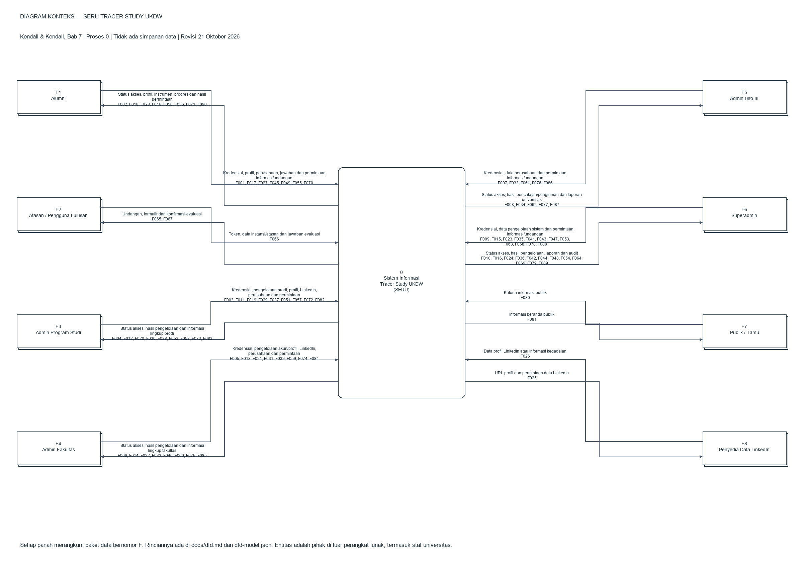

# Tracer Study UKDW (SERU)

Dokumentasi sistem tracer study dengan lima role akun: Superadmin, Admin Program Studi, Admin Fakultas, Admin Biro III, dan Alumni. Atasan mengisi evaluasi melalui tautan bertoken; publik mengakses beranda.

Revisi **25 Oktober 2026**. Repository ini memuat kode aplikasi Laravel/Inertia beserta dokumentasinya. Lima role akun dibedakan dari publik serta atasan bertoken.

## Modul Utama Sistem

- **Dashboard Pengelola Terpadu (`RoleDashboard.vue`)**: Antarmuka dashboard bersama untuk Admin Prodi, Admin Fakultas, dan Biro 3 dengan cakupan data yang terisolasi secara otomatis berdasarkan role.
- **Business Intelligence & Analitik Tracer Study (`/superadmin/analitik`)**:
  - 18 indikator analitik mandiri (`01_ResponseRate.vue` s.d. `18_WorkLocation.vue`) yang dimuat secara asinkron melalui index hub `AnalyticsChartsPanel.vue`.
  - Tata letak terintegrasi **`[ Grafik | Data ]`** (`AnalyticsChartCard.vue`) dengan visual ECharts di kiri dan tabel data numerik di kanan, mendukung seleksi dan filter silang dua arah.
  - Adopsi grafik garis resmi dari Laporan Tracer Study UKDW (Gambar 4.3, 4.6, 4.7, 4.12, dan 4.17 dual-line gap).
  - Tampilan bersih flat tanpa pola decal tekstur dan memakai warna solid brand emerald `#0D542B`.

## Diagram konteks dan DFD

- **[Baca dokumen DFD](docs/dfd.md)**: batas sistem, acuan Kendall, kamus data dan keseimbangan aliran.
- **[Unduh / buka file draw.io](docs/tracer-study-dfd.drawio)**: dua sheet yang dapat diedit, **Diagram Konteks** dan **DFD Diagram 0**. Pada halaman berkas GitHub, gunakan tombol unduh raw.
- [Pratinjau diagram konteks](docs/images/dfd_context_diagram.png).
- [Pratinjau Diagram 0](docs/images/dfd_level_0.png).
- [Registri model JSON](docs/dfd-model.json): 154 aliran data, termasuk 90 aliran eksternal, tujuh proses dan 13 simpanan logis.

## Cara memakai di diagrams.net

1. Unduh `docs/tracer-study-dfd.drawio` dari repository ini.
2. Buka diagrams.net, pilih **File ? Open From ? Device**, lalu pilih berkas tersebut.
3. Pilih sheet **Diagram Konteks** atau **DFD Diagram 0** di bagian bawah editor.
4. Untuk memasukkan diagram ke dokumen Google Drive yang sudah ada, buka dokumen tujuan lalu gunakan **File ? Import From ? Device**; periksa pilihan impor halaman yang muncul dan simpan melalui akun pemilik dokumen.

Semua kotak, label dan konektor dalam `.drawio` dapat diedit. Diagram 0 memakai kanvas vertikal panjang agar label tetap terbaca; kode entitas atau simpanan yang diulang menunjuk objek yang sama. Referensi antarproses memakai kode aliran yang sama pada kedua sisi.

## Dokumen lainnya

| Dokumen | Isi |
| --- | --- |
| [Panduan aplikasi](PANDUAN_APLIKASI.md) | Struktur aplikasi, modul dan konfigurasi. |
| [Use case](USE_CASE.md) | Aktor dan kebutuhan fungsional. |
| [User flow](docs/user-flow.md) | Langkah penggunaan per role dan visualisasi analitik. |
| [ERD](ERD.md) | Relasi tabel database dan kamus data. |
| [Kuesioner](KUESIONER.md) | Bagian dan percabangan pertanyaan. |
| [Pemetaan pertanyaan](DAFTAR_PERTANYAAN_MAPPING.md) | Kode pertanyaan dan sumber datanya. |
| [Activity diagram](docs/activitydiagram.md) | Aktivitas, keputusan dan pemetaan implementasi. |
| [Database views](docs/database-views.md) | Referensi view analitik dan audit. |
| [Integrasi LinkedIn](docs/linkedin-mcp-integration.md) | Driver provider dan peninjauan hasil. |
| [Verifikasi perusahaan](docs/verifikasi-perusahaan-similarity.md) | Algoritma rekomendasi dan konsolidasi. |
| [Arsitektur admin](docs/ARCHITECTURE.md) | Komponen bersama, halaman lintas-role, route, dan batas data. |
| [Riwayat perubahan](docs/changelog.md) | Arsip dan log pembaruan teknis lengkap. |

## Sumber dan batas model

Acuan DFD adalah Kendall & Kendall (2020), *Systems Analysis and Design*, edisi ke-10 Global Edition, Bab 7, dari PDF yang disediakan pemilik proyek. PDF buku tidak disalin ke repository ini. Diagram merupakan pemodelan aplikasi berdasarkan bacaan tersebut, bukan salinan diagram buku.

Data akademik/yudisium/orang tua tersedia pada tabel lokal; konektor langsung SIAKAD tidak diasumsikan. Biro III membaca profil dan hasil LinkedIn; rute bersama tetap mendukung pencatatan perusahaan dan permintaan email evaluasi. Email evaluasi dikirim melalui aksi terpisah dari penyimpanan profil. Driver Apify menggunakan staging/review dan menolak batch.

PNG/SVG DFD diperbarui bersama XML. Aset gambar use case/activity lama yang disebut pada arsip perubahan belum seluruhnya dirender ulang; untuk alur terkini gunakan dokumen Markdown/Mermaid yang direvisi. Pemeriksaan mencakup struktur XML, referensi konektor, keseimbangan aliran, masukan/keluaran proses, sintaks XML SVG dan tautan dokumen. Pembukaan/simpan langsung pada dokumen Google Drive pengguna belum dilakukan dari sesi ini.
