# Spesifikasi Use Case Sistem Tracer Study UKDW

Dokumen ini adalah spesifikasi normatif interaksi pengguna dengan aplikasi Tracer Study UKDW (SERU). Isi dokumen diselaraskan dengan route aktif pada `routes/web.php`, controller, middleware role, tabel schema aktif `tracer`, dan ERD. Setiap use case ditulis dalam tabel agar mudah dipresentasikan, diuji, dan diedit saat live coding.

## 1. Aktor

| Aktor | Deskripsi dan batas akses |
| :--- | :--- |
| Publik atau Tamu | Melihat beranda dan membuka halaman login tanpa autentikasi. |
| Alumni | Mengelola profil, data karier, kuesioner universitas, kuesioner prodi, dan mengirim undangan evaluasi kepada atasan. |
| Pengguna Lulusan atau Atasan | Mengisi evaluasi melalui token publik; tidak memerlukan akun `users`. |
| Admin Prodi | Mengelola alumni dalam prodi, kuesioner prodi, perusahaan dalam cakupan prodi, akun alumni prodi, dan sinkronisasi LinkedIn prodi. |
| Admin Fakultas | Mengelola alumni dalam fakultas, perusahaan dalam cakupan fakultas, akun alumni fakultas, dan sinkronisasi LinkedIn fakultas. |
| Admin Biro III | Memantau statistik dan direktori alumni universitas serta mengirim komunikasi; tidak memiliki aksi sinkronisasi LinkedIn. |
| Superadmin | Mengelola seluruh instrumen, master wilayah dan UMP, perusahaan, akun, evaluasi atasan, analitik, sinkronisasi LinkedIn, dan log aktivitas. |
| Provider LinkedIn atau Apify | Sistem eksternal yang mengembalikan payload profil LinkedIn untuk proses staging; bukan akun manusia. |

## 2. Aturan format spesifikasi

Setiap tabel di bawah mengikuti format Dr. Surya: identitas use case, aktor, deskripsi, prasyarat, pasca-syarat, alur dasar, alur alternatif, dan alur eksepsi. Nama tabel dan kolom database yang disebut adalah sumber implementasi aktual.

Nomor use case mempertahankan master aplikasi: **UC01** adalah beranda publik, sedangkan **UC02** adalah login. Dengan begitu setiap rujukan controller, route, dan diagram tetap stabil.

## 3. Diagram konteks use case

```mermaid
flowchart LR
    Guest[Publik / Tamu] --> UC01((UC01 Beranda))
    Guest --> UC02((UC02 Login))
    Alumni[Alumni] --> UC02
    Alumni --> UC05((UC05 Profil dan Karier))
    Alumni --> UC07((UC07 Kuesioner Universitas))
    Alumni --> UC08((UC08 Kuesioner Prodi))
    Alumni --> UC09((UC09 Undangan Evaluasi Atasan))
    Alumni --> UC25((UC25 Logout dan Sesi))
    Atasan[Pengguna Lulusan / Atasan] --> UC10((UC10 Evaluasi Token))
    Prodi[Admin Prodi] --> UC11((UC11 Monitoring))
    Fak[Admin Fakultas] --> UC11
    Biro[Admin Biro III] --> UC11
    Super[Superadmin] --> UC11
    Prodi --> UC12((UC12 Direktori Alumni))
    Fak --> UC12
    Biro --> UC12
    Super --> UC12
    Super --> UC13((UC13 Instrumen Universitas))
    Prodi --> UC14((UC14 Instrumen Prodi))
    Super --> UC14
    Super --> UC15((UC15 Evaluasi Atasan))
    Prodi --> UC16((UC16 Verifikasi Perusahaan))
    Fak --> UC16
    Super --> UC16
    Super --> UC17((UC17 Manajemen Akun))
    Prodi --> UC18((UC18 Sinkronisasi LinkedIn))
    Fak --> UC18
    Super --> UC18
    Super --> UC19((UC19 Master Wilayah dan UMP))
    Super --> UC20((UC20 Log Aktivitas))
    Super --> UC21((UC21 Analitik Universitas))
    Super --> UC22((UC22 Analitik Prodi))
    Biro --> UC23((UC23 Ekspor Excel))
    Prodi --> UC23
    Fak --> UC23
    Super --> UC23
    Super --> UC24((UC24 Data Alumni))
    Super --> UC25((UC25 Logout dan Sesi))
    Prodi --> UC25
    Fak --> UC25
    Biro --> UC25
```

## 4. Daftar ringkasan use case

| ID | Nama use case | Aktor utama | Sumber route atau data |
| :--- | :--- | :--- | :--- |
| UC01 | Mengakses beranda publik | Publik, seluruh pengguna | `GET /` |
| UC02 | Login | Alumni, seluruh admin | `GET|POST /login`, tabel `users` |
| UC03 | Lupa dan reset kata sandi | Pengguna terdaftar | `/forgot-password`, `/reset-password/{token}` |
| UC04 | Mengubah kata sandi wajib | Alumni | `/change-password` |
| UC05 | Mengelola profil dan karier alumni | Alumni | `/alumni/profile`, `biodata`, `perusahaan`, `atasan` |
| UC06 | Mengusulkan perusahaan baru | Alumni dan admin | `/alumni/company`, tabel `perusahaan` |
| UC07 | Mengisi kuesioner universitas | Alumni | `/alumni/kuesioner`, tabel `tracer` |
| UC08 | Mengisi kuesioner prodi | Alumni | `/alumni/kuesioner-prodi`, tabel `prodi_response` |
| UC09 | Mengirim undangan evaluasi atasan | Alumni | `/alumni/kirim-email-atasan`, tabel `evaluasi_atasan` |
| UC10 | Mengisi evaluasi pengguna lulusan | Pengguna lulusan atau atasan | `/evaluasi-atasan/{token}` |
| UC11 | Monitoring dashboard dan analisis ringkas | Admin Prodi, Fakultas, Biro III, Superadmin | dashboard masing-masing role |
| UC12 | Direktori dan audit detail alumni | Admin Prodi, Fakultas, Biro III, Superadmin | `/prodi/alumni`, `/fakultas/alumni`, `/biro3/alumni`, `/superadmin/alumni` |
| UC13 | Mengelola kuesioner universitas | Superadmin | `/superadmin/sections`, `/superadmin/kuesioner`, `/superadmin/pertanyaan` |
| UC14 | Mengelola kuesioner prodi | Admin Prodi dan Superadmin | `/prodi/sections`, `/prodi/kuesioner`, `/superadmin/prodi-kuesioner` |
| UC15 | Mengelola instrumen evaluasi atasan | Superadmin | `/superadmin/evaluasi-atasan` |
| UC16 | Memverifikasi perusahaan | Admin Prodi, Fakultas, Superadmin | `*/perusahaan` |
| UC17 | Manajemen akun pengguna dan reset sandi | Superadmin | `/superadmin/manajemen-akun` |
| UC18 | Sinkronisasi profil LinkedIn | Admin Prodi, Fakultas, Superadmin | `*/linkedin-sync` |
| UC19 | Mengelola master wilayah, negara, dan UMP | Superadmin | `/superadmin/master-wilayah` |
| UC20 | Memantau log aktivitas | Superadmin | `/superadmin/logs`, tabel `log_activities` |
| UC21 | Analitik universitas | Superadmin | `/superadmin/analitik`, view `v_analytics_*` |
| UC22 | Analitik prodi | Superadmin | `/superadmin/analitik-prodi`, tabel `kuesioner_jawaban` |
| UC26 | Analitik evaluasi pengguna lulusan | Superadmin | `/superadmin/analitik-atasan`, tabel `evaluasi_atasan` dan `kuesioner_jawaban` |
| UC23 | Ekspor data ke Excel | Admin Prodi, Fakultas, Biro III, Superadmin | `*/alumni/*/export-excel`, `*/alumni/export-zip` |
| UC24 | Mengelola data alumni | Superadmin dan admin sesuai scope | daftar/detail alumni dan update profil admin |
| UC25 | Logout dan pengelolaan sesi | Seluruh pengguna login | `POST /logout`, `sessions` |

## 5. Spesifikasi rinci dalam tabel

### UC01 — Mengakses Beranda Publik

| Elemen | Spesifikasi |
| :--- | :--- |
| Aktor | Publik atau Tamu, termasuk pengguna yang belum login. |
| Deskripsi | Menampilkan informasi umum SERU dan navigasi menuju login atau tautan evaluasi. |
| Prasyarat | Perangkat dapat mengakses aplikasi dan route `GET /`. |
| Pasca-syarat | Informasi publik terbaca; tidak ada sesi atau data transaksi yang dibuat. |
| Alur dasar | 1. Pengguna membuka `/`. 2. Sistem mengambil data ringkas yang dibutuhkan beranda. 3. Sistem menampilkan konten dan tombol **Masuk**. |
| Alur alternatif | A1. Klik **Masuk** mengarah ke UC02. A2. Klik tautan evaluasi ber-token mengarah ke UC10. |
| Alur eksepsi | E1. Data beranda gagal dimuat; sistem menampilkan halaman aman tanpa mengungkap detail SQL. |

### UC02 — Login

| Elemen | Spesifikasi |
| :--- | :--- |
| Aktor | Alumni, Admin Prodi, Admin Fakultas, Admin Biro III, Superadmin. |
| Deskripsi | Mengautentikasi `username` dan kata sandi terhadap tabel `users`, lalu menerapkan role dan batas akses. |
| Prasyarat | Akun aktif tersedia dan pengguna membuka `/login`. |
| Pasca-syarat | Sesi login dibuat dan pengguna diarahkan ke dashboard role. |
| Alur dasar | 1. Pengguna mengisi `username` dan `password`. 2. Sistem menjalankan `Auth::attempt()`. 3. Sistem meregenerasi sesi. 4. Sistem mengarahkan alumni ke `/alumni/dashboard`, admin prodi ke `/prodi/dashboard`, admin fakultas ke `/fakultas/dashboard`, Biro III ke `/biro3/dashboard`, atau superadmin ke `/superadmin/dashboard`. |
| Alur alternatif | A1. `must_change_password = true` mengarahkan alumni ke UC04. A2. Pengguna memilih **Lupa Kata Sandi** dan menuju UC03. |
| Alur eksepsi | E1. Kredensial salah: sistem menolak login dan menampilkan pesan validasi. E2. Percobaan melebihi throttle `5,1`: sistem menunda percobaan berikutnya. |

### UC03 — Lupa dan Reset Kata Sandi

| Elemen | Spesifikasi |
| :--- | :--- |
| Aktor | Pengguna yang memiliki email akun. |
| Deskripsi | Mengirim token reset ke email dan mengganti hash kata sandi melalui form reset. |
| Prasyarat | Pengguna membuka `/forgot-password`; email terdaftar. |
| Pasca-syarat | Token dihapus setelah dipakai dan kata sandi baru tersimpan. |
| Alur dasar | 1. Pengguna mengisi email. 2. Sistem menyimpan token di `password_reset_tokens` dan mengirim email. 3. Pengguna membuka `/reset-password/{token}`. 4. Sistem memvalidasi token dan menyimpan kata sandi baru. 5. Sistem mengarahkan ke login. |
| Alur alternatif | A1. Pengguna meminta tautan baru setelah token kedaluwarsa. A2. Pengguna membatalkan proses dan kembali ke `/login`. |
| Alur eksepsi | E1. Token tidak valid atau kedaluwarsa: reset ditolak. E2. Email tidak terdaftar: sistem menampilkan validasi umum tanpa membocorkan status akun. |

### UC04 — Mengubah Kata Sandi Wajib

| Elemen | Spesifikasi |
| :--- | :--- |
| Aktor | Alumni dengan `must_change_password = true`. |
| Deskripsi | Memaksa penggantian kata sandi bawaan sebelum alumni mengakses dashboard. |
| Prasyarat | Alumni sudah terautentikasi dan middleware mengarahkan ke `/change-password`. |
| Pasca-syarat | Hash baru tersimpan dan `must_change_password` menjadi `false`. |
| Alur dasar | 1. Alumni mengisi kata sandi lama, baru, dan konfirmasi. 2. Sistem memvalidasi kecocokan dan panjang minimal. 3. Sistem memperbarui `users.password`. 4. Sistem mengarahkan ke dashboard alumni. |
| Alur alternatif | A1. Alumni kembali ke form tanpa menyimpan perubahan. A2. Admin melakukan reset sehingga proses ini muncul lagi pada login berikutnya. |
| Alur eksepsi | E1. Kata sandi lama salah. E2. Konfirmasi tidak cocok atau kata sandi baru tidak memenuhi aturan. |

### UC05 — Mengelola Profil dan Karier Alumni

| Elemen | Spesifikasi |
| :--- | :--- |
| Aktor | Alumni. |
| Deskripsi | Memutakhirkan kontak, domisili, karier, perusahaan, snapshot atasan, pendidikan lanjut, dan tautan jejaring pada `biodata`. Data atasan berasal dari isian bebas alumni dan secara bisnis menjadi satu relasi untuk satu alumni; nama yang sama tidak digabung sebagai master atasan bersama. |
| Prasyarat | Alumni login dan membuka `/alumni/profile`. |
| Pasca-syarat | Field yang valid tersimpan; relasi wilayah memakai `kode_provinsi` dan `kode_kabupaten`. |
| Alur dasar | 1. Sistem menampilkan data akademik referensi dan field profil aktif. 2. Alumni mengubah kontak, domisili, aktivitas, perusahaan, atasan, dan LinkedIn. 3. Sistem memvalidasi input. 4. Sistem menyimpan `biodata` dan relasi `perusahaan` atau `atasan` bila dipilih. |
| Alur alternatif | A1. Alumni memilih **Tambah perusahaan** menuju UC06. A2. Alumni menyimpan profil tanpa atasan; undangan evaluasi belum dibuat. |
| Alur eksepsi | E1. Kode wilayah tidak ada di master FK. E2. Input email, URL, atau angka gaji tidak valid; transaksi dibatalkan dan field ditandai. |

### UC06 — Mengusulkan Perusahaan Baru

| Elemen | Spesifikasi |
| :--- | :--- |
| Aktor | Alumni dan admin dengan izin pengelolaan perusahaan. |
| Deskripsi | Membuat master perusahaan baru sebelum diverifikasi. |
| Prasyarat | Perusahaan belum ditemukan pada daftar master dan form pengajuan tersedia. |
| Pasca-syarat | Baris `perusahaan` dibuat dengan status `Menunggu Verifikasi`; pengusul dicatat melalui `created_by_user_id` dan `created_by_prodi_id`. |
| Alur dasar | 1. Pengguna mengisi nama, sektor, alamat, `kode_provinsi`, `kode_kabupaten`, `kode_negara`, dan klasifikasi. 2. Sistem menyimpan pengajuan. 3. Sistem menampilkan nomor dan status pengajuan. |
| Alur alternatif | A1. Sistem menampilkan rekomendasi perusahaan mirip; pengguna memilih record yang sudah ada. A2. Perusahaan luar negeri hanya mengisi `kode_negara` dan lokasi domestik boleh kosong. |
| Alur eksepsi | E1. Kode wilayah atau negara tidak ditemukan pada FK. E2. Data duplikat atau nama kosong ditolak oleh validasi. |

### UC07 — Mengisi Kuesioner Universitas

| Elemen | Spesifikasi |
| :--- | :--- |
| Aktor | Alumni. |
| Deskripsi | Menjawab instrumen universitas yang terdiri dari section, pertanyaan, opsi, dan branching. |
| Prasyarat | Alumni login; kuesioner aktif tersedia pada `kuesioner` dan `kuesioner_section` (`target = 'univ'`). |
| Pasca-syarat | Jawaban tersimpan pada `kuesioner_jawaban` dengan FK `pertanyaan_id`, `section_id`, dan snapshot `kode_pertanyaan`. |
| Alur dasar | 1. Sistem memuat paket aktif dan `kuesioner_section`. 2. Alumni menjawab input sesuai `tipe`. 3. Sistem mengevaluasi `jump_to` dan `tampil_di`. 4. Sistem menyimpan `jawaban_teks` dan `jawaban_json` secara idempoten. 5. Dashboard memperbarui status pengisian. |
| Alur alternatif | A1. Alumni menyimpan sebagian jawaban lalu melanjutkan kemudian. A2. Jawaban pilihan ganda menyimpan array di `answer_json`. |
| Alur eksepsi | E1. Pertanyaan wajib kosong. E2. Kombinasi `biodata_id` dan kode pertanyaan duplikat; sistem memperbarui baris yang sama, bukan membuat duplikat. |

### UC08 — Mengisi Kuesioner Prodi

| Elemen | Spesifikasi |
| :--- | :--- |
| Aktor | Alumni. |
| Deskripsi | Mengisi pertanyaan khusus prodi yang aktif untuk `prodi_id` alumni. |
| Prasyarat | Section dan pertanyaan prodi tersedia pada `kuesioner_section` (`target = 'prodi'`) dan `kuesioner_pertanyaan`. |
| Pasca-syarat | Jawaban tersimpan pada `kuesioner_jawaban` dengan unique pair alumni (`biodata_id`) dan pertanyaan. |
| Alur dasar | 1. Sistem mengambil section dan opsi sesuai prodi alumni. 2. Alumni menjawab tiap pertanyaan. 3. Sistem menyimpan `jawaban_teks` atau `jawaban_json`. 4. Sistem menampilkan status selesai. |
| Alur alternatif | A1. Prodi belum memiliki pertanyaan: sistem menampilkan status belum tersedia tanpa membuat data palsu. A2. Pilihan `Lainnya` menyimpan detail pada `answer_json` agar dapat ditampilkan di tabel. |
| Alur eksepsi | E1. Pertanyaan milik prodi lain ditolak. E2. Pertanyaan wajib kosong atau format angka tidak sesuai. |

### UC09 — Mengirim Undangan Evaluasi Atasan

| Elemen | Spesifikasi |
| :--- | :--- |
| Aktor | Alumni. |
| Deskripsi | Membuat atau memperbarui token evaluasi dan mengirim email kepada atasan melalui aksi terpisah dari penyimpanan profil. |
| Prasyarat | `biodata`, perusahaan, dan email atasan tersedia. |
| Pasca-syarat | Baris `evaluasi_atasan` memiliki token unik 64 karakter dan email undangan tercatat sebagai proses pengiriman. |
| Alur dasar | 1. Alumni menekan **Kirim email atasan**. 2. Sistem mencari pasangan `biodata_id`, `perusahaan_id`, dan `atasan_id`. 3. Sistem membuat token unik bila belum ada. 4. Sistem mengirim URL `/evaluasi-atasan/{token}`. |
| Alur alternatif | A1. Token lama dipakai kembali untuk evaluasi yang belum berubah. A2. Alumni memperbarui email lalu mengirim ulang. |
| Alur eksepsi | E1. Email atasan kosong atau format salah. E2. Provider email gagal; token tetap dapat dipakai untuk pengiriman ulang setelah masalah diperbaiki. |

### UC10 — Mengisi Evaluasi Pengguna Lulusan

| Elemen | Spesifikasi |
| :--- | :--- |
| Aktor | Pengguna lulusan atau atasan langsung tanpa akun login. |
| Deskripsi | Mengisi form evaluasi melalui token publik; pertanyaan dan field perusahaan ditampilkan sesuai konfigurasi aktif. |
| Prasyarat | Token ditemukan pada `evaluasi_atasan`. |
| Pasca-syarat | `kuesioner_jawaban` (`responden_type = 'atasan'`) tersimpan, `is_submitted` dan `submitted_at` diperbarui pada `evaluasi_atasan`. |
| Alur dasar | 1. Atasan membuka `/evaluasi-atasan/{token}`. 2. Sistem memuat biodata, perusahaan, atasan, section, dan pertanyaan aktif. 3. Atasan mengisi field karakteristik perusahaan serta skala kinerja. 4. Sistem memvalidasi dan menyimpan detail jawaban. 5. Sistem menampilkan halaman terima kasih. |
| Alur alternatif | A1. Field perusahaan yang dikelola sebagai master diperbarui di `perusahaan`, sedangkan nilai transaksi disimpan di `evaluasi_atasan`. A2. Pertanyaan nonaktif tidak ditampilkan pada form baru. |
| Alur eksepsi | E1. Token tidak ditemukan: tampilkan halaman not found. E2. Nilai tidak ada pada pilihan atau skala: submit ditolak. E3. Submit ulang mengikuti kebijakan controller aktif dan tidak boleh diasumsikan sebagai penguncian permanen jika tidak diterapkan server. |

### UC11 — Monitoring Dashboard dan Analisis Ringkas

| Elemen | Spesifikasi |
| :--- | :--- |
| Aktor | Admin Prodi, Admin Fakultas, Admin Biro III, Superadmin. |
| Deskripsi | Menampilkan KPI dan status kelengkapan sesuai cakupan role tanpa mencampur data antar unit. |
| Prasyarat | Aktor terautentikasi dan middleware role mengizinkan dashboard. |
| Pasca-syarat | Metrik dan tautan drill-down ditampilkan tanpa mengubah data. |
| Alur dasar | 1. Aktor membuka dashboard role. 2. Controller menerapkan scope prodi atau fakultas. 3. Sistem menghitung populasi, respon, kelengkapan, dan antrean verifikasi dari database. 4. Sistem menampilkan kartu ringkasan, tabel, dan tautan detail. |
| Alur alternatif | A1. Superadmin membuka `/superadmin/analitik` untuk indikator universitas. A2. Filter tahun, prodi, dan UMP mengulang permintaan data tanpa cache hasil lama. |
| Alur eksepsi | E1. Dataset kosong: tampilkan nilai nol dan keadaan kosong. E2. Query view gagal: tampilkan pesan ringkas dan log server. |

### UC12 — Direktori dan Audit Detail Alumni

| Elemen | Spesifikasi |
| :--- | :--- |
| Aktor | Admin Prodi, Admin Fakultas, Admin Biro III, Superadmin. |
| Deskripsi | Menelusuri daftar alumni sesuai scope, melihat detail, memperbarui profil yang diizinkan, dan mengirim komunikasi. |
| Prasyarat | Aktor login; scope role dan alumni tersedia. |
| Pasca-syarat | Data hanya berubah jika aksi update berhasil; akses detail tercatat sesuai kebijakan audit. |
| Alur dasar | 1. Aktor membuka daftar alumni. 2. Sistem memfilter berdasarkan role, tahun, prodi, dan pencarian. 3. Aktor membuka detail `{id}`. 4. Detail menampilkan satu snapshot atasan yang dimiliki alumni tersebut, termasuk status evaluasi jika tersedia. 5. Aktor dapat memperbarui profil atau mengirim email melalui route role masing-masing. |
| Alur alternatif | A1. Detail dapat diekspor ke Excel. A2. Biro III hanya dapat melakukan tindakan sesuai route yang tersedia, tanpa aksi LinkedIn. |
| Alur eksepsi | E1. Alumni di luar scope mengembalikan 404 atau unauthorized. E2. ID tidak ditemukan; sistem menampilkan halaman tidak ditemukan. |

### UC13 — Mengelola Kuesioner Universitas

| Elemen | Spesifikasi |
| :--- | :--- |
| Aktor | Superadmin. |
| Deskripsi | Mengelola paket tahunan, section, pertanyaan, opsi, urutan, status aktif, dan branching universitas. |
| Prasyarat | Superadmin memiliki akses ke `/superadmin/sections`, `/superadmin/kuesioner`, dan `/superadmin/pertanyaan`. |
| Pasca-syarat | Konfigurasi tersimpan pada `kuesioner`, `kuesioner_section`, `kuesioner_pertanyaan`, `kuesioner_section_pertanyaan`, dan `kuesioner_opsi`. |
| Alur dasar | 1. Superadmin membuat atau mengaktifkan paket tahun. 2. Superadmin menambah atau mengubah section. 3. Superadmin menambah pertanyaan dan opsi. 4. Superadmin mengatur `jump_to`, `tampil_di`, dan urutan. 5. Form alumni menggunakan konfigurasi terbaru. |
| Alur alternatif | A1. Paket lama dinonaktifkan tanpa menghapus riwayat `kuesioner_jawaban`. A2. Pertanyaan dapat diurutkan ulang. |
| Alur eksepsi | E1. Kode pertanyaan duplikat. E2. `jump_to` mengarah ke kode yang tidak ada. E3. Section yang masih memiliki pertanyaan aktif tidak boleh dihapus tanpa aturan cascade yang disetujui. |

### UC14 — Mengelola Kuesioner Prodi

| Elemen | Spesifikasi |
| :--- | :--- |
| Aktor | Admin Prodi dan Superadmin. |
| Deskripsi | Membuat section, pertanyaan, opsi, tipe input, status wajib, dan urutan untuk setiap `prodi_id`. |
| Prasyarat | Prodi target dapat diakses oleh role; section induk tersedia sebelum pertanyaan dibuat. |
| Pasca-syarat | Struktur tersimpan pada `kuesioner_section`, `kuesioner_pertanyaan`, `kuesioner_section_pertanyaan`, dan `kuesioner_opsi`. |
| Alur dasar | 1. Aktor memilih prodi. 2. Aktor menambah atau mengubah section melalui route `sections`. 3. Aktor menambah pertanyaan dengan tipe dan status wajib. 4. Aktor menambah opsi dan aturan lompat bila diperlukan. 5. Sistem memperbarui form dan analitik prodi secara dinamis. |
| Alur alternatif | A1. Section dapat dibuat, diubah, diurutkan, dan dihapus dari menu pengelolaan section. A2. Pertanyaan dapat dipindahkan urutannya tanpa mengubah jawaban lama. |
| Alur eksepsi | E1. Kode pertanyaan sama dalam prodi yang sama. E2. Section dari prodi lain dipilih. E3. Penghapusan pertanyaan yang memiliki respon ditolak atau dinonaktifkan sesuai aturan historis. |

### UC15 — Mengelola Instrumen Evaluasi Atasan

| Elemen | Spesifikasi |
| :--- | :--- |
| Aktor | Superadmin. |
| Deskripsi | Mengelola aspek evaluasi, tipe input, opsi, status aktif, urutan, dan pemetaan ke tiga langkah stepper evaluasi atasan. |
| Prasyarat | Superadmin membuka `/superadmin/evaluasi-atasan`. |
| Pasca-syarat | Pertanyaan aktif pada `pertanyaan_evaluasi_atasan` langsung menjadi sumber form token dan analitik. |
| Alur dasar | 1. Sistem menampilkan tab **Daftar Bagian**, **Daftar Pertanyaan**, dan **Riwayat Respon**. 2. Superadmin memilih filter section dari dropdown. 3. Superadmin menambah, mengubah, mengurutkan, mengaktifkan, atau menonaktifkan pertanyaan. 4. Sistem menyimpan `kode`, `aspek`, `deskripsi`, `kategori`, `tipe`, `pilihan_jawaban`, `is_active`, dan `order`. |
| Alur alternatif | A1. Field perusahaan seperti `bentuk_perusahaan`, `skala_perusahaan`, `jumlah_pegawai`, `jumlah_alumni_ukdw`, dan `standar_gaji_pertama` diarahkan ke sumber tabel master atau transaksi sesuai metadata. A2. Section baru dapat ditambahkan melalui konfigurasi stepper sebelum pertanyaan dipetakan. |
| Alur eksepsi | E1. Kode aspek duplikat. E2. Pertanyaan yang sudah dipakai respon tidak dihapus permanen tanpa menjaga histori. |

### UC16 — Memverifikasi Perusahaan

| Elemen | Spesifikasi |
| :--- | :--- |
| Aktor | Admin Prodi, Admin Fakultas, Superadmin. |
| Deskripsi | Meninjau, mengubah, menolak, mengganti, atau memverifikasi record `perusahaan` sesuai scope. |
| Prasyarat | Record perusahaan tersedia dan role memiliki cakupan data yang sesuai. |
| Pasca-syarat | `status_verifikasi` berubah menjadi `Terverifikasi` atau `Ditolak`, atau record dikonsolidasikan. |
| Alur dasar | 1. Aktor membuka `*/perusahaan`. 2. Sistem menampilkan data lokasi dan pengusul dengan relasi `kode_provinsi`, `kode_kabupaten`, `kode_negara`. 3. Aktor memeriksa rekomendasi kemiripan. 4. Aktor memilih verifikasi, tolak, ubah, atau replace. 5. Sistem mencatat perubahan. |
| Alur alternatif | A1. Relasi wilayah kosong ditampilkan sebagai data belum lengkap. A2. Record mirip digabung ke master yang sudah terverifikasi. |
| Alur eksepsi | E1. Negara tidak boleh dihapus jika masih direferensikan karena FK `RESTRICT`. E2. Pengguna di luar scope tidak dapat mengubah record. |

### UC17 — Manajemen Akun Pengguna dan Reset Sandi

| Elemen | Spesifikasi |
| :--- | :--- |
| Aktor | Superadmin. |
| Deskripsi | Mengelola akun seluruh pengguna (Admin Fakultas, Admin Prodi, dan Mahasiswa/Alumni) serta mereset kata sandi dan menyinkronkan akun alumni terpadu. |
| Prasyarat | Role memiliki akses `/superadmin/manajemen-akun` dan akun target tersedia. |
| Pasca-syarat | Perubahan akun tersimpan; reset mengaktifkan `must_change_password`. |
| Alur dasar | 1. Superadmin memfilter tab role dan mencari akun berdasarkan NIM, nama, atau email. 2. Superadmin mengubah nama/email atau memilih reset sandi. 3. Sistem memperbarui `users` dan menulis log aktivitas. 4. Pengguna diminta menjalankan UC04 pada login berikutnya. |
| Alur alternatif | A1. Superadmin dapat menyinkronkan akun alumni baru dari data akademik secara massal (`syncAlumniAccounts`). A2. Superadmin mengirimkan email tautan/notifikasi pemulihan sandi. |
| Alur eksepsi | E1. Username sudah dipakai oleh entitas lain. E2. Data tanggal lahir yang menjadi sumber sandi bawaan tidak tersedia; reset ditolak dengan pesan validasi. |

### UC18 — Sinkronisasi Profil LinkedIn

| Elemen | Spesifikasi |
| :--- | :--- |
| Aktor | Admin Prodi, Admin Fakultas, Superadmin; Provider LinkedIn sebagai sistem eksternal. |
| Deskripsi | Mengambil profil LinkedIn, menyimpan staging, meninjau, menyetujui, menolak, dan melihat histori. |
| Prasyarat | Alumni memiliki `linkedin_url` atau `linkedin_username`; provider tersedia. |
| Pasca-syarat | Hasil disimpan pada `linkedin_sync_results`; approval memperbarui `biodata.skills` dan `biodata.experience`. |
| Alur dasar | 1. Admin memilih sinkronisasi satu alumni atau batch. 2. Sistem memanggil provider. 3. Payload disimpan dengan status `pending`. 4. Admin meninjau hasil. 5. Admin menyetujui atau menolak. 6. Sistem menyimpan `reviewed_by` dan waktu keputusan. |
| Alur alternatif | A1. Admin membuka histori per alumni. A2. URL dapat diperbarui lalu sinkronisasi diulang. A3. Biro III hanya meninjau detail dan tidak memicu sinkronisasi. |
| Alur eksepsi | E1. Provider timeout, URL privat, atau kuota habis; hasil ditandai gagal sesuai service dan tidak menimpa data lama. E2. Payload tidak valid; approval ditolak. |

### UC19 — Mengelola Master Wilayah, Negara, dan UMP

| Elemen | Spesifikasi |
| :--- | :--- |
| Aktor | Superadmin. |
| Deskripsi | Mengelola provinsi, kabupaten/kota, negara ISO, dan UMP tahunan sebagai sumber FK serta analitik. |
| Prasyarat | Superadmin membuka `/superadmin/master-wilayah`. |
| Pasca-syarat | Master valid tersimpan; record yang direferensikan tetap konsisten. |
| Alur dasar | 1. Admin menambah atau mengubah `propinsi.kode_provinsi`. 2. Admin mengelola `kabupaten.kode_kabupaten` dan parent provinsi. 3. Admin mengelola `ref_negara.kode_negara` ISO-2. 4. Admin menambah UMP unik per kode provinsi dan tahun. 5. Sistem menyediakan data ini untuk form dan analitik. |
| Alur alternatif | A1. Kabupaten dimuat dinamis melalui `/api/wilayah/kabupaten/{kodeProvinsi}`. A2. UMP dapat menyalin data antar tahun. |
| Alur eksepsi | E1. Kode PK duplikat. E2. Provinsi atau negara yang masih direferensikan tidak dapat dihapus jika aturan FK melarangnya. E3. UMP ganda untuk kombinasi kode dan tahun ditolak. |

### UC20 — Memantau Log Aktivitas

| Elemen | Spesifikasi |
| :--- | :--- |
| Aktor | Superadmin. |
| Deskripsi | Membaca audit trail perubahan data, autentikasi, verifikasi, reset akun, kuesioner, dan sinkronisasi. |
| Prasyarat | Superadmin login dan membuka `/superadmin/logs`. |
| Pasca-syarat | Tidak ada perubahan data; administrator memperoleh jejak audit yang dapat ditelusuri. |
| Alur dasar | 1. Sistem membaca `log_activities`. 2. Superadmin memfilter `action`, `model_type`, tanggal, atau pengguna. 3. Sistem menampilkan `old_values`, `new_values`, IP, user agent, dan waktu. |
| Alur alternatif | A1. Detail JSON dibuka untuk audit perubahan tertentu. A2. Filter dikosongkan untuk menampilkan halaman terbaru. |
| Alur eksepsi | E1. Tidak ada hasil: tampilkan empty state. E2. JSON rusak: tampilkan teks mentah tanpa menghentikan daftar. |

### UC21 — Analitik Universitas

| Elemen | Spesifikasi |
| :--- | :--- |
| Aktor | Superadmin. |
| Deskripsi | Menampilkan indikator universitas dari view SQL `v_analytics_*`, filter tahun/prodi, grafik, data pivot, drill-down, dan metodologi. |
| Prasyarat | View analitik tersedia dan filter aktif valid. |
| Pasca-syarat | Tidak ada tabel transaksi baru; hasil dihitung dari `tracer`, `biodata`, `data_akademik`, `perusahaan`, `propinsi`, dan `ump`. |
| Alur dasar | 1. Superadmin memilih indikator. 2. Controller memilih view dan query indikator tersebut. 3. Sistem mengirim data ke komponen grafik dan tabel. 4. Tab **Grafik** atau **Data** menampilkan hasil. 5. Hover atau klik membuka detail sesuai indikator. |
| Alur alternatif | A1. Filter tahun dan prodi mengubah query tanpa hardcode nilai grafik. A2. Data kosong menampilkan keadaan kosong dan metodologi tetap terlihat. |
| Alur eksepsi | E1. View gagal dibaca; sistem menampilkan error ringkas dan mencatat detail server. E2. Parameter filter tidak valid diabaikan atau dikembalikan ke default. |

### UC22 — Analitik Prodi

| Elemen | Spesifikasi |
| :--- | :--- |
| Aktor | Superadmin. |
| Deskripsi | Membandingkan jawaban kuesioner prodi per program studi dan section dalam struktur tab/stepper yang tidak bertumpuk. |
| Prasyarat | `kuesioner_section`, `kuesioner_pertanyaan`, dan `kuesioner_jawaban` tersedia. |
| Pasca-syarat | Hasil agregasi tampil sebagai grafik dan analisis per pertanyaan; data sumber tidak diubah. |
| Alur dasar | 1. Superadmin memilih prodi, default `Sistem Informasi` bila tersedia. 2. Sistem memuat section dan pertanyaan aktif. 3. Sistem memilih grafik sesuai tipe pertanyaan, bukan berdasarkan nomor hardcode. 4. Sistem menghitung nilai integer untuk distribusi satuan dan rata-rata untuk Likert bila dikonfigurasi. 5. Analisis aktif tampil di bawah grafik yang dipilih. |
| Alur alternatif | A1. Pertanyaan `multiple_choice` dapat menampilkan persentase di hover, sedangkan label batang memakai jumlah. A2. Jawaban `Lainnya` tidak dimasukkan sebagai label grafik bila berupa isian bebas; detailnya tampil di tabel interaktif. A3. Section baru dari pengaturan kuesioner langsung ikut dianalisis. |
| Alur eksepsi | E1. Pertanyaan tidak memiliki respon: tampilkan empty state. E2. Pertanyaan tidak memiliki tipe yang dikenal: tampilkan data tabel dan catatan konfigurasi, bukan grafik palsu. |

### UC23 — Ekspor Data ke Excel

| Elemen | Spesifikasi |
| :--- | :--- |
| Aktor | Admin Prodi, Admin Fakultas, Admin Biro III, Superadmin. |
| Deskripsi | Mengunduh detail alumni atau rekap sesuai scope dalam format Excel atau ZIP. |
| Prasyarat | Aktor login dan memiliki izin pada route ekspor. |
| Pasca-syarat | Berkas unduhan dibuat dari query terbaru; tidak ada perubahan pada database. |
| Alur dasar | 1. Aktor memilih filter dan record. 2. Sistem menerapkan scope role. 3. Exporter membaca relasi yang kanonik. 4. Sistem mengembalikan `.xlsx` atau `.zip`. |
| Alur alternatif | A1. Ekspor satu alumni melalui `/{id}/export-excel`. A2. Biro III atau superadmin mengekspor kumpulan alumni melalui `export-zip`. |
| Alur eksepsi | E1. Tidak ada data: sistem mengembalikan berkas kosong dengan header atau pesan validasi. E2. Relasi opsional hilang: kolom tetap diekspor kosong, bukan error. |

### UC24 — Mengelola Data Alumni

| Elemen | Spesifikasi |
| :--- | :--- |
| Aktor | Superadmin dan admin sesuai scope. |
| Deskripsi | Menampilkan, memperbarui, dan memverifikasi data alumni berdasarkan sumber akademik, biodata, tracer, prodi, dan perusahaan. |
| Prasyarat | Record alumni ada pada `biodata` dan akses role valid. |
| Pasca-syarat | Perubahan tersimpan pada tabel sumber yang tepat dan audit tersedia bila aksi dicatat. |
| Alur dasar | 1. Admin membuka daftar atau detail alumni. 2. Sistem menggabungkan `data_akademik`, `yudisium`, `biodata`, dan relasi karier. 3. Admin mengubah field yang diizinkan, termasuk snapshot atasan milik alumni tersebut. 4. Sistem memvalidasi FK dan menyimpan tanpa mengubah snapshot atasan alumni lain. |
| Alur alternatif | A1. Data akademik readonly menjadi referensi, sedangkan kontak/karier diubah pada `biodata`. A2. Admin mengirim email tindak lanjut dari detail alumni. |
| Alur eksepsi | E1. NIM tidak ditemukan pada `data_akademik` sehingga profil tidak boleh dibuat parsial. E2. Admin mencoba mengubah data di luar scope. |

### UC25 — Logout dan Pengelolaan Sesi

| Elemen | Spesifikasi |
| :--- | :--- |
| Aktor | Semua pengguna yang sudah login. |
| Deskripsi | Mengakhiri sesi HTTP dengan aman dan mencabut akses ke halaman internal. |
| Prasyarat | Sesi aktif tersimpan pada `sessions`. |
| Pasca-syarat | Sesi di-invalidate, token CSRF diregenerasi, dan pengguna kembali ke `/`. |
| Alur dasar | 1. Pengguna menekan **Keluar**. 2. Sistem memanggil `Auth::logout()`. 3. Sistem menghapus atau menginvalidasi sesi. 4. Sistem meregenerasi token CSRF dan mengarahkan ke beranda. |
| Alur alternatif | A1. Sesi kedaluwarsa saat halaman dibuka; sistem mengarahkan ke login. A2. Pengguna menutup browser tanpa logout; sesi mengikuti kebijakan session driver. |
| Alur eksepsi | E1. Request bukan `POST /logout` sesuai kontrak route; sistem menolak method. E2. Sesi sudah tidak ada; sistem tetap mengembalikan pengguna ke halaman publik secara aman. |

## 6. Matriks keterlacakan aktor

| Use case | Publik | Alumni | Atasan token | Admin Prodi | Admin Fakultas | Biro III | Superadmin |
| :--- | :---: | :---: | :---: | :---: | :---: | :---: | :---: |
| UC01 | X | X | X | X | X | X | X |
| UC02 | X | X | - | X | X | X | X |
| UC03 | X | X | - | X | X | X | X |
| UC04 | - | X | - | - | - | - | - |
| UC05–UC09 | - | X | - | - | - | - | - |
| UC10 | - | - | X | - | - | - | - |
| UC11–UC12 | - | - | - | X | X | X | X |
| UC13 | - | - | - | - | - | - | X |
| UC14 | - | - | - | X | - | - | X |
| UC15 | - | - | - | - | - | - | X |
| UC16–UC18 | - | - | - | X | X | - | X |
| UC19–UC22 | - | - | - | - | - | - | X |
| UC23 | - | - | - | X | X | X | X |
| UC24 | - | - | - | X | X | X | X |
| UC25 | - | X | - | X | X | X | X |

### UC26 - Analitik Evaluasi Pengguna Lulusan

| Elemen | Spesifikasi |
| :--- | :--- |
| Aktor | Superadmin. |
| Deskripsi | Menampilkan rata-rata aspek kinerja Likert, distribusi kesiapan kerja, dan perbandingan skor antarprogram studi dari evaluasi atasan. |
| Prasyarat | Superadmin login; master pertanyaan aktif dan tabel evaluasi dapat dibaca. |
| Pasca-syarat | Payload grafik, tabel respon, dan metodologi tampil tanpa mengubah data transaksi. |
| Alur dasar | 1. Superadmin membuka `/superadmin/analitik-atasan`. 2. Sistem memuat evaluasi terkirim beserta tahun lulusan, prodi, perusahaan, atasan, dan respons. 3. Superadmin memilih filter tahun atau prodi. 4. Service menghitung response rate, distribusi kesiapan, rata-rata Likert, dan ringkasan per prodi. 5. Vue menampilkan tiga grafik dan tabel penelusuran. |
| Alur alternatif | A1. Filter memanggil endpoint `/superadmin/analitik-atasan/data` tanpa reload penuh. A2. Label dan opsi mengikuti master `pertanyaan_evaluasi_atasan`. A3. Data kosong menampilkan empty state tanpa baris sintetis. |
| Alur eksepsi | E1. Filter tidak valid dikembalikan ke `ALL`. E2. Respons non-Likert tidak masuk rata-rata kinerja. E3. Kegagalan endpoint menampilkan pesan pemuatan ringkas. |

## 7. Catatan konsistensi implementasi

1. Database runtime aplikasi adalah `tracer`, bukan `tracer_study`.
2. PK/FK wilayah menggunakan `kode_provinsi` dan `kode_kabupaten`; negara menggunakan `kode_negara` ISO-3166-1 alpha-2.
3. Seluruh jawaban kuesioner universitas, kuesioner prodi, dan kuesioner evaluasi atasan disimpan terpusat di tabel `kuesioner_jawaban`.
4. Tidak ada tabel `jawaban`, `prodi_response_answer`, `provinsi_id`, `propinsi_id`, `kabupaten_id`, atau `negara_id` pada schema aktif.
5. Setiap perubahan migration, route, controller, service, view, atau sumber data yang mengubah kontrak di atas wajib memperbarui `ERD.md`, dokumen arsitektur, dan tabel use case ini.

Dokumen ini sengaja menggunakan alur yang dapat ditelusuri ke route dan tabel aktual sehingga perubahan saat live coding dapat dilakukan dengan mengganti satu baris konfigurasi atau satu use case tanpa menebak sumber grafik.
