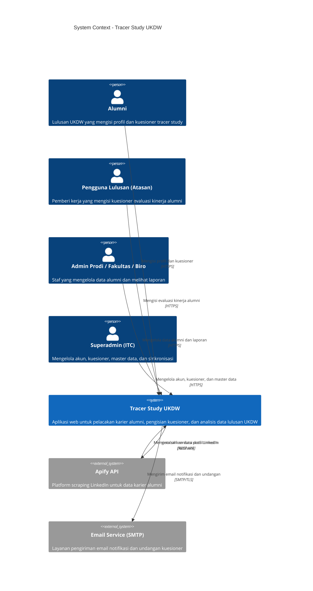
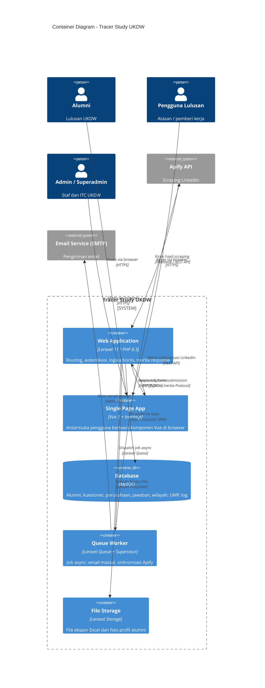

# C4 Diagram — Tracer Study UKDW

> Referensi: [C4 Model](https://c4model.com) — Simon Brown

---

## Level 1 — System Context

Menunjukkan posisi Sistem Tracer Study UKDW di antara penggunanya dan sistem eksternal.

---

## Level 2 — Container

Menunjukkan container teknis di dalam sistem Tracer Study UKDW.

