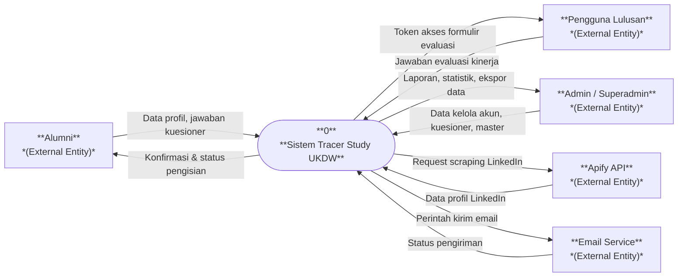

# Data Flow Diagram (DFD) — Tracer Study UKDW

> Referensi notasi: Kendall & Kendall (2020), *Systems Analysis and Design*, 10th Edition.
> Simbol: **proses** = persegi panjang berlabel nomor, **external entity** = persegi panjang,
> **data store** = dua garis horizontal (D1, D2…), **data flow** = panah berlabel.

---

## Diagram Konteks (Level 0)

Menggambarkan sistem sebagai satu proses tunggal beserta seluruh entitas eksternal.

---

## DFD Level 1 — Dekomposisi Proses Utama

Memperinci proses utama dalam Sistem Tracer Study UKDW.

```mermaid
flowchart TB
    alumni["**Alumni**"]
    atasan["**Pengguna Lulusan**"]
    admin["**Admin**"]
    superadmin["**Superadmin**"]
    apify["**Apify API**"]
    smtp["**Email Service**"]

    p1(["**1.0**\nAutentikasi\n& Akun"])
    p2(["**2.0**\nKelola\nProfil Alumni"])
    p3(["**3.0**\nPengisian\nKuesioner"])
    p4(["**4.0**\nEvaluasi\nPengguna Lulusan"])
    p5(["**5.0**\nSinkronisasi\nLinkedIn"])
    p6(["**6.0**\nLaporan\n& Ekspor"])
    p7(["**7.0**\nKelola Master\n& Konfigurasi"])

    d1[("D1 · users")]
    d2[("D2 · biodata")]
    d3[("D3 · kuesioner\n& jawaban")]
    d4[("D4 · evaluasi_atasan")]
    d5[("D5 · perusahaan")]
    d6[("D6 · linkedin\n_sync_results")]
    d7[("D7 · master\n(prodi, wilayah, ump)")]

    %% Autentikasi
    alumni      -->|"Kredensial login"| p1
    admin       -->|"Kredensial login"| p1
    superadmin  -->|"Kredensial login"| p1
    p1          -->|"Sesi autentikasi"| d1
    d1          -->|"Data akun"| p1

    %% Profil Alumni
    alumni      -->|"Data profil & perusahaan"| p2
    p2          <-->|"Baca/tulis biodata"| d2
    p2          <-->|"Baca/tulis perusahaan"| d5

    %% Kuesioner
    alumni      -->|"Jawaban kuesioner"| p3
    p3          <-->|"Baca instrumen & simpan jawaban"| d3

    %% Evaluasi Atasan
    atasan      -->|"Jawaban evaluasi kinerja"| p4
    p4          -->|"Token akses"| atasan
    p4          <-->|"Baca/tulis evaluasi"| d4
    p4          -->|"Kirim undangan"| smtp

    %% Sinkronisasi LinkedIn
    admin       -->|"Trigger sinkronisasi"| p5
    p5          -->|"Request scraping"| apify
    apify       -->|"Data profil LinkedIn"| p5
    p5          <-->|"Simpan hasil scraping"| d6
    p5          -->|"Update profil tersetujui"| d2

    %% Laporan & Ekspor
    admin       -->|"Parameter laporan & ekspor"| p6
    p6          -->|"Laporan & file ekspor"| admin
    p6          <-->|"Baca data alumni & jawaban"| d2
    p6          <-->|"Baca jawaban kuesioner"| d3

    %% Kelola Master
    superadmin  -->|"Data master & konfigurasi"| p7
    p7          <-->|"Baca/tulis master"| d7
    p7          <-->|"Baca/tulis instrumen"| d3
```

---

## Keterangan Data Store

| ID | Nama Store | Tabel Utama |
|:---|:---|:---|
| D1 | Akun Pengguna | `users` |
| D2 | Profil Alumni | `biodata`, `perusahaan`, `atasan` |
| D3 | Instrumen & Jawaban | `kuesioner`, `kuesioner_section`, `kuesioner_pertanyaan`, `kuesioner_jawaban` |
| D4 | Evaluasi Pengguna Lulusan | `evaluasi_atasan` |
| D5 | Master Perusahaan | `perusahaan` |
| D6 | Hasil Sinkronisasi LinkedIn | `linkedin_sync_results` |
| D7 | Data Master | `prodi`, `ref_fakultas`, `propinsi`, `kabupaten`, `ref_negara`, `ump` |
