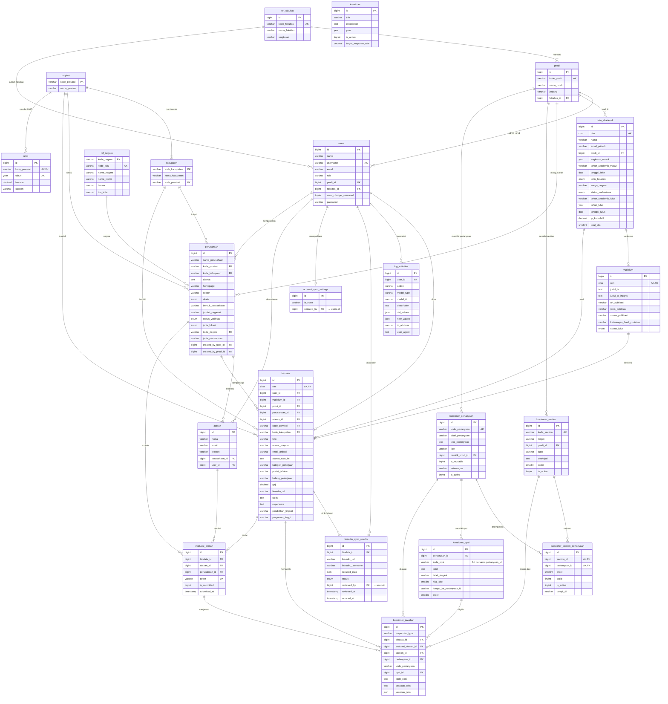

# Entity Relationship Diagram (ERD) — Tracer Study UKDW

> Notasi: Crow's Foot (Mermaid `erDiagram`).
> **PK** = Primary Key · **AK** = Alternate Key · **FK** = Foreign Key · **UK** = Unique Key
>
> Catatan: Tabel `kuesioner` belum terhubung ke tabel lain melalui FK — koneksi ke `kuesioner_jawaban` dijadwalkan ditambahkan.

---

