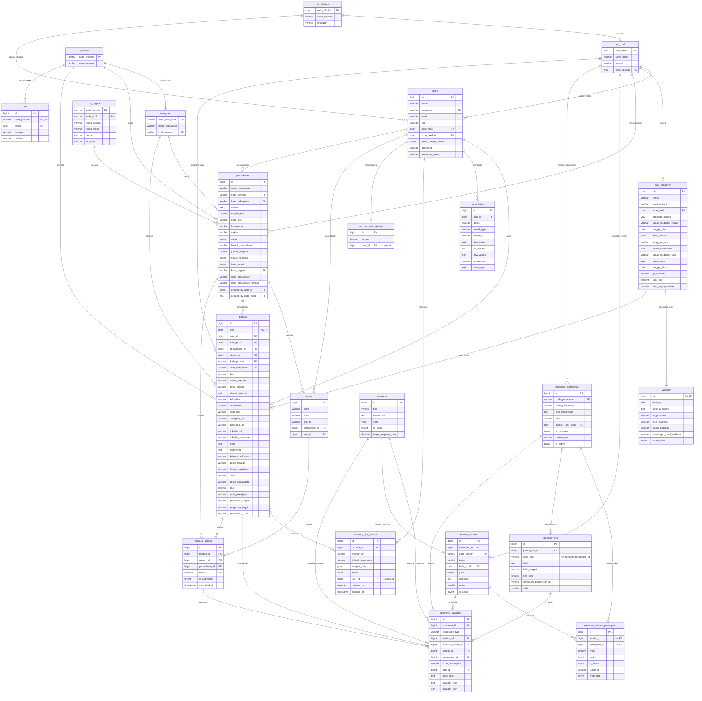

# Entity Relationship Diagram (ERD) — Tracer Study UKDW

> Notasi: Crow's Foot (Mermaid `erDiagram`).
> **PK** = Primary Key · **AK** = Alternate Key · **FK** = Foreign Key · **UK** = Unique Key
>
> Seluruh instrumen kuesioner (Universitas, Program Studi, dan Evaluasi Pengguna Lulusan/Atasan) terhubung secara terpadu (*Unified Survey Engine*), dengan relasi langsung periode kuesioner ke respon jawaban.

---

