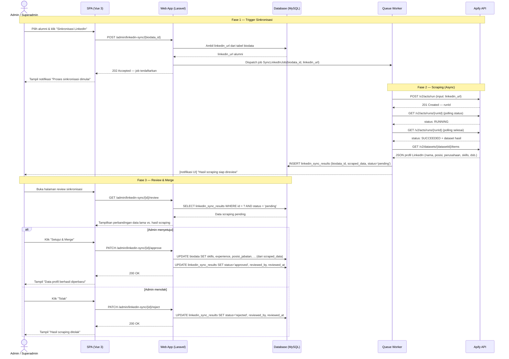
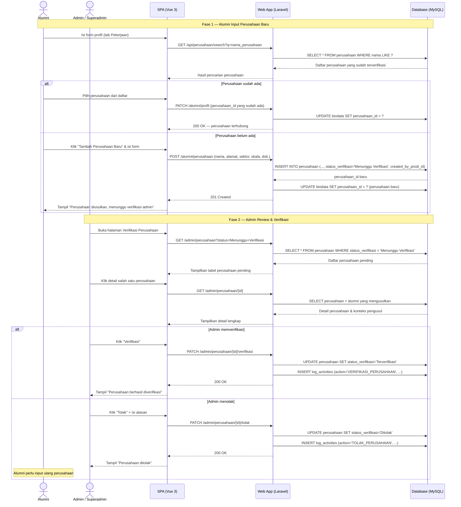

# Sequence Diagram — Tracer Study UKDW

> Diagram interaksi antar objek untuk use case utama yang melibatkan sistem eksternal.
> Menggunakan notasi Mermaid `sequenceDiagram` — dapat dirender langsung di GitHub.

---

## UC-08 — Sinkronisasi LinkedIn via Apify

Proses pengambilan data profil karier alumni dari LinkedIn menggunakan layanan scraping Apify.
Alur dibagi dua fase: **Trigger & Scraping** dan **Review & Merge**.

---

## UC-07 — Verifikasi & Rekomendasi Perusahaan

Proses alumni mengusulkan perusahaan baru dan admin memverifikasi kelayakannya sebelum masuk master data.

