# Dokumen Spesifikasi Data Flow Diagram (DFD) — Sistem Informasi Tracer Study UKDW

Dokumen ini menyajikan perancangan dan spesifikasi formal **Data Flow Diagram (DFD)** untuk Sistem Informasi Tracer Study Universitas Kristen Duta Wacana (UKDW), yang disusun mengacu penuh pada standar acuan akademik:
**Kenneth E. Kendall & Julie E. Kendall, *Systems Analysis and Design*, Tenth Edition, Global Edition (Pearson, 2020), Chapter 7: *Using Data Flow Diagrams*, halaman 224–254**.

---

## 1. Landasan Teori & Kaidah Baku Kendall & Kendall (Edisi Ke-10)

Berdasarkan Kendall & Kendall (2020, hlm. 226–234), DFD adalah teknik analisis terstruktur yang merepresentasikan bagaimana data mengalir, ditransformasikan oleh proses, dan disimpan dalam suatu organisasi.

### 1.1 Empat Simbol Dasar DFD

Sistem dan seluruh subsistem dimodelkan hanya menggunakan kombinasi **empat simbol dasar**:

| Simbol Visual | Nama Komponen | Deskripsi & Aturan Penamaan (Kendall hlm. 226–227) |
| :---: | :--- | :--- |
| **Kotak Ganda (*Double Square*)** | **Entitas Eksternal (*External Entity / Source & Destination*)** | Pihak luar (orang, departemen, organisasi, atau sistem eksternal) yang mengirimkan data ke sistem atau menerima data dari sistem. Berada di luar batas sistem (*outside system boundary*). Diberi nama menggunakan **Kata Benda (*Noun*)**. Entitas yang sama dapat digambar lebih dari sekali untuk mencegah garis bersilangan (*crossing lines*). |
| **Panah (*Arrow*)** | **Aliran Data (*Data Flow*)** | Menunjukkan pergerakan data dari satu titik ke titik lain dengan kepala panah menunjuk ke arah tujuan. Karena merepresentasikan data (bukan kontrol/keputusan), aliran data wajib dinamai menggunakan **Kata Benda (*Noun*)**, misal: `Data Mahasiswa Lulus`, `Jawaban Kuesioner Tracer`. |
| **Persegi Membulat (*Rectangle with Rounded Corners*)** | **Proses Transformasi (*Transforming Process*)** | Menunjukkan pekerjaan atau perubahan bentuk data. Aliran data yang keluar dari proses harus memiliki nama berbeda dari aliran yang masuk. Penamaan menggunakan format **Kata Kerja – Kata Sifat – Kata Benda (*Verb–Adjective–Noun*)**, misal: `Kelola Akun Pengguna`, `Validasi Data Profil`, `Proses Kuesioner Tracer`. Memiliki nomor unik (0 untuk Konteks, 1–9 untuk Diagram 0, 1.1, 1.2 untuk Diagram Anak). |
| **Persegi Terbuka Kanan (*Open-Ended Rectangle*)** | **Simpanan Data Logis (*Data Store*)** | Tempat penyimpanan data permanen (berupa berkas master, basis data, atau berkas transaksi). Dinamai dengan **Kata Benda (*Noun*)** dan diberi nomor referensi unik (`D1`, `D2`, `D3`, dst.). |

### 1.2 Aturan Sintaksis & Integritas Diagram (Kendall hlm. 227–232)

1. **Integritas Aliran Data Proses**:
   - Setiap proses harus memiliki minimal satu aliran data masuk (*input*) dan minimal satu aliran data keluar (*output*).
   - Dilarang membuat proses tanpa keluaran (*Black Hole*), proses tanpa masukan (*Miracle*), atau proses dengan keluaran yang tidak dapat dibentuk dari masukannya (*Gray Hole*).
2. **Koneksi Simpanan Data & Entitas**:
   - Entitas eksternal **dilarang terhubung langsung** ke Simpanan Data (harus melalui proses penengah).
   - Entitas eksternal **dilarang terhubung langsung** ke Entitas Eksternal lain di dalam diagram sistem.
   - Simpanan Data **dilarang terhubung langsung** ke Simpanan Data lain tanpa proses transformasi.
3. **Batas Jumlah Proses Diagram 0**:
   - Diagram 0 adalah ledakan (*explosion*) dari Diagram Konteks dan dibatasi **antara 3 hingga 9 proses**. Lebih dari 9 proses akan membuat diagram terlalu padat (*cluttered*) dan menyulitkan pemahaman.
4. **Keseimbangan Vertikal (*Vertical Balancing*)**:
   - Seluruh aliran data masukan dan keluaran yang terhubung pada proses induk di Diagram 0 harus muncul secara persis (*interface data flow*) pada child diagram yang meledakkannya. Diagram anak tidak boleh menerima masukan atau menghasilkan keluaran luar yang tidak dimiliki proses induknya.
5. **Penolakan Aliran Linier (*Avoiding Linear Flow Error*)**:
   - Aliran proses berantai satu arah (A $\rightarrow$ B $\rightarrow$ C) seperti flowchart dilarang. Proses DFD bekerja secara berulang/bersamaan berdasarkan ketersediaan data.
6. **Diagram Konteks Tanpa Simpanan Data**:
   - Diagram Konteks hanya memuat entitas eksternal, aliran data antarmuka, dan proses 0. Tidak ada *data store* yang digambarkan pada tingkat konteks.

---

## 2. Batas Sistem & Analisis Entitas Eksternal Sistem Tracer

Batas sistem (*system boundary*) adalah batasan perangkat lunak aplikasi web **Sistem Informasi Tracer Study UKDW**. Pihak atau sistem apa pun yang berinteraksi dari luar batas aplikasi diklasifikasikan sebagai **Entitas Eksternal**:

### 2.1 Entitas Sistem Eksternal (Mesin / Perangkat Lunak Luar)

Sesuai penegasan Kendall & Kendall (hlm. 226) bahwa entitas eksternal dapat berupa *"another machine or system"*, sistem ini terhubung dengan 3 sistem eksternal:

1. **`Sistem Akademik (SIAKAD UKDW)`**:
   - **Peran**: Sistem informasi akademik sentral universitas (Biro 1).
   - **Aliran Masuk ke Tracer**: Mengirimkan `Data Mahasiswa Lulus` (NIM, Nama, Prodi, Tanggal Masuk, Tanggal Lulus, IPK) dan `Data Kelulusan & Yudisium` (Nomor SK Yudisium, Tanggal Kelulusan Resmi, Judul Skripsi/Tugas Akhir).
2. **`Sistem Referensi Universitas (SIM Referensi)`**:
   - **Peran**: Sistem master data institusi dan pangkalan data referensi terpusat universitas.
   - **Aliran Masuk ke Tracer**: Mengirimkan data referensi organisasi internal (`Referensi Fakultas & Program Studi`) serta referensi standar wilayah nasional (`Referensi Provinsi & Kota BPS/Kemendagri`, `Kode Negara ISO`, dan `Standar UMP Tahunan`).
3. **`Layanan Eksternal Apify (LinkedIn Engine)`**:
   - **Peran**: Penyedia layanan otomatisasi web scraping API pihak ketiga.
   - **Interaksi**: Menerima `URL Profil LinkedIn Sasaran` dari sistem Tracer, dan mengembalikan `Data Snapshot Mentah LinkedIn`.

### 2.2 Entitas Pengguna Manusia (*Human External Entities*)

1. **`Alumni`**: Lulusan UKDW yang memperbarui profil karier, mengusulkan instansi tempat bekerja, serta menjawab instrumen kuesioner tracer universitas dan program studi.
2. **`Pengguna Lulusan (Atasan Langsung)`**: Pimpinan instansi tempat alumni bekerja yang menerima tautan evaluasi berbasis token tanpa akun login, untuk menilai kompetensi dan kinerja alumni.
3. **`Admin Program Studi`**: Staf pengelola tingkat program studi yang mengelola instrumen prodi, memverifikasi usulan instansi alumni prodi, dan memantau kinerja lulusan prodinya.
4. **`Admin Fakultas`**: Pimpinan dan staf fakultas yang memantau capaian kinerja lulusan lintas prodi di bawah fakultas bersangkutan.
5. **`Admin Biro 3 (Kemahasiswaan & Alumni)`**: Pengelola tingkat universitas yang mengelola instrumen universitas, memantau tingkat partisipasi (*response rate*), dan menyusun laporan IKU S1.
6. **`Superadmin (ITC)`**: Administrator teknologi informasi universitas yang mengelola akun sistem, otorisasi peran, konfigurasi sinkronisasi, dan audit sistem.

---

## 3. Daftar Penyimpanan Data Logis (*Data Stores*)

Mengacu pada kamus data basis data aktif sistem tracer study:

| Kode Simpanan | Nama Simpanan Logis (*Data Store Name*) | Tabel Basis Data Terkait | Peran dalam Sistem |
| :---: | :--- | :--- | :--- |
| **`D1`** | **Data Pengguna & Akun** | `users`, `password_reset_tokens` | Menyimpan kredensial autentikasi, username/NIM, peran otorisasi, dan token pemulihan sandi. |
| **`D2`** | **Master Akademik & Yudisium** | `data_akademik`, `yudisium` | Menyimpan rekaman riwayat akademik mahasiswa lulus dan berkas yudisium dari Sistem Akademik. |
| **`D3`** | **Data Biodata & Profil Alumni** | `biodata` | Menyimpan profil terintegrasi alumni (identitas, kontak, domisili, status karier kanonik F8, riwayat pekerjaan, dan studi lanjut). |
| **`D4`** | **Master Perusahaan & Kontak Atasan** | `perusahaan`, `atasan` | Menyimpan data instansi kerja alumni (nama, skala, wilayah) dan snapshot kontak pimpinan/atasan langsung. |
| **`D5`** | **Instrumen & Bank Soal Kuesioner** | `kuesioner`, `kuesioner_section`, `kuesioner_pertanyaan`, `kuesioner_section_pertanyaan`, `kuesioner_opsi` | Menyimpan bank soal survei terpadu (*Unified Survey Engine*), konfigurasi stepper/bagian, dan opsi jawaban berbobot. |
| **`D6`** | **Jawaban Survei Terpadu** | `kuesioner_jawaban` | *Single Source of Truth* seluruh respon jawaban survei tracer universitas, prodi, maupun evaluasi atasan. |
| **`D7`** | **Sesi Evaluasi Atasan** | `evaluasi_atasan` | Menyimpan lembar transaksi survei kepuasan atasan berbasis token acak 64-karakter dan status penyelesaiannya. |
| **`D8`** | **Staging Sinkronisasi LinkedIn** | `linkedin_sync_results` | Menyimpan data mentah hasil penarikan profil LinkedIn sebelum diverifikasi menjadi riwayat karier aktif. |
| **`D9`** | **Referensi Wilayah, Organisasi & UMP** | `propinsi`, `kabupaten`, `ref_negara`, `ump`, `ref_fakultas`, `prodi` | Menyimpan tabel referensi master institusi dan wilayah administratif standar nasional. |
| **`D10`** | **Log Aktivitas Audit** | `log_activities` | Menyimpan rekam jejak audit (*audit trail*) atas aksi mutasi data penting yang dilakukan pengguna/admin. |

---

## 4. Diagram Konteks (Context Diagram — Tingkat Tertinggi)

Diagram Konteks memberikan gambaran *bird's-eye view* atas batas sistem, memuat **satu proses tunggal bernomor 0**, 9 entitas eksternal, dan seluruh aliran data antarmuka (*interface flows*).

```mermaid
flowchart TD
    %% Entitas Sistem Luar
    E_AKAD["Sistem Akademik (SIAKAD)"]
    E_REF["Sistem Referensi Universitas (SIM Referensi)"]
    E_APIFY["Layanan Apify (LinkedIn Engine)"]

    %% Entitas Pengguna Manusia
    E_ALUMNI["Alumni"]
    E_ATASAN["Pengguna Lulusan (Atasan)"]
    E_PRODI["Admin Program Studi"]
    E_FAK["Admin Fakultas"]
    E_BIRO3["Admin Biro 3 (Kemahasiswaan)"]
    E_SUPER["Superadmin (ITC)"]

    %% Proses Konteks Tunggal
    P0(("0<br/>Sistem Informasi<br/>Tracer Study UKDW"))

    %% Aliran Sistem Akademik & Referensi
    E_AKAD -->|"Data Mahasiswa Lulus & Yudisium"| P0
    E_REF -->|"Data Referensi Fakultas, Prodi, Wilayah & UMP"| P0

    %% Aliran Alumni
    E_ALUMNI -->|"Kredensial Login & Permohonan Akun"| P0
    E_ALUMNI -->|"Data Profil, Riwayat Karier & Usulan Instansi"| P0
    E_ALUMNI -->|"Jawaban Kuesioner Tracer (Univ & Prodi)"| P0
    P0 -->|"Status Akun & Hasil Pemulihan Sandi"| E_ALUMNI
    P0 -->|"Status Keterisian Profil & Kuesioner"| E_ALUMNI

    %% Aliran Pengguna Lulusan (Atasan)
    P0 -->|"Tautan Evaluasi Berbasis Token"| E_ATASAN
    E_ATASAN -->|"Jawaban Evaluasi Aspek Kinerja"| P0
    P0 -->|"Konfirmasi Penyerahan Evaluasi"| E_ATASAN

    %% Aliran Admin Prodi
    E_PRODI -->|"Kredensial Login"| P0
    E_PRODI -->|"Instrumen Kuesioner Prodi"| P0
    E_PRODI -->|"Keputusan Verifikasi Perusahaan & Staging LinkedIn"| P0
    P0 -->|"Laporan Kinerja Lulusan & Rekapitulasi Prodi"| E_PRODI

    %% Aliran Admin Fakultas
    E_FAK -->|"Kredensial Login"| P0
    P0 -->|"Laporan Kinerja Lulusan Fakultas"| E_FAK

    %% Aliran Admin Biro 3
    E_BIRO3 -->|"Kredensial Login"| P0
    E_BIRO3 -->|"Konfigurasi Kuesioner Universitas"| P0
    P0 -->|"Laporan Eksekutif, Response Rate & Capaian IKU S1"| E_BIRO3

    %% Aliran Superadmin
    E_SUPER -->|"Kredensial Login"| P0
    E_SUPER -->|"Pengaturan Akun & Parameter Konfigurasi"| P0
    P0 -->|"Laporan Audit Trail & Log Aktivitas Sistem"| E_SUPER

    %% Aliran Apify
    P0 -->|"URL Profil LinkedIn Sasaran"| E_APIFY
    E_APIFY -->|"Data Snapshot Mentah LinkedIn"| P0
```

---

## 5. Diagram 0 (Level 0 Logical DFD — Ledakan Diagram Konteks)

Diagram 0 meledakkan Proses 0 menjadi **9 proses fungsional utama** bernomor bulat 1.0 s.d. 9.0, mematuhi batas maksimal 9 proses Kendall & Kendall.

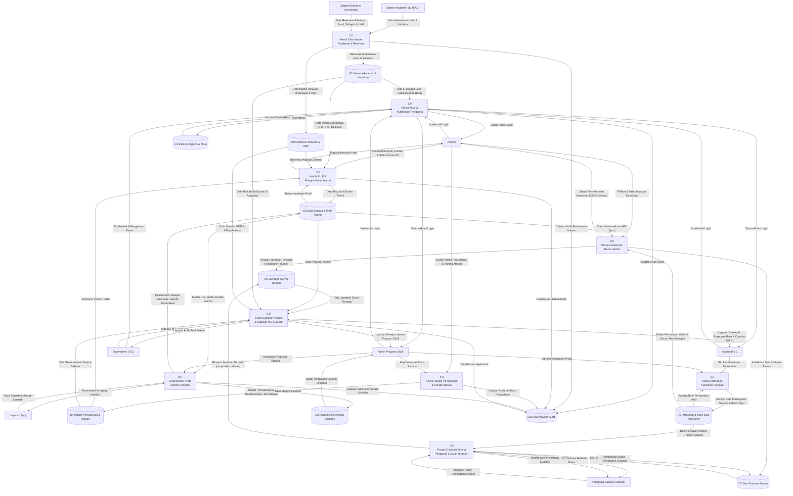

---

## 6. Diagram Rinci / Child Diagram (Level 1)

Setiap diagram anak di bawah meledakkan satu proses induk di Diagram 0 dengan menjaga **keseimbangan vertikal (*vertical balancing*)**. Sembilan proses induk diuraikan secara lengkap sehingga seluruh fitur aplikasi terpetakan secara utuh:

### 6.1 Diagram 1: Kelola Akun & Autentikasi Pengguna
Meledakkan **Proses 1.0** yang menangani otentikasi multi-peran, ubah kata sandi, dan reset sandi.

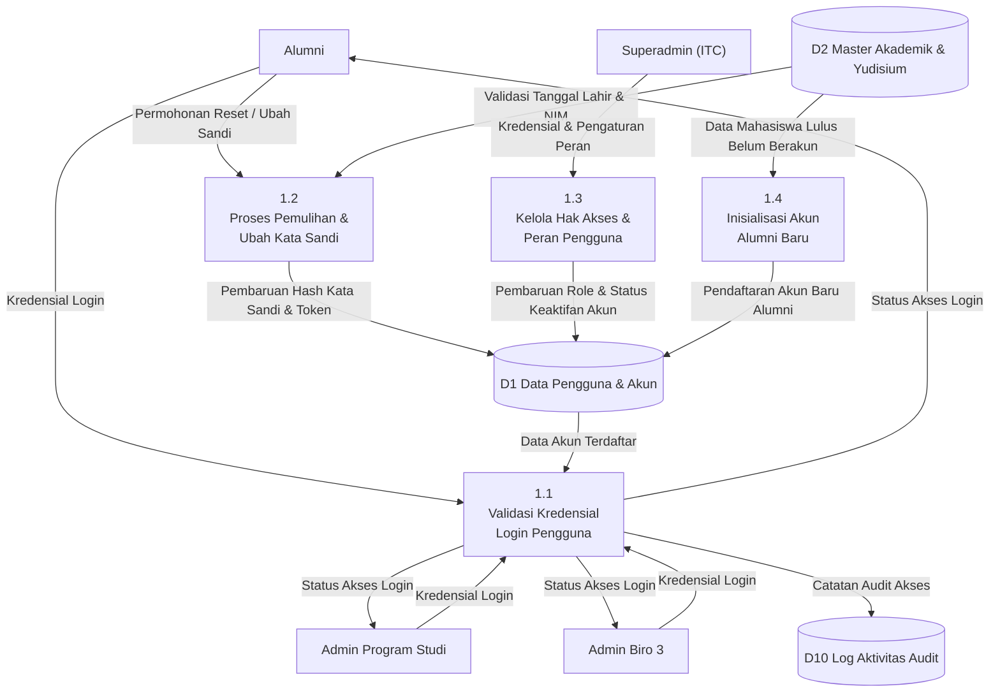

### 6.2 Diagram 2: Kelola Data Master Akademik & Referensi
Meledakkan **Proses 2.0** yang menerima data dari kedua sistem eksternal (`Sistem Akademik` dan `Sistem Referensi`).

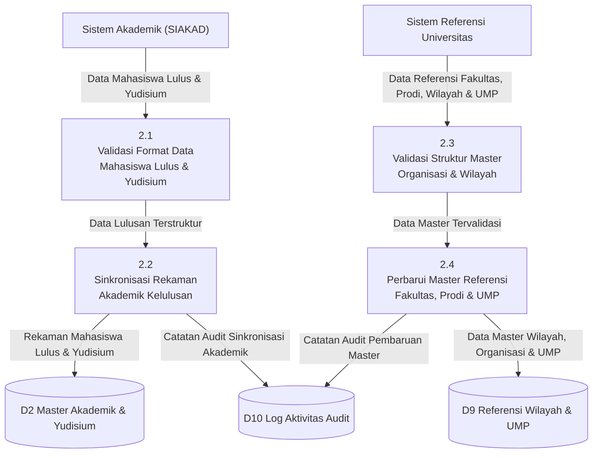

### 6.3 Diagram 3: Kelola Profil & Riwayat Karier Alumni
Meledakkan **Proses 3.0** yang menangani pengisian identitas pribadi, domisili, sinkronisasi 5 status karier F8, dan riwayat pekerjaan/studi lanjut.

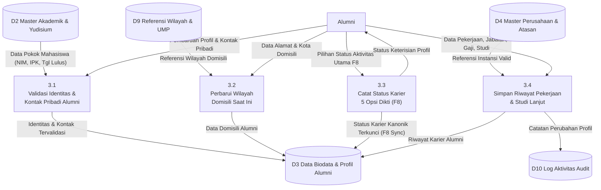

### 6.4 Diagram 4: Kelola Usulan Perusahaan & Kontak Atasan
Meledakkan **Proses 4.0** yang menangani usulan perusahaan baru, rekomendasi kemiripan instansi, verifikasi, dan manajemen kontak atasan.

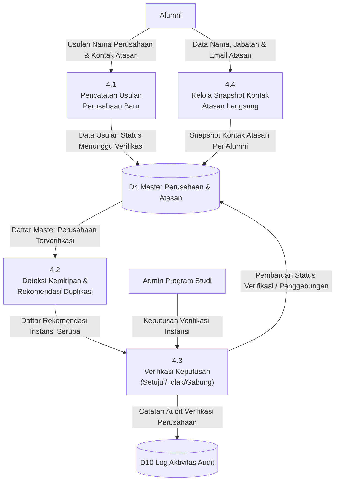

### 6.5 Diagram 5: Kelola Instrumen Kuesioner Terpadu
Meledakkan **Proses 5.0** yang menangani periode kuesioner, pembuatan section/stepper, butir bank pertanyaan, opsi pilihan, dan penempatan soal.

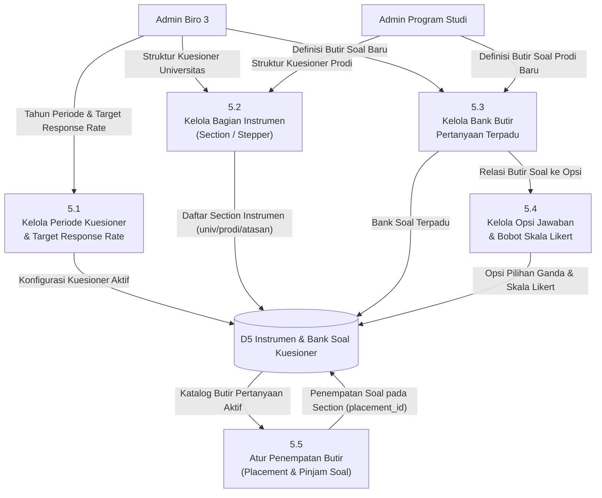

### 6.6 Diagram 6: Proses Kuesioner Tracer Alumni
Meledakkan **Proses 6.0** yang menangani pengisian survei universitas & prodi, validasi status karier F8, perhitungan kelengkapan 100%, serta inisialisasi sesi token atasan.

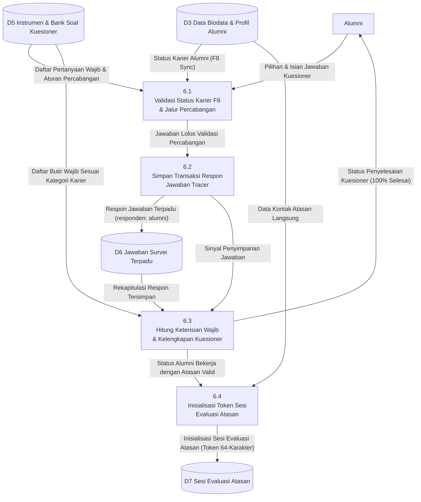

### 6.7 Diagram 7: Proses Evaluasi Kinerja Pengguna Lulusan (Atasan)
Meledakkan **Proses 7.0** yang memfasilitasi penilaian kinerja alumni oleh pimpinan langsung tanpa perlu login akun.

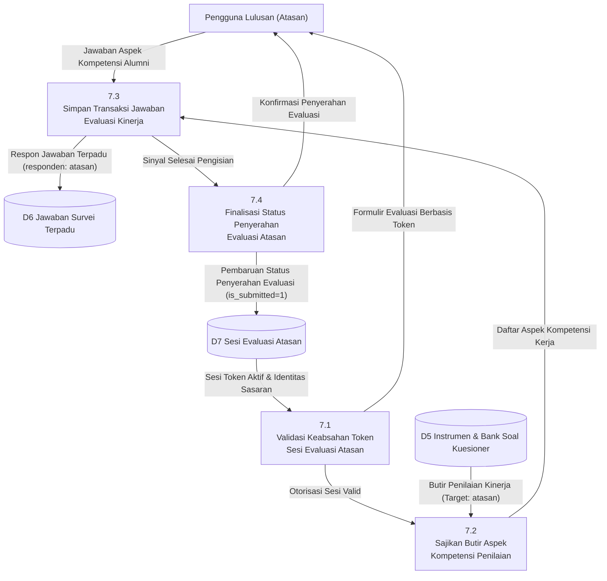

### 6.8 Diagram 8: Sinkronisasi & Verifikasi Profil LinkedIn
Meledakkan **Proses 8.0** yang menangani permintaan penarikan profil via Apify, penampungan staging, dan persetujuan data karier alumni.

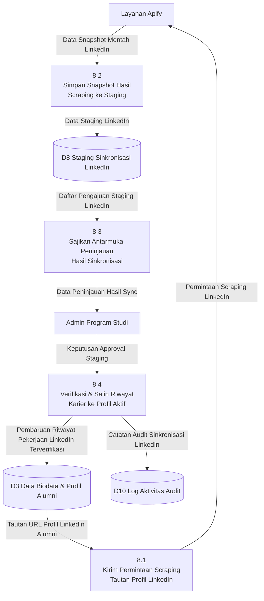

### 6.9 Diagram 9: Susun Laporan Analitik & Capaian IKU
Meledakkan **Proses 9.0** yang menyusun analitik tracer, evaluasi atasan, rekapitulasi IKU S1, blast pengingat, dan ekspor laporan.

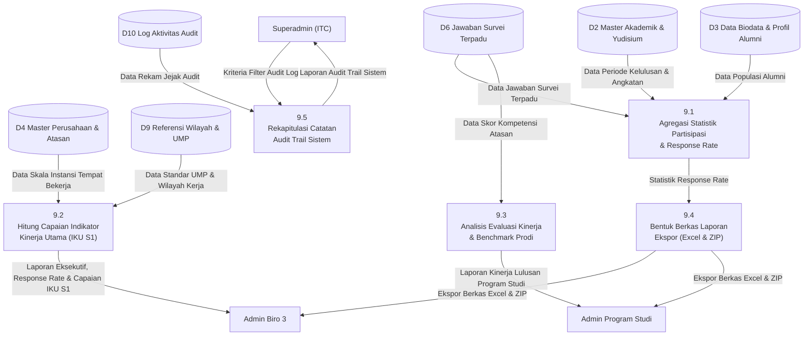

---

## 7. Matriks Keseimbangan Vertikal (*Vertical Balancing Matrix*)

Sesuai aturan Kendall & Kendall (hlm. 230), tabel berikut membuktikan bahwa seluruh aliran data pada 9 child diagram konsisten 100% dengan proses induknya di Diagram 0:

| Proses Induk (Diagram 0) | Aliran Data Masuk (*Input Interface Flow*) | Aliran Data Keluar (*Output Interface Flow*) | Anak Proses Penanggung Jawab | Status Seimbang |
| :--- | :--- | :--- | :--- | :---: |
| **1.0 Kelola Akun & Autentikasi Pengguna** | • `Kredensial Login` (dari `Alumni, Prodi, Biro3, Super`) • `Kredensial & Pengaturan Peran` (dari `Superadmin`) • `NIM & Tanggal Lahir` (dari `D2`) | • `Data Akun Terverifikasi` (ke `D1`) • `Status Akses Login` (ke pengguna) • `Catatan Audit Akses` (ke `D10`) | • Proses 1.1 • Proses 1.2 • Proses 1.3 • Proses 1.4 | **Seimbang (*Balanced*)** |
| **2.0 Kelola Data Master Akademik & Referensi** | • `Data Mahasiswa Lulus & Yudisium` (dari `Sistem Akademik`) • `Data Referensi Fakultas, Prodi, Wilayah & UMP` (dari `Sistem Referensi`) | • `Rekaman Mahasiswa Lulus & Yudisium` (ke `D2`) • `Data Master Wilayah, Organisasi & UMP` (ke `D9`) • `Catatan Audit Pembaruan Master` (ke `D10`) | • Proses 2.1 & 2.2 • Proses 2.3 & 2.4 | **Seimbang (*Balanced*)** |
| **3.0 Kelola Profil & Riwayat Karier Alumni** | • `Pembaruan Profil, Kontak & Status Karier F8` (dari `Alumni`) • `Data Pokok Mahasiswa` (dari `D2`) • `Referensi Wilayah Domisili` (dari `D9`) • `Referensi Instansi Valid` (dari `D4`) | • `Data Biodata & Karier Terkini` (ke `D3`) • `Status Keterisian Profil` (ke `Alumni`) • `Catatan Perubahan Profil` (ke `D10`) | • Proses 3.1 • Proses 3.2 • Proses 3.3 • Proses 3.4 | **Seimbang (*Balanced*)** |
| **4.0 Kelola Usulan Perusahaan & Kontak Atasan** | • `Usulan Nama Perusahaan & Kontak Atasan` (dari `Alumni`) • `Keputusan Verifikasi Instansi` (dari `Admin Prodi`) | • `Master Perusahaan & Kontak Atasan Terverifikasi` (ke `D4`) • `Catatan Audit Verifikasi Perusahaan` (ke `D10`) | • Proses 4.1 • Proses 4.2 • Proses 4.3 • Proses 4.4 | **Seimbang (*Balanced*)** |
| **5.0 Kelola Instrumen Kuesioner Terpadu** | • `Struktur Kuesioner Universitas` (dari `Admin Biro 3`) • `Struktur Kuesioner Prodi` (dari `Admin Prodi`) | • `Definisi Butir Pertanyaan, Section & Bobot Opsi` (ke `D5`) | • Proses 5.1 • Proses 5.2 • Proses 5.3 • Proses 5.4 • Proses 5.5 | **Seimbang (*Balanced*)** |
| **6.0 Proses Kuesioner Tracer Alumni** | • `Pilihan & Isian Jawaban Kuesioner` (dari `Alumni`) • `Daftar Pertanyaan Wajib & Aturan Percabangan` (dari `D5`) • `Status Karier Alumni (F8 Sync)` (dari `D3`) | • `Respon Jawaban Terpadu (responden: alumni)` (ke `D6`) • `Status Penyelesaian Kuesioner (100% Selesai)` (ke `Alumni`) • `Inisialisasi Sesi Evaluasi Atasan` (ke `D7`) | • Proses 6.1 • Proses 6.2 • Proses 6.3 • Proses 6.4 | **Seimbang (*Balanced*)** |
| **7.0 Proses Evaluasi Kinerja Pengguna Lulusan** | • `Sesi Token Aktif & Identitas Sasaran` (dari `D7`) • `Butir Penilaian Kinerja (Target: atasan)` (dari `D5`) • `Jawaban Aspek Kompetensi Alumni` (dari `Atasan`) | • `Formulir Evaluasi Berbasis Token` (ke `Atasan`) • `Respon Jawaban Terpadu (responden: atasan)` (ke `D6`) • `Pembaruan Status Penyerahan Evaluasi` (ke `D7`) • `Konfirmasi Penyerahan Evaluasi` (ke `Atasan`) | • Proses 7.1 • Proses 7.2 • Proses 7.3 • Proses 7.4 | **Seimbang (*Balanced*)** |
| **8.0 Sinkronisasi & Verifikasi Profil LinkedIn** | • `Tautan URL Profil LinkedIn Alumni` (dari `D3`) • `Data Snapshot Mentah LinkedIn` (dari `Apify`) • `Keputusan Approval Staging` (dari `Admin Prodi`) | • `Permintaan Scraping LinkedIn` (ke `Apify`) • `Data Staging LinkedIn` (ke `D8`) • `Pembaruan Riwayat Pekerjaan LinkedIn Terverifikasi` (ke `D3`) • `Catatan Audit Sinkronisasi LinkedIn` (ke `D10`) | • Proses 8.1 • Proses 8.2 • Proses 8.3 • Proses 8.4 | **Seimbang (*Balanced*)** |
| **9.0 Susun Laporan Analitik & Capaian IKU** | • `Data Jawaban Survei Terpadu` (dari `D6`) • `Data Populasi Alumni` (dari `D3`) • `Data Periode Kelulusan & Angkatan` (dari `D2`) • `Data Skala Instansi Tempat Bekerja` (dari `D4`) • `Data Standar UMP & Wilayah Kerja` (dari `D9`) • `Data Rekam Jejak Audit` (dari `D10`) | • `Laporan Eksekutif, Response Rate & Capaian IKU S1` (ke `Admin Biro 3`) • `Laporan Kinerja Lulusan Program Studi` (ke `Admin Prodi`) • `Laporan Audit Trail Sistem` (ke `Superadmin`) • `Ekspor Berkas Excel & ZIP` (ke admin) | • Proses 9.1 • Proses 9.2 • Proses 9.3 • Proses 9.4 • Proses 9.5 | **Seimbang (*Balanced*)** |

---

## 8. Kamus Aliran Data (*Data Flow Dictionary*)

Mengacu pada Kendall & Kendall (hlm. 237–238), struktur rincian data untuk setiap paket aliran data adalah sebagai berikut:

| Nama Aliran Data | Bentuk / Tipe Data | Komposisi Elemen Data Pokok |
| :--- | :--- | :--- |
| **`Data Mahasiswa Lulus & Yudisium`** | Paket Data Eksternal | `NIM` + `Nama Mahasiswa` + `Kode Prodi` + `Tanggal Masuk` + `Tanggal Kelulusan Resmi` + `IPK Kelulusan` + `Nomor SK Yudisium` + `Judul Skripsi/Tugas Akhir` + `Periode Akademik Lulus` |
| **`Data Referensi Fakultas, Prodi, Wilayah & UMP`** | Paket Data Eksternal | `Kode Fakultas` + `Nama Fakultas` + `Kode Prodi` + `Nama Prodi` + `Jenjang` + `Kode Provinsi` + `Nama Provinsi` + `Kode Kota/Kabupaten` + `Nama Kota/Kabupaten` + `Kode Negara ISO` + `Nominal UMP` + `Tahun Berlaku UMP` |
| **`Data Profil, Riwayat Karier & Usulan Instansi`** | Transaksi Pengguna | `NIM` + `Nomor Telepon` + `Email Pribadi` + `Alamat Domisili` + `Kode Kota Domisili` + `Kategori Karier F8` + `Nama Perusahaan` + `Jabatan` + `Kisaran Gaji` + `Nama Atasan Langsung` + `Kontak/Email Atasan` |
| **`Pilihan & Isian Jawaban Kuesioner`** | Transaksi Pengguna | `NIM / Biodata ID` + `Kode Section` + `ID Butir Pertanyaan` + `ID Opsi Terpilih` + `Jawaban Teks Bebas` + `Nilai Skala Likert` + `Timestamp Pengisian` |
| **`Jawaban Aspek Kompetensi Alumni`** | Transaksi Pengguna | `Token Evaluasi` + `Biodata ID Sasaran` + `ID Butir Penilaian Kinerja` + `Nilai Skor Likert 1-5` + `Komentar Kualitatif Atasan` + `Timestamp Submit` |
| **`Laporan Eksekutif, Response Rate & Capaian IKU S1`** | Dokumen Keluaran | `Tahun Periode Tracer` + `Populasi Lulusan S1 (TS-1)` + `Jumlah Responden Mengisi` + `Persentase Response Rate` + `Jumlah Lulusan Mendapat Pekerjaan Layak` + `Jumlah Lulusan Studi Lanjut` + `Jumlah Lulusan Wiraswasta` + `Skor Capaian Bobot IKU S1` |
| **`Laporan Audit Trail & Log Aktivitas Sistem`** | Dokumen Keluaran | `ID Log` + `User ID Pelaku` + `Username / Role` + `Kode Aksi (ACTION_TYPE)` + `Model Terkena Mutasi` + `ID Rekaman Target` + `Deskripsi Perubahan Data` + `IP Address` + `Waktu Kejadian` |

---

## 9. Kesimpulan & Panduan Presentasi Tugas Akhir

1. **Pemenuhan Kaidah Kendall & Kendall**:
   - Seluruh simbol, penomoran (`0` untuk konteks, `1.0`–`9.0` untuk Diagram 0, `X.1`–`X.4` untuk diagram anak), dan penamaan verb-adjective-noun telah tervalidasi.
   - Tidak ada koneksi ilegal entitas-ke-entitas, entitas-ke-simpanan, maupun simpanan-ke-simpanan.
   - Diagram 0 memiliki tepat 9 proses, memenuhi batas maksimal keterbacaan Kendall.
2. **Keberadaan Entitas Sistem Eksternal**:
   - `Sistem Akademik (SIAKAD)` dan `Sistem Referensi Universitas (SIM Referensi)` digambarkan secara resmi sebagai **Entitas Eksternal (*Double Square*)** yang memberikan data masukan ke proses master data sistem Tracer Study UKDW.
   - Posisi ini secara ilmiah dan praktis memisahkan batasan aplikasi tugas akhir dengan sistem institusional kampus yang telah berjalan mandiri.
